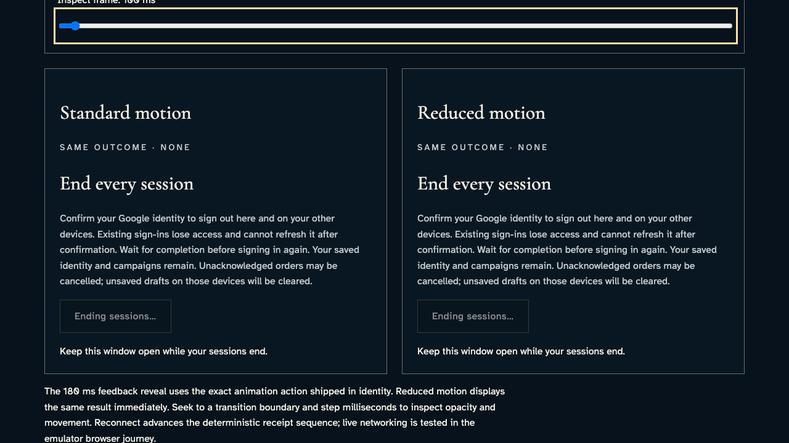
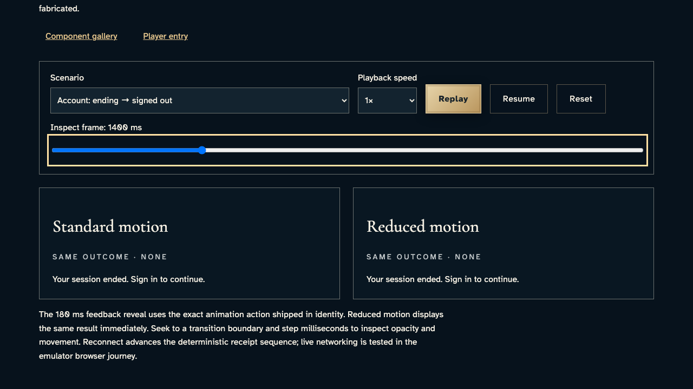
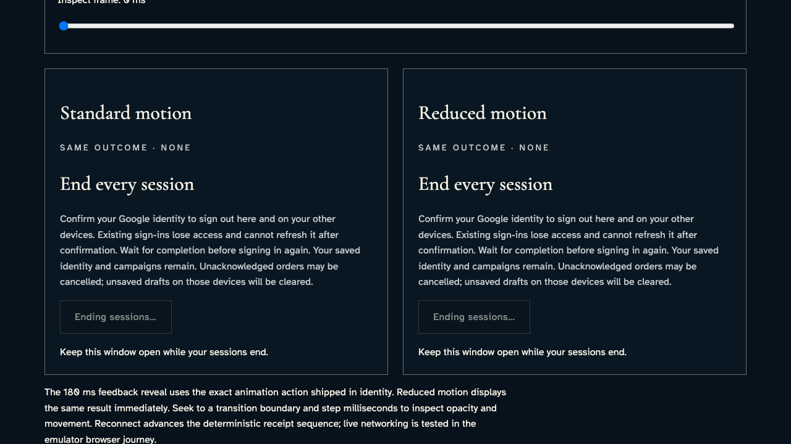

# Inspect pending and ended session presentations

**Exact comparison passed.** short · darwin-arm64. Inventory: UX-14, UX-16.

A developer inspects the shipped SessionSecurity and Feedback components. Pending controls disclose draft/order consequences; ended feedback reveals through the shared animation and has the same result under reduced motion. The browser clock and scenario frames are explicit component fixtures, not authentication, credential revocation or multi-device service evidence.

## 1. Freeze browser playback only. The session-ending specimen never authenticates or revokes a real account; live account recovery remains separately tested.

Actor: **Test harness**. **Harness control; not a player action.**

Acknowledged outcome: Explicit test control; not a player action or hosted-service certification.

## 2. Inspect the disabled ending control and the complete consequences of ending sessions.

Actor: **Developer**.

Acknowledged outcome: Both production presentations report “Keep this window open while your sessions end.” with identical text.

- [x] Both modes disclose saved identity, cancelled unacknowledged orders and cleared unsaved drafts while the ending action is disabled.

### Viewpoint: Developer · standard lifecycle presentation

- [x] The whole labeled specimen and outcome fit inside the reference viewport.

### Viewpoint: Developer · reduced lifecycle presentation

- [x] The whole labeled specimen and outcome fit inside the reference viewport.

## 3. Seek 50ms into the actual ended-feedback reveal and compare immediate reduced motion.

Actor: **Developer**.

Acknowledged outcome: Both production presentations report “Your session ended. Sign in to continue.” with identical text.

- [x] Both modes remove the pending account control and retain the selected ended frame.

### Viewpoint: Developer · standard lifecycle presentation

- [x] The whole labeled specimen and outcome fit inside the reference viewport.
- [x] Explicit paused motion: [aria-label="Standard motion comparison"], 1 animation(s), 50/180 ms; unchanged exact comparison.
- [x] Explicit paused motion: [aria-label="Reduced motion comparison"], 1 animation(s), 180/180 ms; unchanged exact comparison.

### Viewpoint: Developer · reduced lifecycle presentation

- [x] The whole labeled specimen and outcome fit inside the reference viewport.
- [x] Explicit paused motion: [aria-label="Standard motion comparison"], 1 animation(s), 50/180 ms; unchanged exact comparison.
- [x] Explicit paused motion: [aria-label="Reduced motion comparison"], 1 animation(s), 180/180 ms; unchanged exact comparison.

## 4. Inspect the completed reveal without changing the signed-out outcome.

Actor: **Developer**.

Acknowledged outcome: Both production presentations report “Your session ended. Sign in to continue.” with identical text.

- [x] Both modes remove the pending account control and retain the selected ended frame.

### Viewpoint: Developer · standard lifecycle presentation

- [x] The whole labeled specimen and outcome fit inside the reference viewport.
- [x] Explicit paused motion: [aria-label="Standard motion comparison"], 1 animation(s), 180/180 ms; unchanged exact comparison.
- [x] Explicit paused motion: [aria-label="Reduced motion comparison"], 1 animation(s), 180/180 ms; unchanged exact comparison.

### Viewpoint: Developer · reduced lifecycle presentation

- [x] The whole labeled specimen and outcome fit inside the reference viewport.
- [x] Explicit paused motion: [aria-label="Standard motion comparison"], 1 animation(s), 180/180 ms; unchanged exact comparison.
- [x] Explicit paused motion: [aria-label="Reduced motion comparison"], 1 animation(s), 180/180 ms; unchanged exact comparison.

## 5. Reset the lab and recover the same pending disclosure and disabled control.

Actor: **Developer**.

Acknowledged outcome: Both production presentations report “Keep this window open while your sessions end.” with identical text.

- [x] Both modes disclose saved identity, cancelled unacknowledged orders and cleared unsaved drafts while the ending action is disabled.

### Viewpoint: Developer · standard lifecycle presentation

- [x] The whole labeled specimen and outcome fit inside the reference viewport.

### Viewpoint: Developer · reduced lifecycle presentation

- [x] The whole labeled specimen and outcome fit inside the reference viewport.

