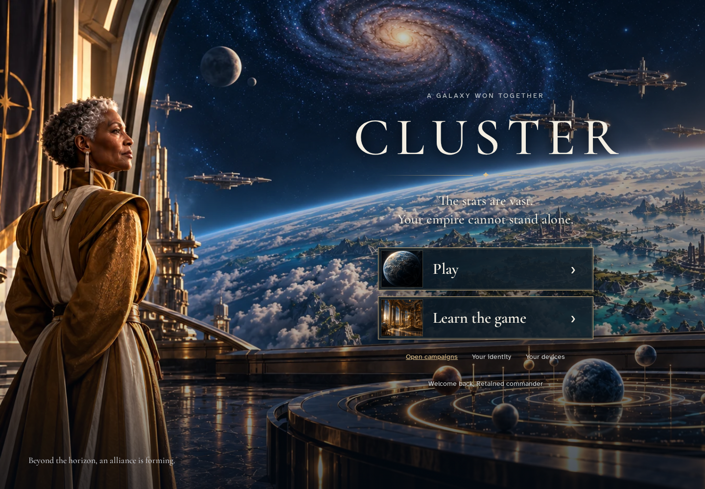
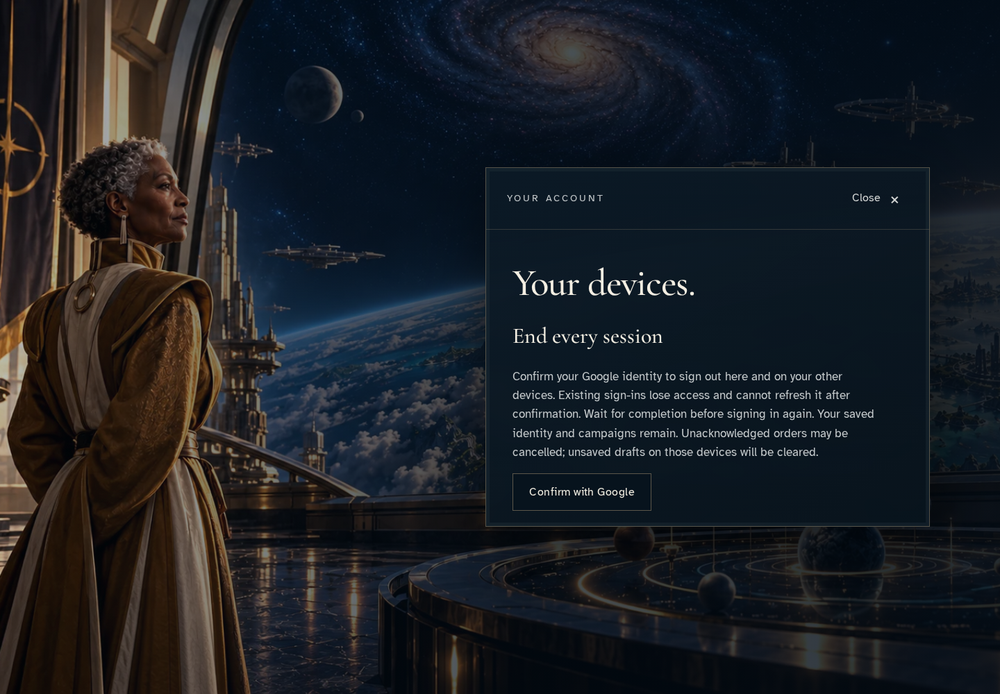
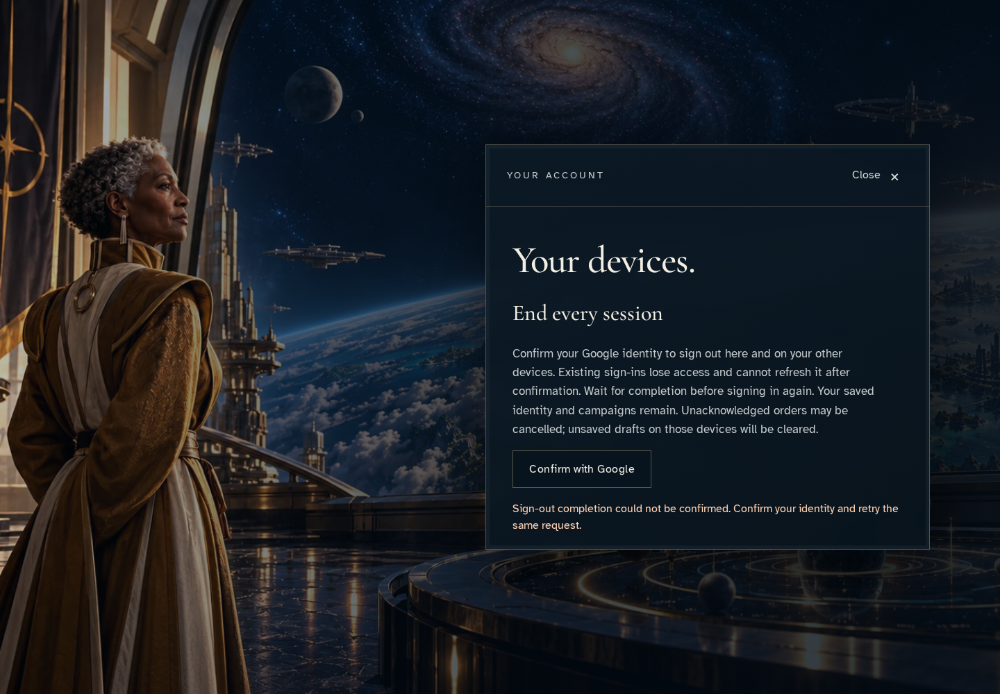
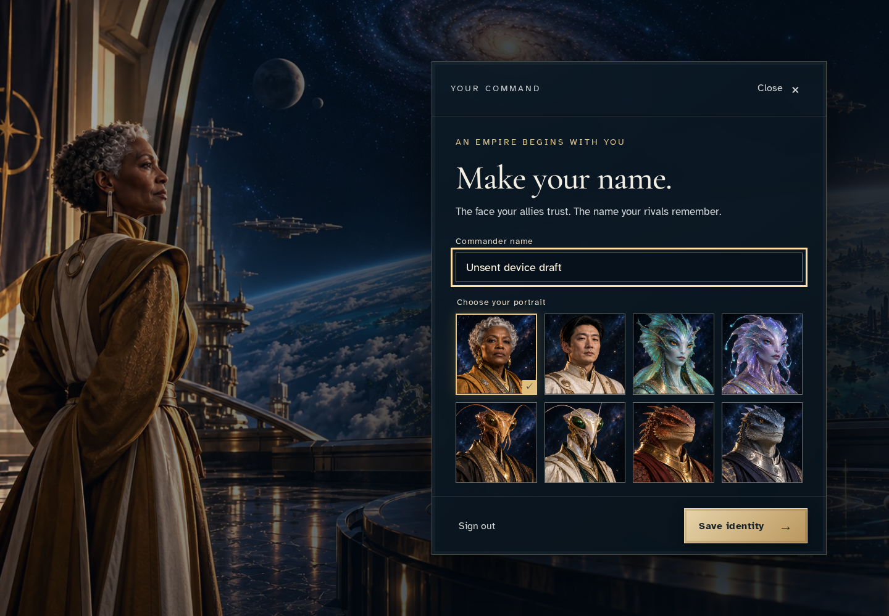
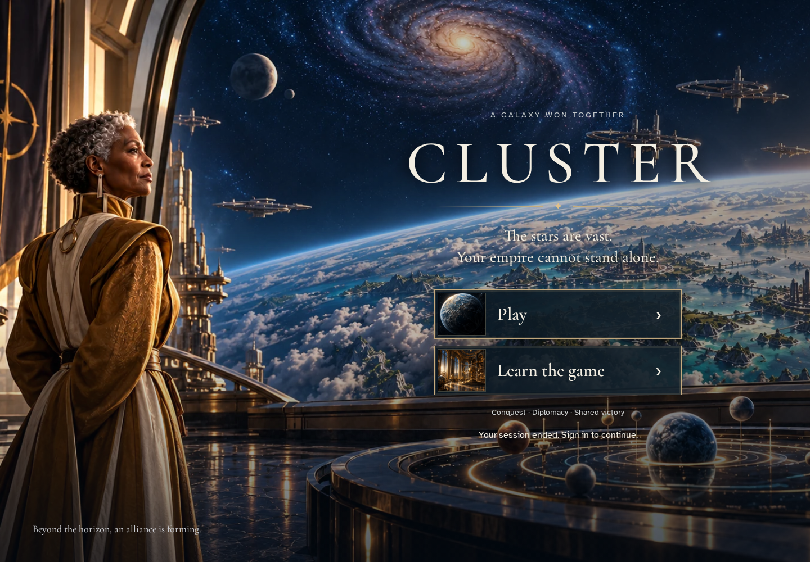
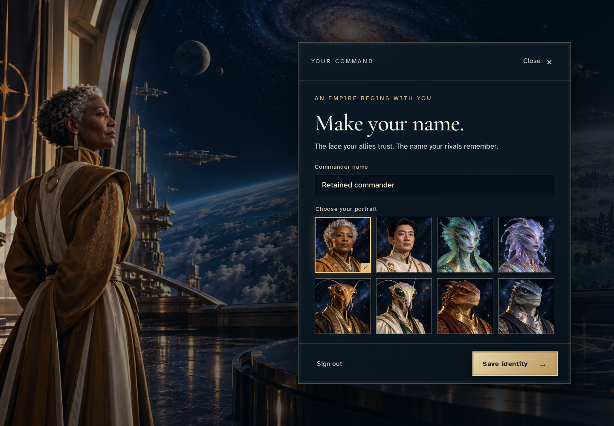

# Recover sign-out after a persisted worker interruption

**Exact comparison passed.** desktop · linux-arm64. Inventory: UX-01, UX-14, UX-16.

One commander uses two independent authenticated devices. Saved identity survives account-wide sign-out; an unsaved draft remains while confirmation is cancelled. Both devices show the acknowledged session end before fresh sign-in recovers the saved identity.

## 1. Prepare two independent authenticated devices through ordinary sign-in and identity-save controls; the second device holds an unsaved draft.

Actor: **Test harness**. **Harness control; not a player action.**

Acknowledged outcome: Explicit test control; not a player action or hosted-service certification.

## 2. The signed-in entry provides device management while the other device retains its draft.

Actor: **Commander · first device**.

Acknowledged outcome: Your devices is available.

- [x] Saved identity has one revision, one version and one acknowledged receipt.

### Viewpoint: Commander · first device

### Viewpoint: Commander · second device

## 3. Open account-wide sign-out confirmation.

Actor: **Commander · first device**.

Acknowledged outcome: The device panel asks for Google confirmation.

- [x] Saved identity has one revision, one version and one acknowledged receipt.

### Viewpoint: Commander · first device

## 4. Close the panel and return focus to its opening control.

Actor: **Commander · first device**.

Acknowledged outcome: Your devices regains keyboard focus.

- [x] Saved identity has one revision, one version and one acknowledged receipt.

### Viewpoint: Commander · first device

## 5. Reopen devices and cancel the Google confirmation popup. No session has ended.

Actor: **Commander · first device**.

Acknowledged outcome: The uncertain completion alert receives focus.

- [x] Saved identity has one revision, one version and one acknowledged receipt.
- [x] The second device still holds its unsent draft.

### Viewpoint: Commander · first device

### Viewpoint: Commander · second device

## 6. Intercept the actual authenticated callable, invoke its real service transaction, stop after its fence persists and expire only the stopped worker lease. No identity, command or session result is fabricated.

Actor: **Test harness**. **Harness control; not a player action.**

Acknowledged outcome: Explicit test control; not a player action or hosted-service certification.

## 7. Confirm with Google; the worker stops after recording the session fence, leaving completion uncertain.

Actor: **Commander · first device**.

Acknowledged outcome: Completion remains uncertain after the real persisted fence.

- [x] Saved identity has one revision, one version and one acknowledged receipt.

### Viewpoint: Commander · first device

### Viewpoint: Commander · second device

## 8. Remove the one-request transport interruption so normal callable recovery can claim the expired lease.

Actor: **Test harness**. **Harness control; not a player action.**

Acknowledged outcome: Explicit test control; not a player action or hosted-service certification.

## 9. Reload restores the unfinished sign-out panel and its confirmation action.

Actor: **Commander · first device**.

Acknowledged outcome: The persisted recovery panel is ready for confirmation.

- [x] Saved identity has one revision, one version and one acknowledged receipt.

### Viewpoint: Commander · first device

### Viewpoint: Commander · second device

## 10. Confirm account-wide sign-out. Both devices acknowledge the ended session and discard their editors.

Actor: **Commander · first device**.

Acknowledged outcome: Both devices acknowledge session end and focus Play.

- [x] Saved identity has one revision, one version and one acknowledged receipt.

### Viewpoint: Commander · first device

### Viewpoint: Commander · second device

## 11. Firebase auth_time uses whole seconds. Wait until a fresh sign-in is strictly after the acknowledged revocation cutoff; this changes no service clock or state.

Actor: **Test harness**. **Harness control; not a player action.**

Acknowledged outcome: Explicit test control; not a player action or hosted-service certification.

## 12. Sign in again and recover the saved identity, not the other device’s discarded draft.

Actor: **Commander · first device**.

Acknowledged outcome: The saved commander identity is restored.

- [x] Saved identity has one revision, one version and one acknowledged receipt.
- [x] Recovered identity does not claim a new save from the ended session.

### Viewpoint: Commander · first device

### Viewpoint: Commander · second device

## 13. Reload and reopen identity without saving another revision.

Actor: **Commander · first device**.

Acknowledged outcome: The same saved identity survives reload.

- [x] Saved identity has one revision, one version and one acknowledged receipt.

### Viewpoint: Commander · first device

