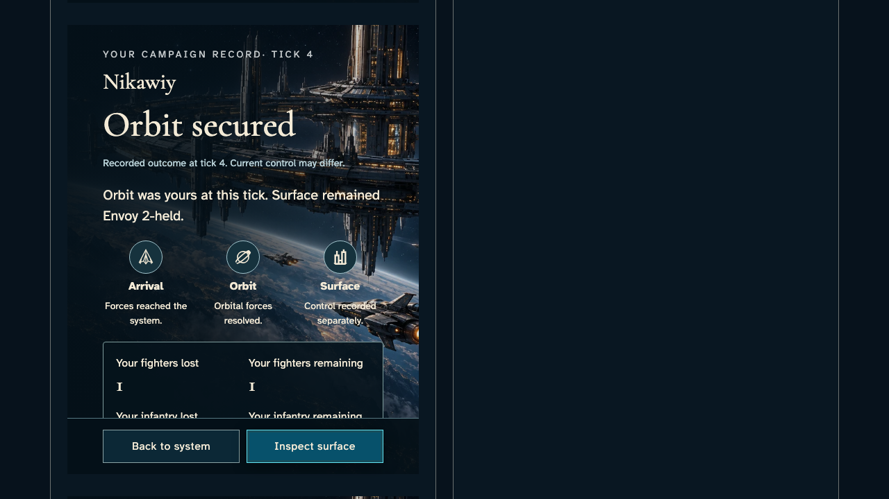
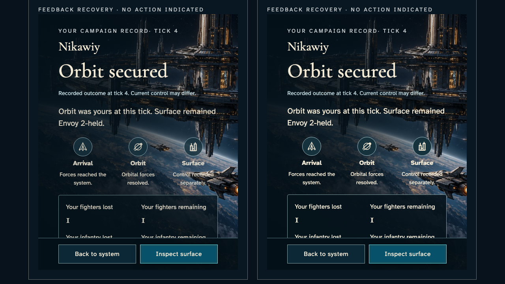

# Inspect the production aftermath instrument

**BASELINE CANDIDATES — generation, not verification.** short · darwin-arm64. Inventory: UX-09, UX-16.

Explicit reducer-derived component scenarios exercise the real ArrivalReports. They do not replace authenticated live combat or private report acceptance.

## 1. Read the existing split-occupation specimen with its contextual return control and historical distinction.

Actor: **Component reviewer**.

Acknowledged outcome: The actual shared component distinguishes its recorded outcome from current control.

- [x] Context return and surface inspection remain entirely contained before any automatic capture scrolling.

### Viewpoint: Component reviewer

## 2. Seek the existing arrivals scenario to1200ms. Compare the same report under actual normal and reduced shared feedback code.

Actor: **Component reviewer**.

Acknowledged outcome: Both actual report components expose the same recorded split ownership and contextual return.

- [x] Paused inspection changes presentation, never the report's casualty or control facts.

### Viewpoint: Standard motion comparison

- [x] The named comparison's outcome and persistent actions are visible together.
- [x] Explicit paused motion: [aria-label="Standard motion comparison"], 2 animation(s), 90/180 ms; unchanged exact comparison.
- [x] Explicit paused motion: [aria-label="Reduced motion comparison"], 2 animation(s), 180/180 ms; unchanged exact comparison.

### Viewpoint: Reduced motion comparison

- [x] The named comparison's outcome and persistent actions are visible together.
- [x] Explicit paused motion: [aria-label="Standard motion comparison"], 2 animation(s), 90/180 ms; unchanged exact comparison.
- [x] Explicit paused motion: [aria-label="Reduced motion comparison"], 2 animation(s), 180/180 ms; unchanged exact comparison.

