# Inspect an authorized aftermath from its system

**BASELINE CANDIDATES — generation, not verification.** short · darwin-arm64. Inventory: UX-04, UX-06, UX-07, UX-08, UX-09, UX-14, UX-15, UX-16.

Four independently authenticated commanders use real fleet controls after100 earned ticks. An escape and rival route produce actual orbital loss and retained surface control. Both recipients open their own immutable report from the selected system, restore context and inspect current surface through reload. Fixed catalogue/domain clocks are explicit harness controls; budgets are220 ticks,240 seconds and24 captures per viewport. Rules remain under review; this does not certify managed encryption or hosted scheduling.

## 1. Ordinary emulator sign-in and identity save, with explicit developer entitlement and fixed browser Date; timers continue normally.

Actor: **Test harness**. **Harness control; not a player action.**

Acknowledged outcome: Explicit test control; not a player action or hosted-service certification.

## 2. Ordinary emulator sign-in and identity save, with explicit developer entitlement and fixed browser Date; timers continue normally.

Actor: **Test harness**. **Harness control; not a player action.**

Acknowledged outcome: Explicit test control; not a player action or hosted-service certification.

## 3. Ordinary emulator sign-in and identity save, with explicit developer entitlement and fixed browser Date; timers continue normally.

Actor: **Test harness**. **Harness control; not a player action.**

Acknowledged outcome: Explicit test control; not a player action or hosted-service certification.

## 4. Ordinary emulator sign-in and identity save, with explicit developer entitlement and fixed browser Date; timers continue normally.

Actor: **Test harness**. **Harness control; not a player action.**

Acknowledged outcome: Explicit test control; not a player action or hosted-service certification.

## 5. Create/join through ordinary campaign controls. Fixed catalogue and admission clock are test controls; no seat, message or command outcome is injected.

Actor: **Test harness**. **Harness control; not a player action.**

Acknowledged outcome: Explicit test control; not a player action or hosted-service certification.

## 6. Create/join through ordinary campaign controls. Fixed catalogue and admission clock are test controls; no seat, message or command outcome is injected.

Actor: **Test harness**. **Harness control; not a player action.**

Acknowledged outcome: Explicit test control; not a player action or hosted-service certification.

## 7. Create/join through ordinary campaign controls. Fixed catalogue and admission clock are test controls; no seat, message or command outcome is injected.

Actor: **Test harness**. **Harness control; not a player action.**

Acknowledged outcome: Explicit test control; not a player action or hosted-service certification.

## 8. Create/join through ordinary campaign controls. Fixed catalogue and admission clock are test controls; no seat, message or command outcome is injected.

Actor: **Test harness**. **Harness control; not a player action.**

Acknowledged outcome: Explicit test control; not a player action or hosted-service certification.

## 9. Advance the designated browser/domain clock to 12:15 UTC and deliver the actual emulator Scheduler HTTP request. This does not certify hosted scheduling.

Actor: **Test harness**. **Harness control; not a player action.**

Acknowledged outcome: Explicit test control; not a player action or hosted-service certification.

## 10. Both captured players return through ordinary Campaigns controls while time passes; setup-only witnesses close after admission. No service delivery or authorization is bypassed.

Actor: **Test harness**. **Harness control; not a player action.**

Acknowledged outcome: Explicit test control; not a player action or hosted-service certification.

## 11. Deliver100 real leased ticks in bounded batches. No levels, balances, forces or ownership are injected; this is not hosted scheduling.

Actor: **Test harness**. **Harness control; not a player action.**

Acknowledged outcome: Explicit test control; not a player action or hosted-service certification.

## 12. Both real saved identities reopen the exact campaign after elapsed-time settlement.

Actor: **Test harness**. **Harness control; not a player action.**

Acknowledged outcome: Explicit test control; not a player action or hosted-service certification.

## 13. Use the actual home-system fleet controls to reserve all160 earned fighters. The other commander's order remains private.

Actor: **Fleet marshal**.

Acknowledged outcome: A real receipt accepts160 fighters for tick101.

- [x] Actual owner SDK reads and campaignKey grants succeed; foreign private reads are denied and returned projections omit foreign order IDs.

### Viewpoint: Fleet marshal

[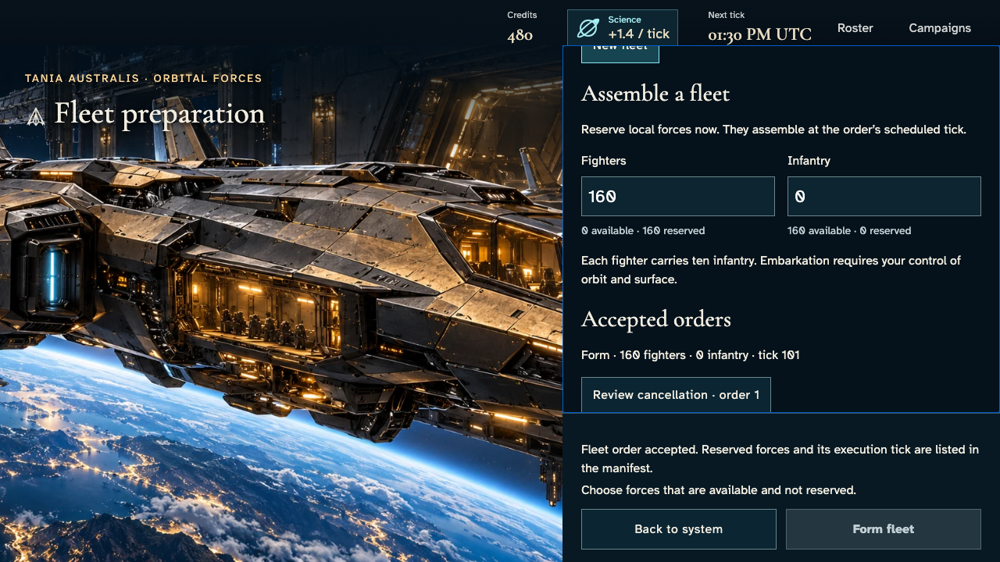](013-form-0-1-fleet-marshal.png)

## 14. Use the actual home-system fleet controls to reserve all160 earned fighters. The other commander's order remains private.

Actor: **Independent marshal**.

Acknowledged outcome: A real receipt accepts160 fighters for tick101.

- [x] Actual owner SDK reads and campaignKey grants succeed; foreign private reads are denied and returned projections omit foreign order IDs.

### Viewpoint: Independent marshal

## 15. Real leased settlement forms both fleets once; repeat delivery does no work.

Actor: **Test harness**. **Harness control; not a player action.**

Acknowledged outcome: Explicit test control; not a player action or hosted-service certification.

## 16. Select each acknowledged fleet with the keyboard and read its actual160-fighter complement.

Actor: **Fleet marshal**.

Acknowledged outcome: Both players see the settled formation outcome.

- [x] Actual owner SDK reads and campaignKey grants succeed; foreign private reads are denied and returned projections omit foreign order IDs.

### Viewpoint: Fleet marshal

### Viewpoint: Independent marshal

[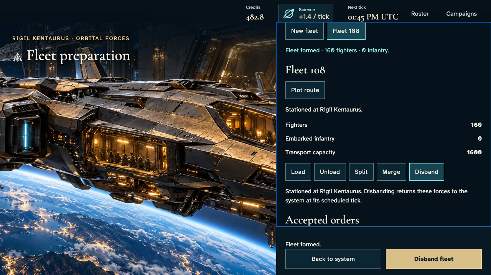](016-formed-fleets-2-independent-marshal.png)

## 17. Plot an escape to a neutral star without a science station.

Actor: **Fleet marshal**.

Acknowledged outcome: Reachable legs enable commitment; range30 and speed2 remain distinct.

- [x] Actual owner SDK reads and campaignKey grants succeed; foreign private reads are denied and returned projections omit foreign order IDs.

### Viewpoint: Fleet marshal

[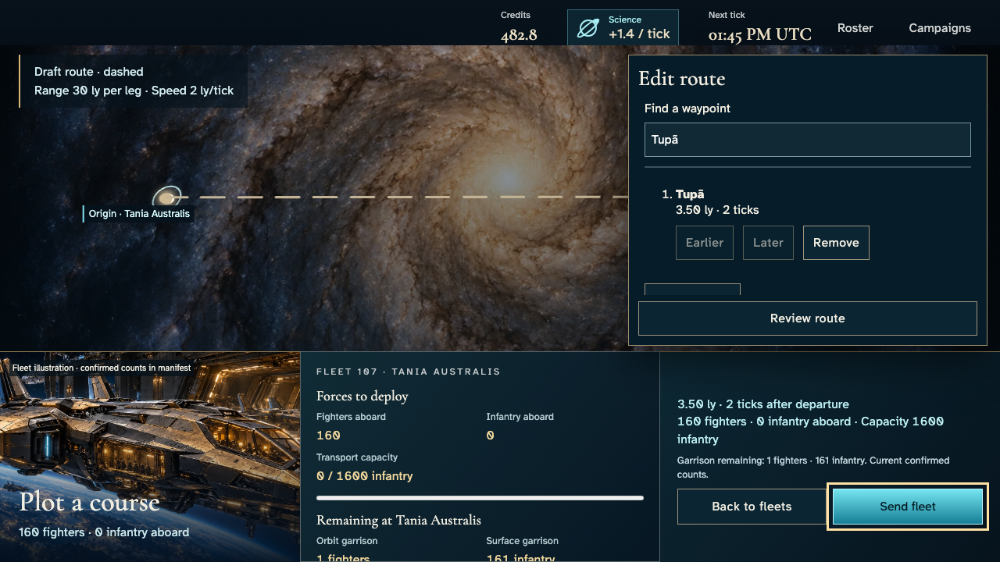](017-preview-route-0-1-fleet-marshal.png)

## 18. Confirm the original route with Enter and read the authoritative scheduled departure acknowledgement.

Actor: **Fleet marshal**.

Acknowledged outcome: The server accepts the route and retains its exact waypoints for tick102.

- [x] Actual owner SDK reads and campaignKey grants succeed; foreign private reads are denied and returned projections omit foreign order IDs.

### Viewpoint: Fleet marshal

[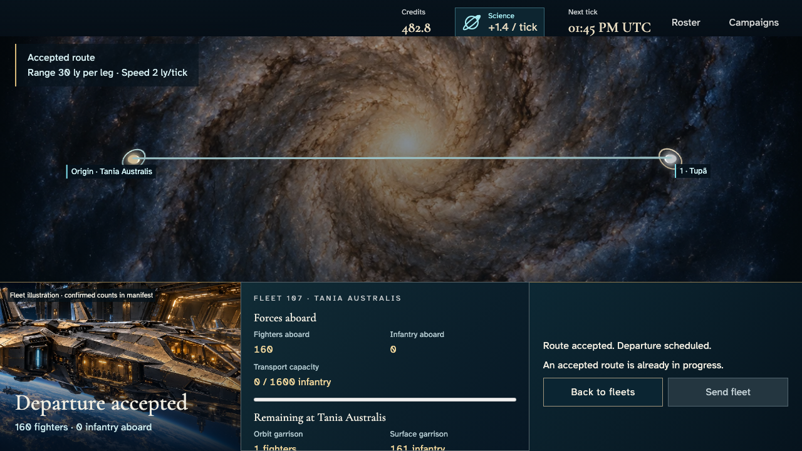](018-commit-route-0-1-fleet-marshal.png)

## 19. Plot a seven-leg route through the actual catalogue toward the other commander's home.

Actor: **Independent marshal**.

Acknowledged outcome: Reachable legs enable commitment; range30 and speed2 remain distinct.

- [x] Actual owner SDK reads and campaignKey grants succeed; foreign private reads are denied and returned projections omit foreign order IDs.

### Viewpoint: Independent marshal

[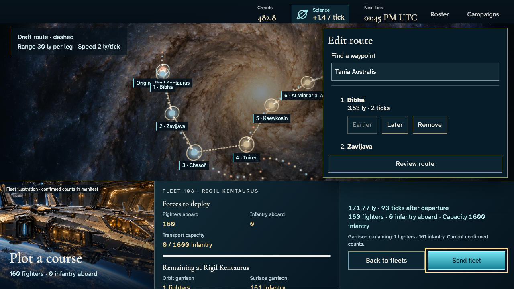](019-preview-route-1-1-independent-marshal.png)

## 20. Confirm the original route with Enter and read the authoritative scheduled departure acknowledgement.

Actor: **Independent marshal**.

Acknowledged outcome: The server accepts the route and retains its exact waypoints for tick102.

- [x] Actual owner SDK reads and campaignKey grants succeed; foreign private reads are denied and returned projections omit foreign order IDs.

### Viewpoint: Independent marshal

[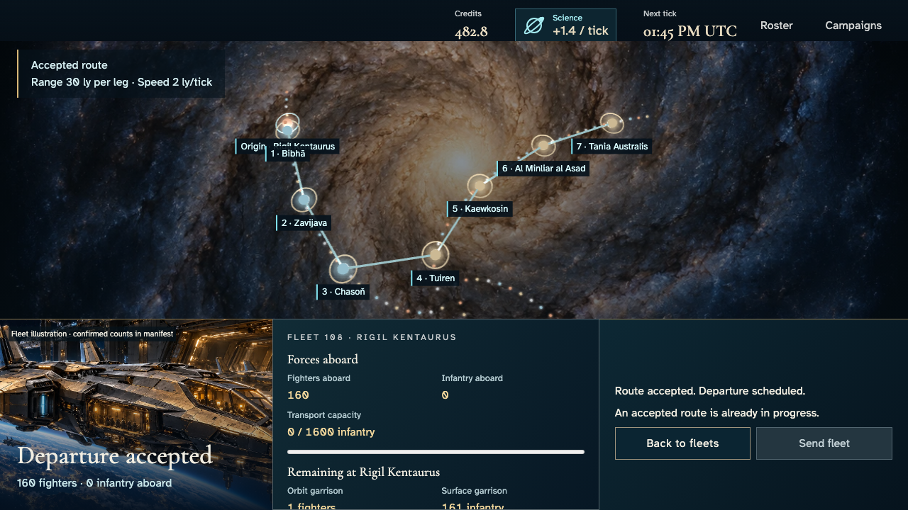](020-commit-route-1-1-independent-marshal.png)

## 21. Deliver bounded real leased travel/combat/production ticks. The peer captures orbit; no battle outcome is injected.

Actor: **Test harness**. **Harness control; not a player action.**

Acknowledged outcome: Explicit test control; not a player action or hosted-service certification.

## 22. Both recipients reload their real campaign and use the factual systems list to inspect the contested home. No report is invented for an unobserved system.

Actor: **Fleet marshal**.

Acknowledged outcome: The authorized system exposes its recorded arrival tick and selected Orbit control.

- [x] Actual owner SDK reads and campaignKey grants succeed; foreign private reads are denied and returned projections omit foreign order IDs.

### Viewpoint: Fleet marshal

### Viewpoint: Independent marshal

[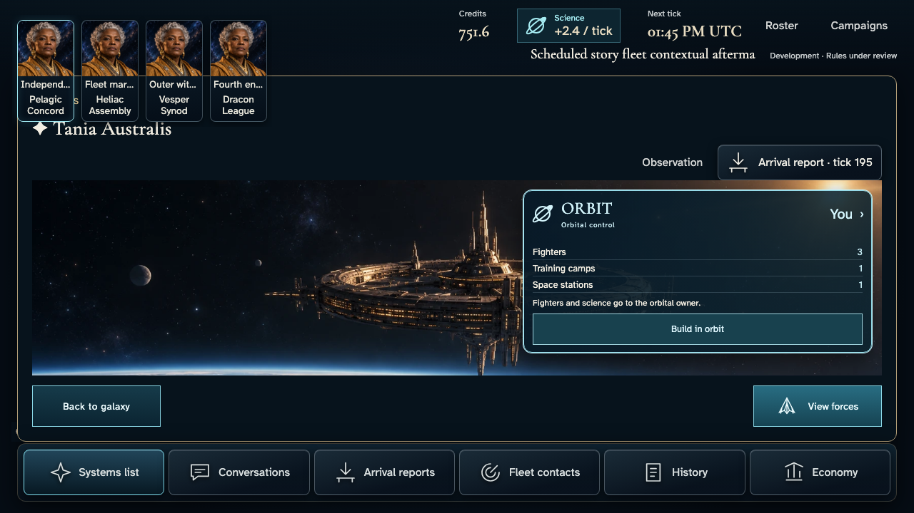](022-select-contested-system-2-independent-marshal.png)

## 23. Open the selected system's actual report with Enter. Each player sees its own outcome and an explicit historical timestamp.

Actor: **Fleet marshal**.

Acknowledged outcome: Surface held and Orbit secured are the two recipient-specific outcomes of the same persisted tick.

- [x] Actual owner SDK reads and campaignKey grants succeed; foreign private reads are denied and returned projections omit foreign order IDs.
- [x] Each recipient reads only its own persisted losses; split ownership still redacts opposing layer quantities.

### Viewpoint: Fleet marshal

### Viewpoint: Independent marshal

## 24. Deliver one additional leased production tick while reports remain open. Repeated delivery must settle zero further ticks; this is an explicit scheduler harness, not elapsed-time inference.

Actor: **Test harness**. **Harness control; not a player action.**

Acknowledged outcome: Explicit test control; not a player action or hosted-service certification.

## 25. Read the same outcome while the campaign advances. Current facts update without rewriting the selected historical report.

Actor: **Fleet marshal**.

Acknowledged outcome: Both authorized current projections acknowledge the next tick and both selected report identities remain unchanged.

- [x] Actual owner SDK reads and campaignKey grants succeed; foreign private reads are denied and returned projections omit foreign order IDs.
- [x] Each recipient reads only its own persisted losses; split ownership still redacts opposing layer quantities.

### Viewpoint: Fleet marshal

[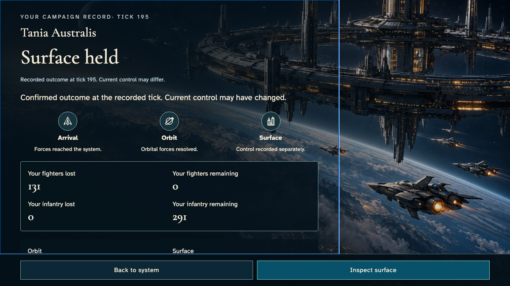](025-retain-record-during-update-1-fleet-marshal.png)

### Viewpoint: Independent marshal

## 26. Escape returns both commanders to the same system and selected Orbit layer, with keyboard focus on the exact contextual opener.

Actor: **Fleet marshal**.

Acknowledged outcome: The report closes, selected layer is retained and the contextual opener is focused and entirely usable.

- [x] Actual owner SDK reads and campaignKey grants succeed; foreign private reads are denied and returned projections omit foreign order IDs.

### Viewpoint: Fleet marshal

[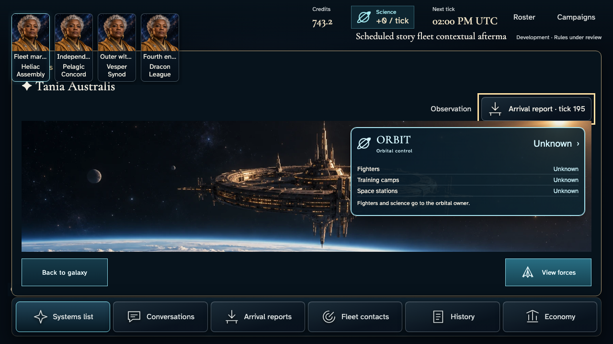](026-restore-system-context-1-fleet-marshal.png)

### Viewpoint: Independent marshal

## 27. Reopen the immutable report, then follow Inspect surface to the actual current layer. This navigation does not issue another gameplay command.

Actor: **Fleet marshal**.

Acknowledged outcome: The current surface instrument is selected and its bounded details receive focus.

- [x] Actual owner SDK reads and campaignKey grants succeed; foreign private reads are denied and returned projections omit foreign order IDs.

### Viewpoint: Fleet marshal

[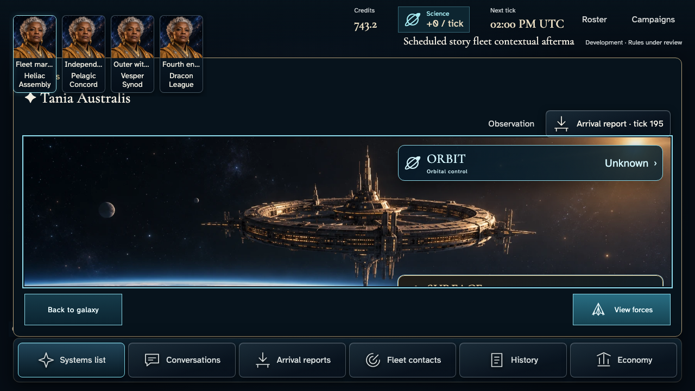](027-inspect-current-surface-1-fleet-marshal.png)

### Viewpoint: Independent marshal

[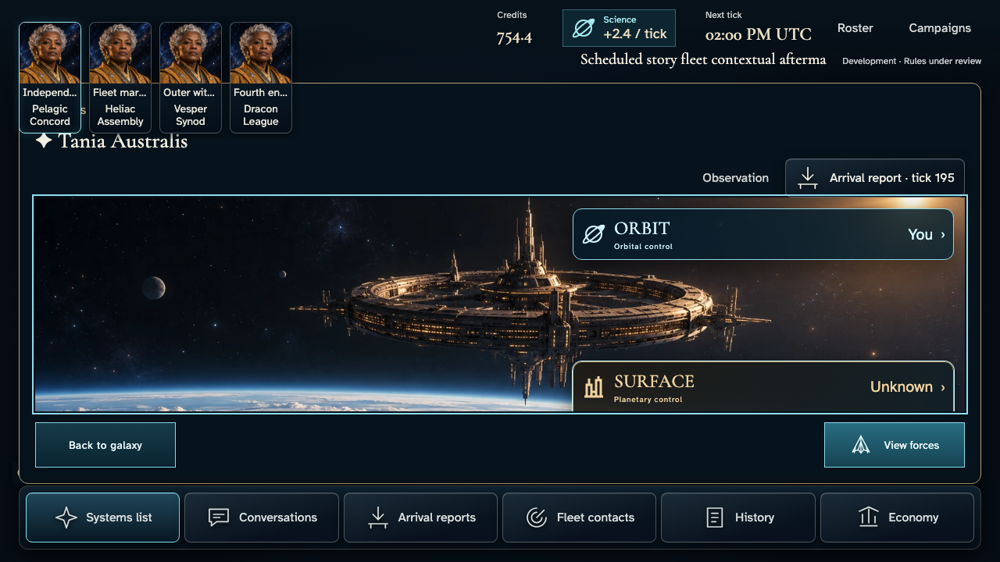](027-inspect-current-surface-2-independent-marshal.png)

## 28. Reload with normal motion, reselect the real system and reopen the same authorized record. Let the actual finite report effects finish without fast-forwarding.

Actor: **Fleet marshal**.

Acknowledged outcome: Recovery retains the exact report and normal-motion preference; it creates no new arrival or admission.

- [x] Actual owner SDK reads and campaignKey grants succeed; foreign private reads are denied and returned projections omit foreign order IDs.
- [x] Each recipient reads only its own persisted losses; split ownership still redacts opposing layer quantities.

### Viewpoint: Fleet marshal

- [x] Normal-motion device preference; finite effects settled without fast-forward and exact pixels unchanged.

[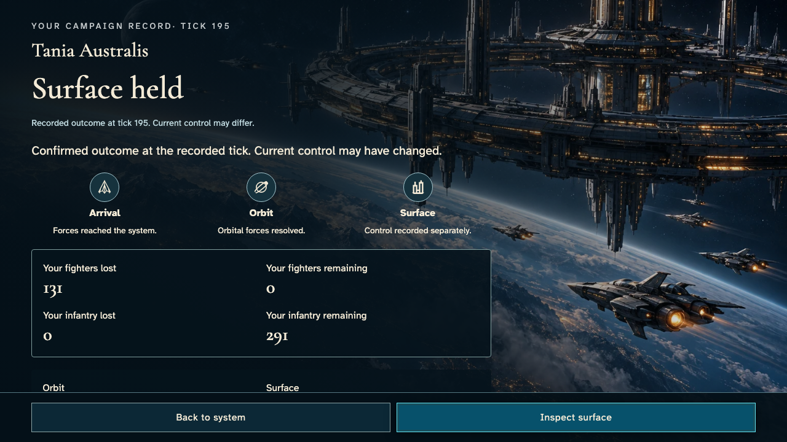](028-recover-report-normal-motion-1-fleet-marshal.png)

### Viewpoint: Independent marshal

- [x] Normal-motion device preference; finite effects settled without fast-forward and exact pixels unchanged.

[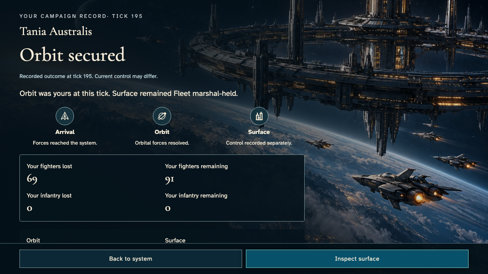](028-recover-report-normal-motion-2-independent-marshal.png)
