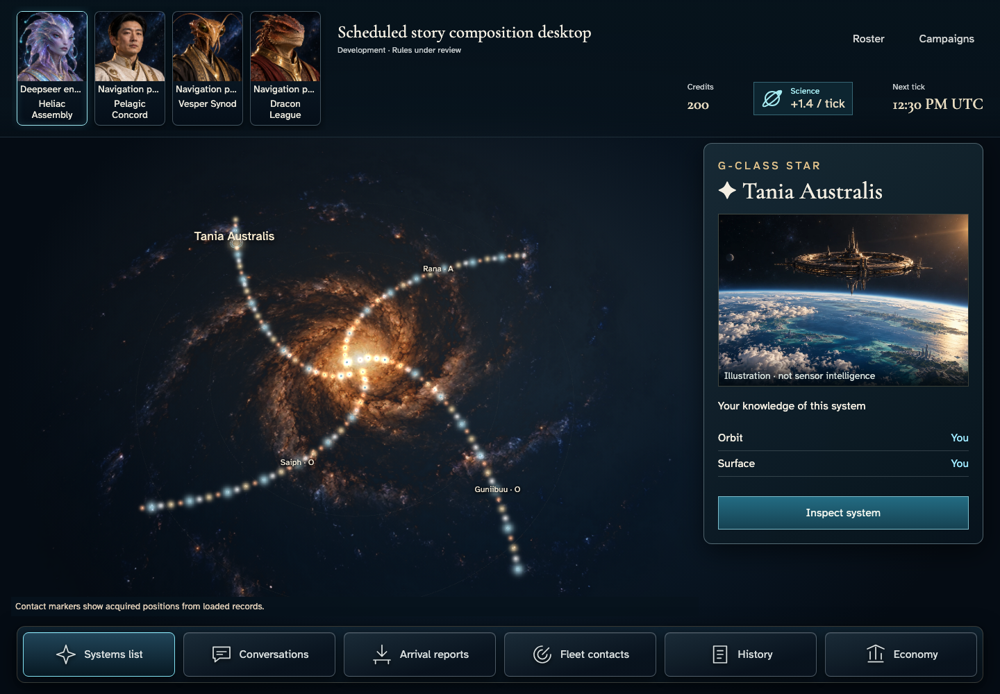
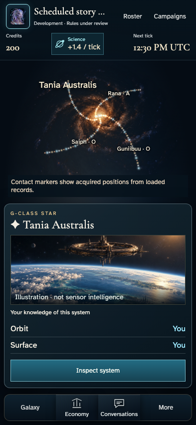
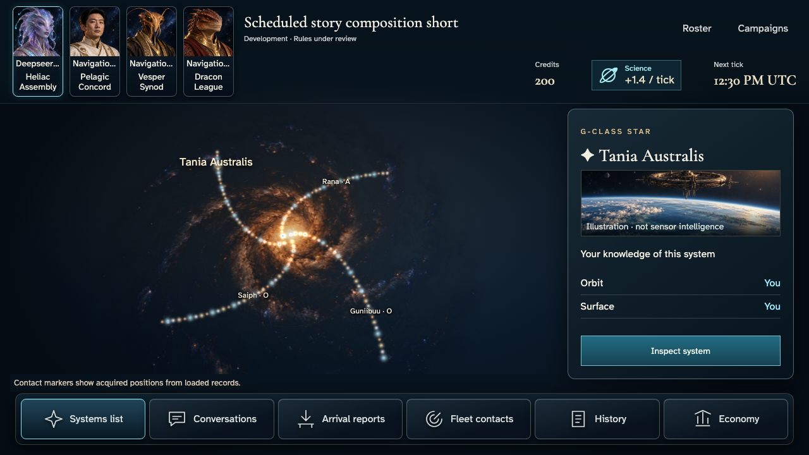

# Galaxy composition candidates — not approved baselines

Clean `aa9200b`, spec SHA-256 `ad41dbec7335c3ade54ffc68edb92c09a1ef0135b2d46496ea9ec0bdf2bcd5ba`. Four Nix journeys passed57.5s,28 original PNGs. Original source, renderer manifests, named acknowledgements and assertions remain in each generated narrative; [byte index](sha256.json) covers originals and metadata. No images were regenerated for this archive or promoted to expected screenshots.

| Approved composition reference | Actual desktop, same real campaign interaction |
| --- | --- |
|  |  |

| Phone | Short |
| --- | --- |
|  |  |

[Original3840×2160](large/darwin-arm64/004-read-commanders-and-home-1-deepseer-envoy.png). Review at native resolution for typography; the author's image viewer scaled the large composition.

## Explicit comparison

Saved commander portraits occupy the upper-left deck with cosmetic identity and mechanical faction labelled separately; phone uses the own-portrait menu and actual Roster access. The authorized catalogue fills its available camera field instead of leaving the old empty upper area. The provenanced world/orbit scene is materially larger and integrated with independent ownership rows and Inspect. A shared illustrated-icon dock spans the bottom, with compact phone destinations and a real More tray.

Short inspector clearance and both ownership rows now have dedicated no-scroll containment checks. The illustration disclaimer is no longer clipped; the contact explanation occupies its own region outside map labels. Normal-motion Return from inspection and reduced-detail settings retain real system/resource facts and keyboard restoration. Default captures use reduced motion; step008 explicitly records normal-motion device preference and settled finite effects.

The reference is not copied by fabricating data: actual128-star positions retain their regular spiral, current authorized home/class/ownership and production rate remain real, and no illustrative route graph, planet count, minerals or unavailable commands appear. Existing world/orbit illustration is labelled as illustration rather than sensor intelligence. These necessary factual differences are explicit. Independent full composition/native4K review remains open; generation passing does not certify complete plate03 fidelity.

## Ordered player evidence

- [Phone](phone/darwin-arm64/README.md)
- [Desktop](desktop/darwin-arm64/README.md)
- [Large](large/darwin-arm64/README.md)
- [Short](short/darwin-arm64/README.md)

Original preceding e5b502f28-image family and bab0685/4746ca7 failure traces remain under their separate `/tmp/cluster118-composition-*` roots, recorded in [diagnosis](../../../testing/GALAXY_COMPOSITION_REVIEW.md). No previous settings, entry, layer, waiting or Linux baseline is replaced.

Author inspected all four opening scenes plus phone expanded/normal/lower-detail states. This is not independent approval of all28 images. Expanded bounded details still require deliberate reading; this slice does not approve predecessor layer/build families, all canvas-marker equivalence, peer-private authorization, concurrency, hosted/KMS, performance, historical ingress/100-tick diagnosis or release.
