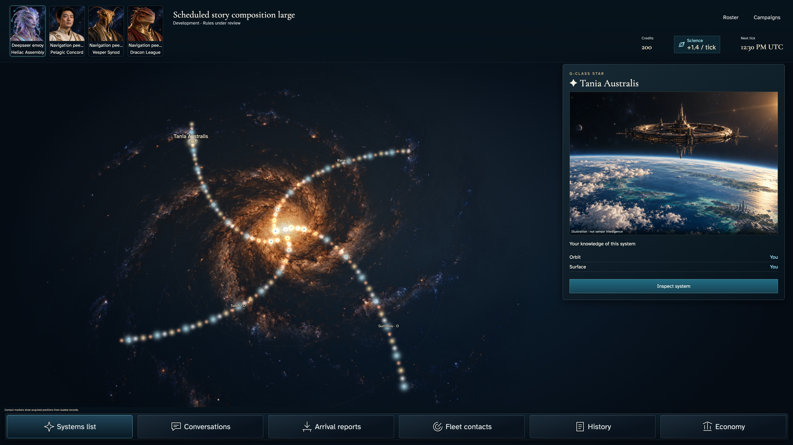
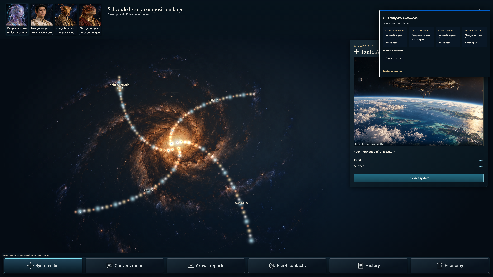
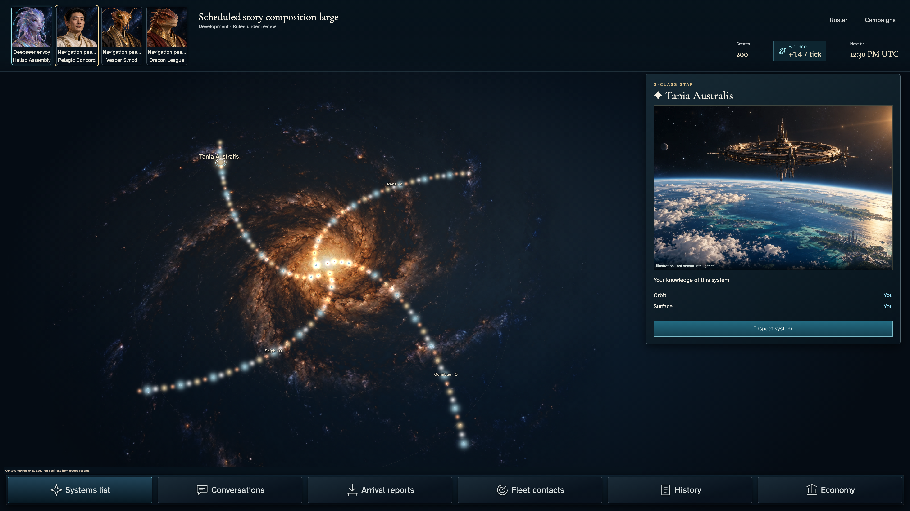
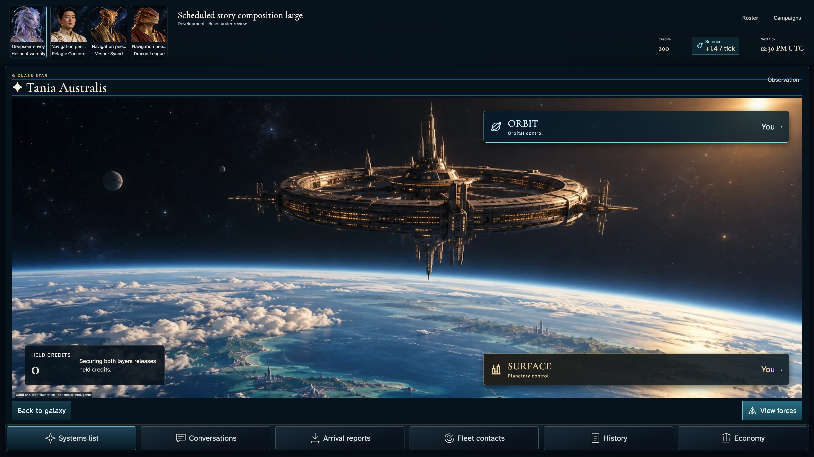
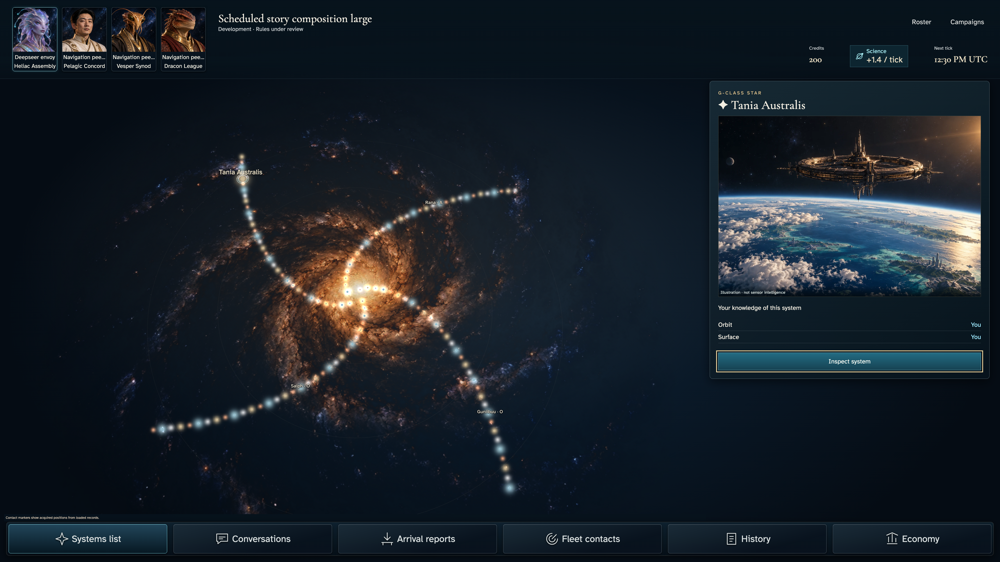
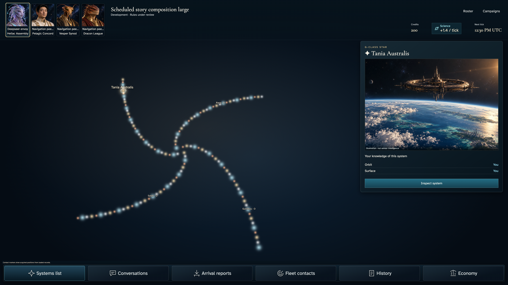

# Commanders and systems share one galaxy

**BASELINE CANDIDATES — generation, not verification.** large · darwin-arm64. Inventory: UX-02, UX-03, UX-04, UX-15, UX-16.

Four ordinary authenticated players save cosmetic portraits, join different mechanical factions and receive real scheduled homes. Fixed catalogue/admission time and Scheduler HTTP delivery are labelled demo-only harness controls. The owner reads the actual scene, uses keyboard roster/menu/system instruments and recovers the same authorized campaign. Normal-motion settled visual evidence is declared separately; this does not certify hosted scheduling or peer-private read denial.

## 1. Ordinary authenticated identity save; developer entitlement is the explicit emulator permission fixture, not a fabricated member.

Actor: **Test harness**. **Harness control; not a player action.**

Acknowledged outcome: Explicit test control; not a player action or hosted-service certification.

## 2. Create and claim through actual commands, receipts and private projections; the existing demo loader fixes catalogue and admission time only.

Actor: **Test harness**. **Harness control; not a player action.**

Acknowledged outcome: Explicit test control; not a player action or hosted-service certification.

## 3. Three independent ordinary player admissions then actual scheduler HTTP delivery; no injected seats, home, resources or results. Not hosted timing evidence.

Actor: **Test harness**. **Harness control; not a player action.**

Acknowledged outcome: Explicit test control; not a player action or hosted-service certification.

- [x] Authenticate independent Pelagic Concord commander, save identity and acknowledge ordinary seat admission.
- [x] Authenticate independent Vesper Synod commander, save identity and acknowledge ordinary seat admission.
- [x] Authenticate independent Dracon League commander, save identity and acknowledge ordinary seat admission.
- [x] Deliver the real scheduler HTTP request at the fixed demo admission boundary; acknowledge Began and the assigned home chart. Not hosted scheduling evidence.

## 4. Read the acknowledged home neighbourhood. The saved Deepseer portrait remains cosmetic; Heliac Assembly is the mechanical faction.

Actor: **Deepseer envoy**.

Acknowledged outcome: The real started campaign exposes the assigned home, credits and science rate.

- [x] The inspector title clears the measured resource rail and both ownership rows plus the illustration disclaimer are fully readable without automatic scrolling.
- [x] Portrait identity and mechanical faction are labelled separately; saved portrait is the M2 atlas tile.

### Viewpoint: Deepseer envoy

## 5. Open the authoritative roster from a commander portrait, or the compact phone Roster control, and read the named independent empires.

Actor: **Deepseer envoy**.

Acknowledged outcome: Four actual members and Began are visible in the roster.

- [x] Closing the roster is a contained keyboard action.

### Viewpoint: Deepseer envoy

## 6. Close the roster with Escape and return to its exact opener, retaining the same selected home.

Actor: **Deepseer envoy**.

Acknowledged outcome: The actual opening portrait or Roster control regains keyboard focus.

- [x] The home selection is unchanged by roster navigation.

### Viewpoint: Deepseer envoy

## 7. Use Inspect to read the real independent Orbit and Surface instruments without creating an order.

Actor: **Deepseer envoy**.

Acknowledged outcome: Both authorized ownership instruments are available.

- [x] The same system title remains selected.

### Viewpoint: Deepseer envoy

## 8. Permit normal device motion, return from the contextual system instrument and inspect the settled production scene. No animation is fast-forwarded; finite-effect and exact stable-image readiness still apply.

Actor: **Deepseer envoy**.

Acknowledged outcome: The compact inspector returns for the same authoritative system.

- [x] Normal-motion device preference is genuine and the document remains fixed.

### Viewpoint: Deepseer envoy

- [x] Normal-motion device preference; finite effects settled without fast-forward and exact pixels unchanged.

## 9. Return to reduced-motion capture preference, open the real portrait menu and lower decorative detail. The local acknowledgement precedes the unchanged factual scene.

Actor: **Deepseer envoy**.

Acknowledged outcome: The saved local detail preference closes back to the portrait menu opener.

- [x] All displayed selected-system and resource facts remain identical; this is not complete canvas-equivalence or private-peer authorization certification.

### Viewpoint: Deepseer envoy

## 10. Reload the actual campaign and recover the same assigned home and saved cosmetic portrait without claiming another seat.

Actor: **Deepseer envoy**.

Acknowledged outcome: The same authorized campaign and home recover after reload.

- [x] The saved commander and lower-detail preference persist independently of mechanical faction.

### Viewpoint: Deepseer envoy

