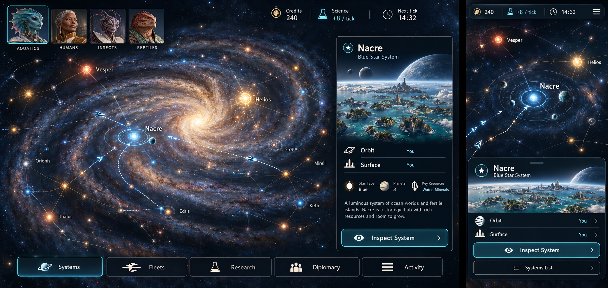
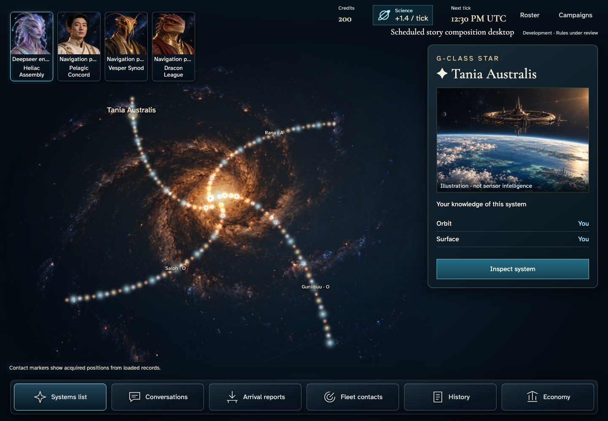
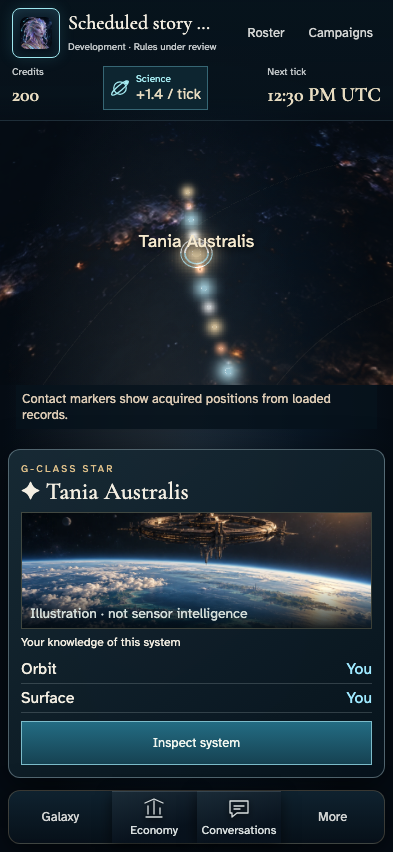
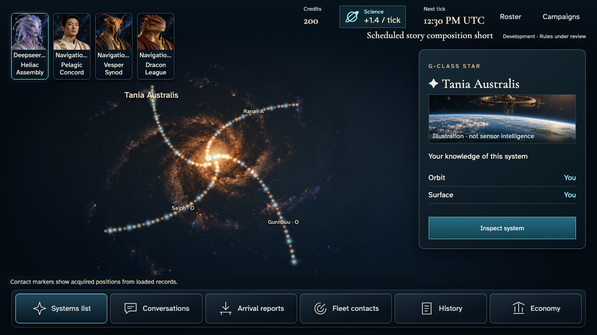

# Galaxy overlay and home framing — candidates only

Clean `b8884c346ba9e99f91aa7569e8d10505dfc6a62f`; spec `1f333c2fe637f4449bfab187b85676466668fdf1ca186ab017f72965055e2d65`. Four Nix journeys passed1.1m with32 original PNGs. [SHA-256 index](sha256.json), source/renderer manifests and generated narratives retain exact provenance. No baseline promotion or exact reviewed-pixel verification is claimed.

| Approved plate03 | Actual desktop |
| --- | --- |
|  |  |

| Actual phone home neighbourhood | Actual short overlay |
| --- | --- |
|  |  |

[Original4K scene](large/darwin-arm64/004-read-commanders-and-home-1-deepseer-envoy.png). Full-size files are retained; the overview viewer downscales large images. Author additionally inspected unscaled1500×240 resource-rail and1050×1250 inspector crops for text/art readability, not a full native4K audit.

## Correction against the recorded findings

Reviewer07:50 withheld the previous family's fidelity: an opaque desktop/short band consumed20–23% of the screen, and phone showed a distant whole galaxy above a tall card. Desktop now places portrait instruments over the scene with a compact resource/campaign rail. Phone starts on the actual authorized home neighbourhood and retains a shorter contextual instrument with both ownership rows and Inspect completely visible. Full Overview and Center home remain genuine keyboard actions through the systems list; step007 explicitly captures Overview before returning to the same home.

The catalogue, coordinates, class, ownership, intelligence and resource ledger are unchanged. Camera distance is presentation, not fleet range or speed. Portrait choice is the actual campaign cosmetic choice, separate from mechanical faction. The concept's illustrative unimplemented planet facts/routes/actions are not invented; supported real destinations remain explicit. Regular spiral geometry therefore differs from the illustrated catalogue. This is not a claim of complete plate03 fidelity.

All four sizes execute actual four-player admission/start, exact roster-opener restoration, contextual inspection, explicit Overview/home navigation, normal-motion Return, acknowledged local lower-detail change and reload of the same home/profile. Normal-motion images are step009; lower-detail and recovered views are010/011. Factual inspector/resource text remains unchanged by decoration settings. This is not complete canvas-marker, peer-private authorization, account-switch or concurrency certification.

## Ordered evidence and checks

- [Phone](phone/darwin-arm64/README.md)
- [Desktop](desktop/darwin-arm64/README.md)
- [Large](large/darwin-arm64/README.md)
- [Short](short/darwin-arm64/README.md)
- [Runtime log](runtime.log): four journeys, original240s/30s/10s budgets, retries0/max-failures1.
- [Unit log](unit.log):111 tests/4370 assertions passed, including independent Three projection checks.
- [Policy log](policy.log): guarded story-policy suite and four no-browser baseline-path cases passed.

Author inspected all four opening compositions and native crops; independent32-image review remains open. Earlier aa9200b28 images remain committed and held; e5b502f28 and every failure trace remain separately retained. In particular797f314 stopped at actual Surface containment, without capturing or continuing other sizes; b8884c3 corrected the production card while retaining that assertion.

No scene, waiting/layer/build, shared-gallery, Linux, hosted/KMS, privacy/concurrency, historical ingress/100-tick or release hold is silently closed. No merge or baseline promotion.
