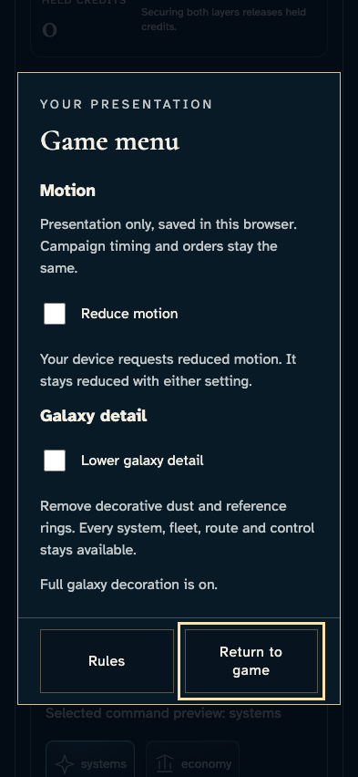
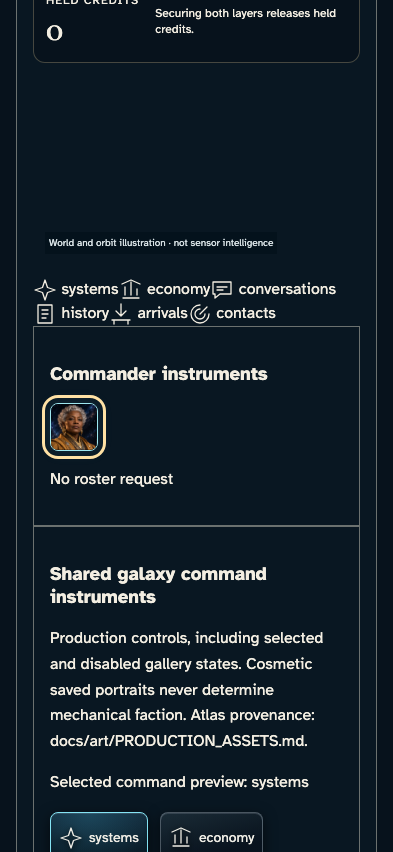
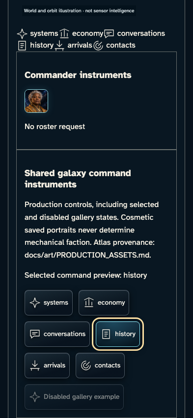
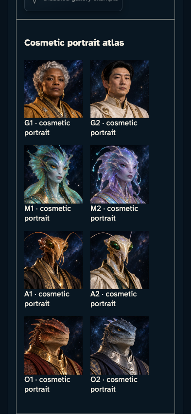

# Inspect shared commander and command instruments

**BASELINE CANDIDATES — generation, not verification.** phone · darwin-arm64. Inventory: UX-03, UX-15, UX-16.

The developer gallery renders the actual CommanderDeck, CommanderPortrait, CommandControl and GameMenu. Its existing reducer-derived scenario is explicitly a component demonstration, not an authenticated campaign, admission or privacy claim. Keyboard and local preview outcomes are named separately from service acknowledgements.

## 1. Read the actual commander deck, open its portrait menu with Enter, and traverse every modal control including both wrap boundaries.

Actor: **Gallery reviewer**.

Acknowledged outcome: The actual native game menu contains focus at its final control.

- [x] This is the browser-local presentation menu, not campaign navigation or a fabricated order.

### Viewpoint: Gallery reviewer

## 2. Escape restores the exact portrait opener. Read the own and peer controls; compact phone uses the own portrait while live Roster remains covered by the campaign story.

Actor: **Gallery reviewer**.

Acknowledged outcome: The commander opener regains focus and the modal closes.

- [x] Responsive peer visibility and semantic cosmetic/faction labelling are retained.

### Viewpoint: Gallery reviewer

## 3. Read all six shared command instruments and the disabled example, then select History with the keyboard.

Actor: **Gallery reviewer**.

Acknowledged outcome: The local preview names History and exposes its current state to assistive technology.

- [x] All real icon controls remain labelled; only one is current and the explicit disabled example cannot be activated.

### Viewpoint: Gallery reviewer

## 4. Read all eight cosmetic portrait tiles from the original approved atlas, rendered by the shared production portrait component.

Actor: **Gallery reviewer**.

Acknowledged outcome: Eight labelled atlas tiles are rendered from the production portrait asset.

- [x] The atlas uses the existing provenanced image and every tile has a contained readable caption.

### Viewpoint: Gallery reviewer

