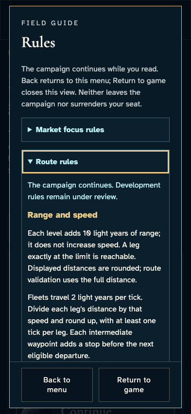
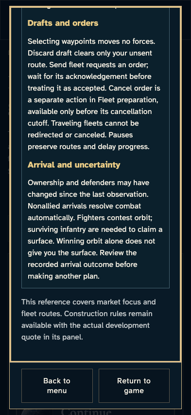
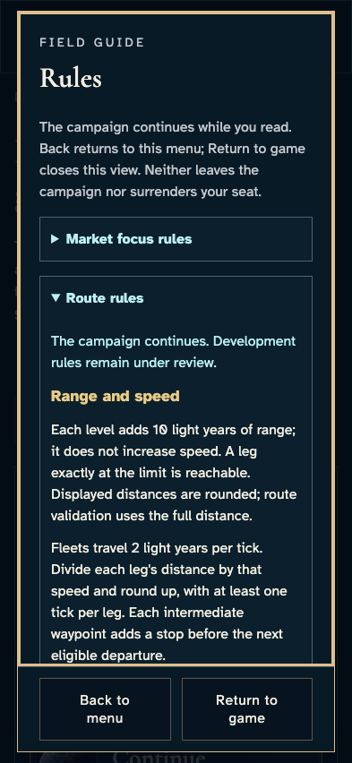
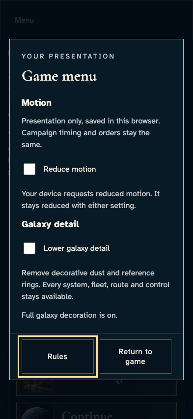
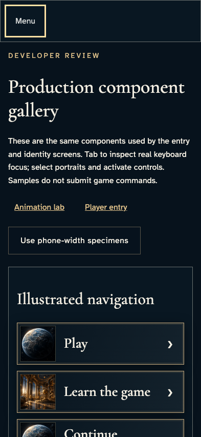

# Read route rules and return to the same menu

**BASELINE CANDIDATES — generation, not verification.** phone · darwin-arm64. Inventory: UX-15, UX-16.

Actual shared GameMenu and RouteRules in the production gallery. Local navigation only; this does not establish live campaign draft/tick preservation or authoritative actions.

## 1. Open the shared menu and Rules with the keyboard, then expand the existing route chapter.

Actor: **Reader**.

Acknowledged outcome: The actual route chapter opens inside the single existing modal.

- [x] The top heading, chapter entry and rule-review disclosure are wholly within the reading clip while both footer actions remain contained.
- [x] Reading continues the campaign and cannot be confused with leaving or surrendering; proposed rules retain their disclosure.

### Viewpoint: Reader

## 2. Shift+Tab from the chapter entry into the named bounded reading region, then use End to read arrival and uncertainty without moving the footer.

Actor: **Reader**.

Acknowledged outcome: Keyboard scrolling reveals the complete lower heading and its relevant paragraph.

- [x] The reading region retains keyboard focus and both persistent footer actions remain inside their clipping ancestors and viewport before helper scrolling.

### Viewpoint: Reader · arrival uncertainty

## 3. After capturing the lower text, use Home in the same focused reading region to return to the top without scrolling the document.

Actor: **Reader**.

Acknowledged outcome: Home restores the top heading and chapter entry inside the bounded region.

- [x] Document scroll is unchanged, focus stays in Rules reading and the persistent actions remain contained.

### Viewpoint: Reader · rules top

## 4. Use Back to menu, then reopen Rules and use Escape to return to its opening control.

Actor: **Reader**.

Acknowledged outcome: Rules closes inside the still-open menu and restores Rules focus.

- [x] Presentation controls remain available and there is no second modal.

### Viewpoint: Reader

## 5. Escape the menu and return focus to its original opener without route navigation.

Actor: **Reader**.

Acknowledged outcome: The menu is closed and Menu regains focus.

- [x] The same gallery route remains mounted.

### Viewpoint: Reader

