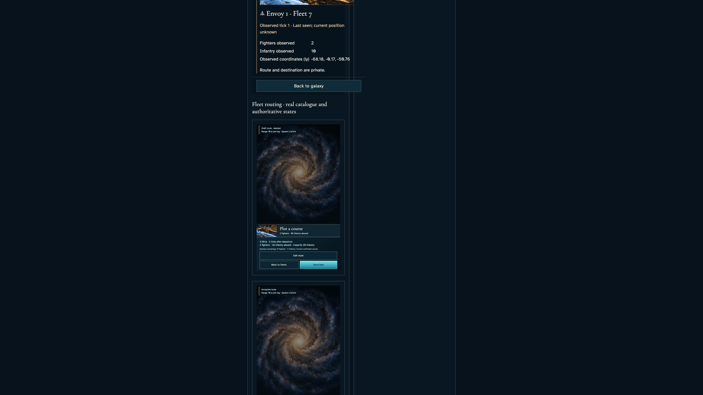
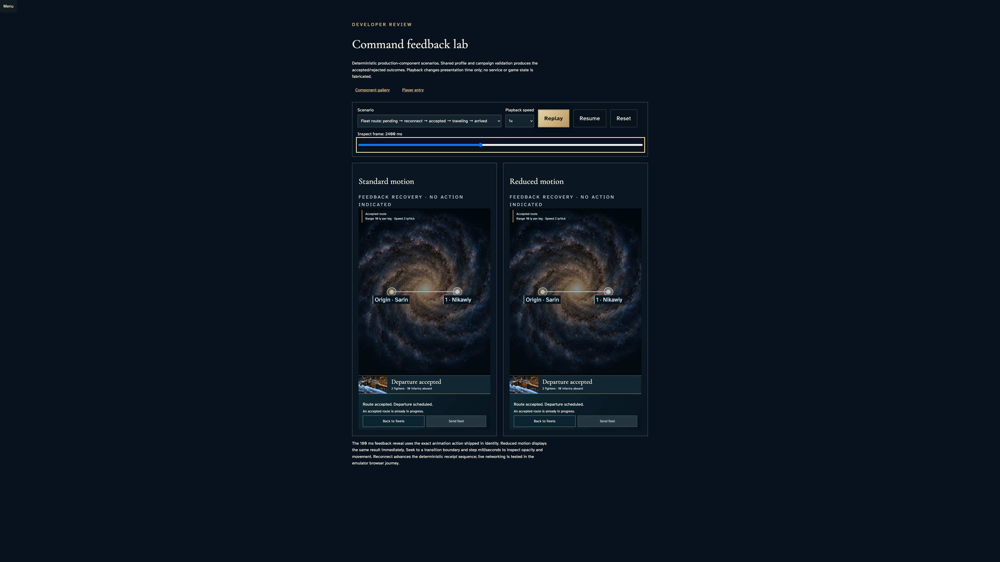

# Inspect the actual route instrument

**BASELINE CANDIDATES — generation, not verification.** large · darwin-arm64. Inventory: UX-08, UX-16.

Actual shared FleetRoute in reducer-derived gallery/lab scenarios. These are explicit component examples, not authenticated command acceptance. Live acceptance is the companion forces story.

## 1. Read the real route scene and shared force instrument in its gallery container.

Actor: **Component reviewer**.

Acknowledged outcome: The actual component exposes current capacity and a real editable route.

- [x] The named route chart is bounded by its specimen and has positive usable height.

### Viewpoint: Component reviewer

## 2. Select the existing travel scenario and inspect its accepted frame without replacing production state.

Actor: **Component reviewer**.

Acknowledged outcome: Both shared comparison panels report the same accepted route and departure tick.

- [x] Accepted frames disable duplicate dispatch in both actual shared components.

### Viewpoint: Component reviewer

