# Review the forces sent and left behind

**BASELINE CANDIDATES — generation, not verification.** short · darwin-arm64. Inventory: UX-08, UX-14, UX-16.

Ordinary authenticated formation and dispatch with actual leased settlement. Fixed catalogue/domain clock and Scheduler delivery are labelled harness controls, never injected forces. Owner and peer authorized projections corroborate private forces; hosted scheduling and managed crypto remain outside this development journey.

## 1. Ordinary emulator sign-in and identity save, with explicit developer entitlement and fixed browser Date; timers continue normally.

Actor: **Test harness**. **Harness control; not a player action.**

Acknowledged outcome: Explicit test control; not a player action or hosted-service certification.

## 2. Ordinary emulator sign-in and identity save, with explicit developer entitlement and fixed browser Date; timers continue normally.

Actor: **Test harness**. **Harness control; not a player action.**

Acknowledged outcome: Explicit test control; not a player action or hosted-service certification.

## 3. Ordinary emulator sign-in and identity save, with explicit developer entitlement and fixed browser Date; timers continue normally.

Actor: **Test harness**. **Harness control; not a player action.**

Acknowledged outcome: Explicit test control; not a player action or hosted-service certification.

## 4. Ordinary emulator sign-in and identity save, with explicit developer entitlement and fixed browser Date; timers continue normally.

Actor: **Test harness**. **Harness control; not a player action.**

Acknowledged outcome: Explicit test control; not a player action or hosted-service certification.

## 5. Create/join through ordinary campaign controls. Fixed catalogue and admission clock are test controls; no seat, message or command outcome is injected.

Actor: **Test harness**. **Harness control; not a player action.**

Acknowledged outcome: Explicit test control; not a player action or hosted-service certification.

## 6. Create/join through ordinary campaign controls. Fixed catalogue and admission clock are test controls; no seat, message or command outcome is injected.

Actor: **Test harness**. **Harness control; not a player action.**

Acknowledged outcome: Explicit test control; not a player action or hosted-service certification.

## 7. Create/join through ordinary campaign controls. Fixed catalogue and admission clock are test controls; no seat, message or command outcome is injected.

Actor: **Test harness**. **Harness control; not a player action.**

Acknowledged outcome: Explicit test control; not a player action or hosted-service certification.

## 8. Create/join through ordinary campaign controls. Fixed catalogue and admission clock are test controls; no seat, message or command outcome is injected.

Actor: **Test harness**. **Harness control; not a player action.**

Acknowledged outcome: Explicit test control; not a player action or hosted-service certification.

## 9. Advance the designated browser/domain clock to 12:15 UTC and deliver the actual emulator Scheduler HTTP request. This does not certify hosted scheduling.

Actor: **Test harness**. **Harness control; not a player action.**

Acknowledged outcome: Explicit test control; not a player action or hosted-service certification.

## 10. Form two fighters carrying twenty infantry through the actual preparation controls.

Actor: **Route marshal**.

Acknowledged outcome: Authoritative formation receipt reserves the complement without moving the garrison.

- [x] Independent commander receives no owner's fleet, route order or private complement.

### Viewpoint: Route marshal

[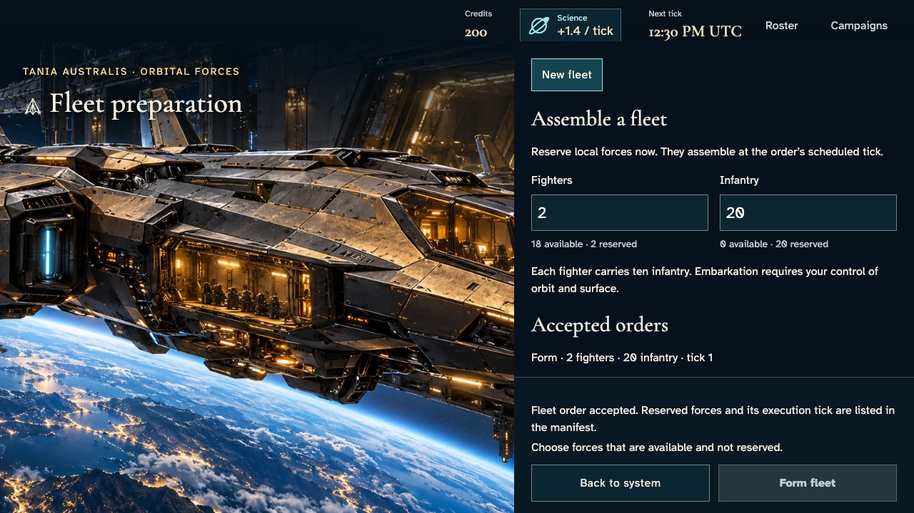](010-reserve-real-complement-1-route-marshal.png)

### Viewpoint: Independent marshal

[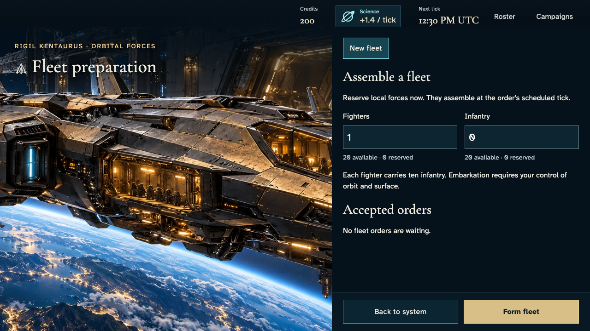](010-reserve-real-complement-2-independent-marshal.png)

## 11. One real tick, concurrent and repeated deliveries; no state injection or hosted scheduling claim.

Actor: **Test harness**. **Harness control; not a player action.**

Acknowledged outcome: Explicit test control; not a player action or hosted-service certification.

## 12. Select the formed fleet and review capacity and the exact origin garrison before planning.

Actor: **Route marshal**.

Acknowledged outcome: The review shows actual formed forces and capacity; garrison excludes the fleet exactly once.

- [x] Independent commander receives no owner's fleet, route order or private complement.
- [x] Review fits its bounded reading region while commitment actions stay in the viewport.

### Viewpoint: Route marshal

[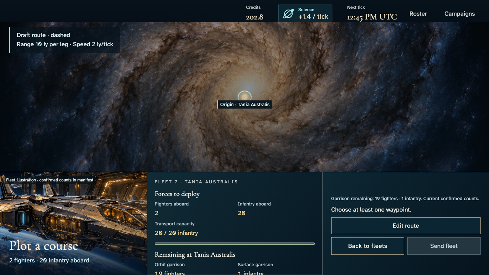](012-review-confirmed-forces-1-route-marshal.png)

### Viewpoint: Independent marshal

## 13. Read the independently authorized origin layers and other own stationed fleets before sending.

Actor: **Route marshal**.

Acknowledged outcome: Both current garrison counts and the concurrent-order qualification are fully readable in the bounded region.

- [x] Independent commander receives no owner's fleet, route order or private complement.

### Viewpoint: Route marshal

[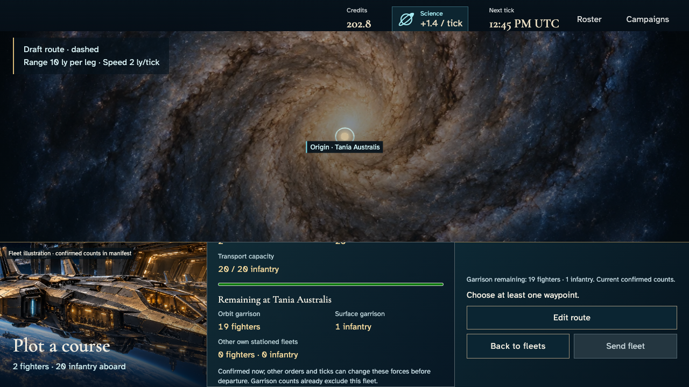](013-read-origin-defense-1-route-marshal.png)

### Viewpoint: Independent marshal

## 14. Choose an actually reachable catalogue destination, review the commitment without issuing an order.

Actor: **Route marshal**.

Acknowledged outcome: Send becomes available while confirmed remaining-defense counts remain visible.

- [x] Independent commander receives no owner's fleet, route order or private complement.

### Viewpoint: Route marshal

### Viewpoint: Independent marshal

## 15. Add another actual reachable waypoint and inspect both editable legs without issuing a command.

Actor: **Route marshal**.

Acknowledged outcome: Two actual waypoints are retained as unsent intent; no service revision changes.

- [x] Independent commander receives no owner's fleet, route order or private complement.

### Viewpoint: Route marshal

[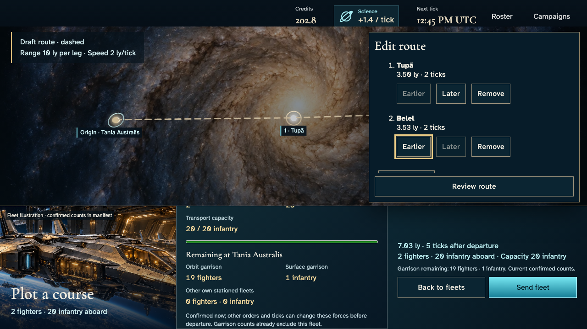](015-edit-multiple-waypoints-1-route-marshal.png)

### Viewpoint: Independent marshal

## 16. Read the leg facts with the earlier keyboard control focused; no route is changed.

Actor: **Route marshal**.

Acknowledged outcome: Keyboard focus is visible on the requested enabled control.

- [x] Independent commander receives no owner's fleet, route order or private complement.
- [x] The painted focus outline clears every leg fact and the reading clip; unsent intent changes no authoritative state.

### Viewpoint: Route marshal

## 17. Read the leg facts with the later keyboard control focused; no route is changed.

Actor: **Route marshal**.

Acknowledged outcome: Keyboard focus is visible on the requested enabled control.

- [x] Independent commander receives no owner's fleet, route order or private complement.
- [x] The painted focus outline clears every leg fact and the reading clip; unsent intent changes no authoritative state.

### Viewpoint: Route marshal

[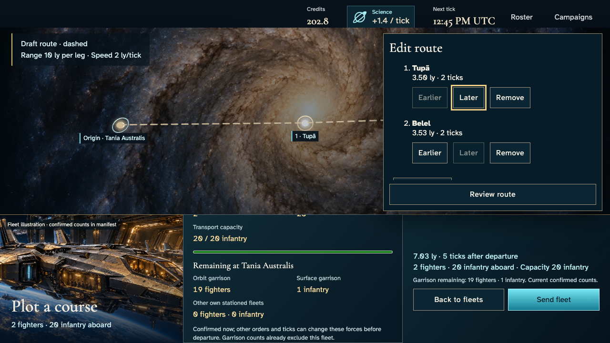](017-read-later-focus-1-route-marshal.png)

## 18. Read the leg facts with the remove keyboard control focused; no route is changed.

Actor: **Route marshal**.

Acknowledged outcome: Keyboard focus is visible on the requested enabled control.

- [x] Independent commander receives no owner's fleet, route order or private complement.
- [x] The painted focus outline clears every leg fact and the reading clip; unsent intent changes no authoritative state.

### Viewpoint: Route marshal

[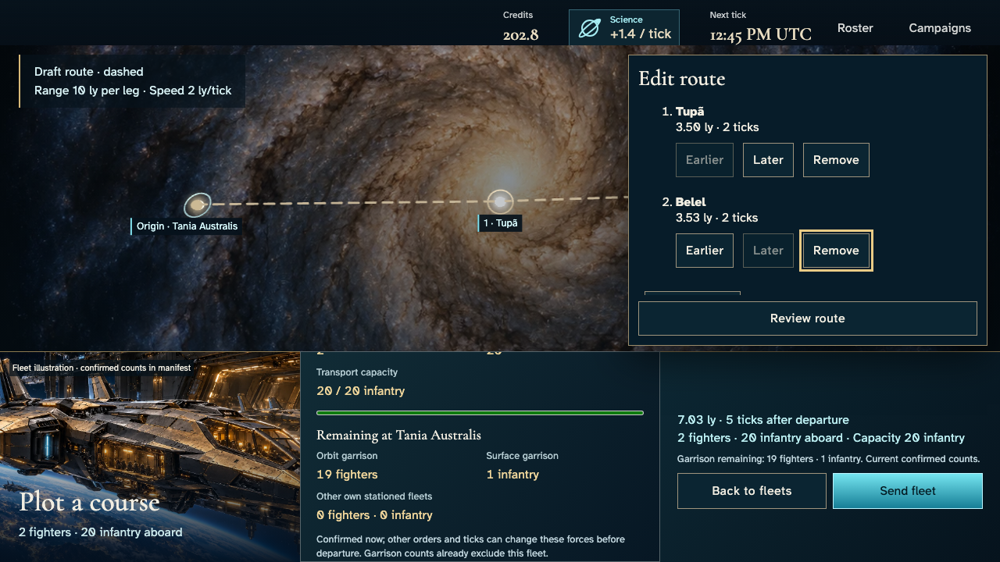](018-read-remove-focus-1-route-marshal.png)

## 19. Move the second leg earlier and back, remove it, then return to the original route review.

Actor: **Route marshal**.

Acknowledged outcome: All edits remain local, the original destination survives and Edit route regains focus.

- [x] Independent commander receives no owner's fleet, route order or private complement.

### Viewpoint: Route marshal

### Viewpoint: Independent marshal

## 20. Read the same confirmed route with normal motion preference and settled finite effects; no fast-forward.

Actor: **Route marshal**.

Acknowledged outcome: Actual media and root preference allow normal motion, with identical authoritative state.

- [x] Independent commander receives no owner's fleet, route order or private complement.

### Viewpoint: Route marshal

- [x] Normal-motion device preference; finite effects settled without fast-forward and exact pixels unchanged.

[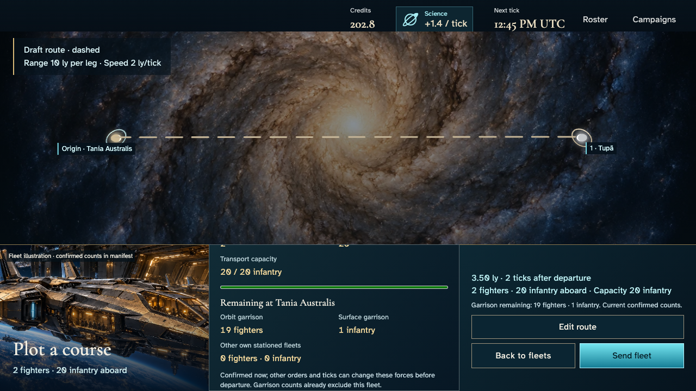](020-review-normal-motion-1-route-marshal.png)

## 21. Send with Enter and read the real accepted route before any departure.

Actor: **Route marshal**.

Acknowledged outcome: An authoritative receipt schedules departure without subtracting forces again.

- [x] Independent commander receives no owner's fleet, route order or private complement.

### Viewpoint: Route marshal

[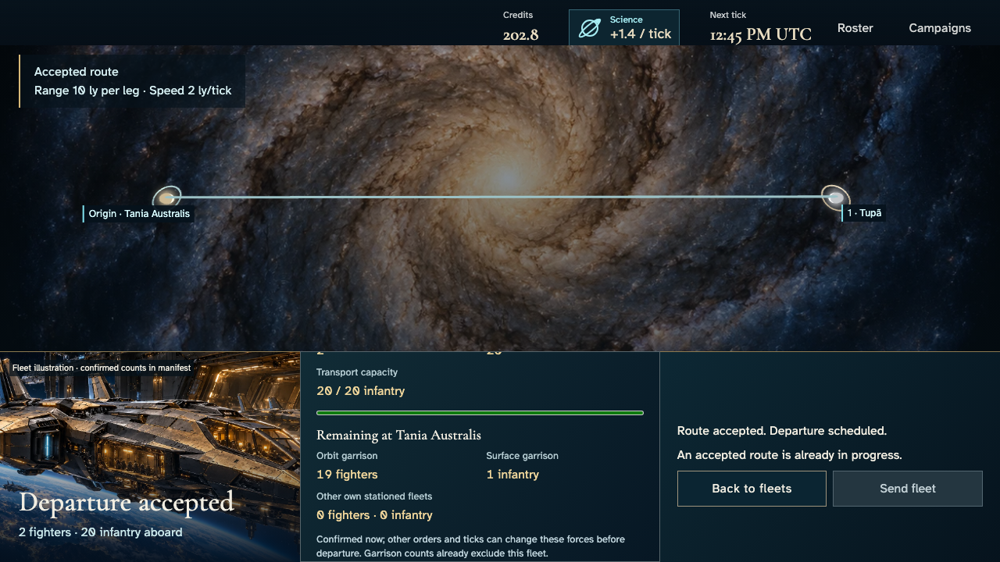](021-acknowledge-dispatch-1-route-marshal.png)

### Viewpoint: Independent marshal

## 22. Use Home in the bounded manifest to read the accepted fleet top, without moving the page or issuing another order.

Actor: **Route marshal**.

Acknowledged outcome: The selected reading extent is reached inside the manifest.

- [x] Independent commander receives no owner's fleet, route order or private complement.
- [x] Complete counts or accepted waypoint text are contained, with the same accepted command and unchanged document scroll.

### Viewpoint: Route marshal

[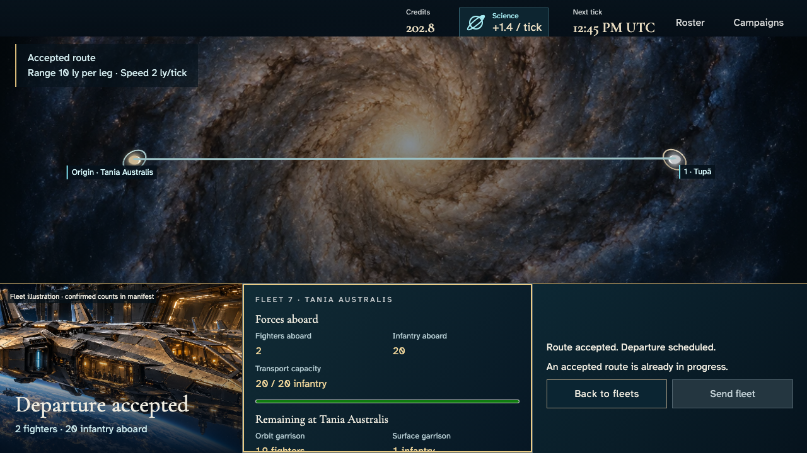](022-read-accepted-top-1-route-marshal.png)

## 23. Use End in the bounded manifest to read the accepted fleet bottom, without moving the page or issuing another order.

Actor: **Route marshal**.

Acknowledged outcome: The selected reading extent is reached inside the manifest.

- [x] Independent commander receives no owner's fleet, route order or private complement.
- [x] Complete counts or accepted waypoint text are contained, with the same accepted command and unchanged document scroll.

### Viewpoint: Route marshal

[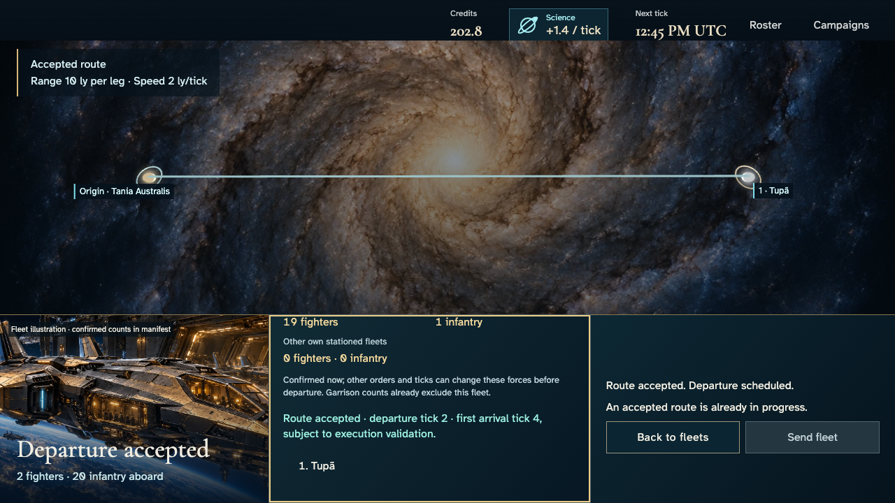](023-read-accepted-bottom-1-route-marshal.png)

## 24. Reload the same campaign and inspect the same accepted fleet and destination without sending again.

Actor: **Route marshal**.

Acknowledged outcome: The accepted destination and immutable order return; no duplicate revision or forces.

- [x] Independent commander receives no owner's fleet, route order or private complement.

### Viewpoint: Route marshal

[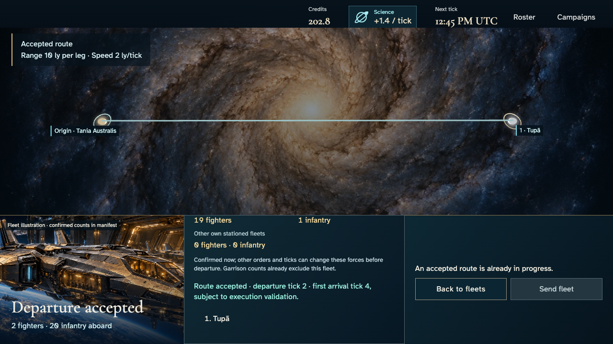](024-recover-same-dispatch-1-route-marshal.png)

### Viewpoint: Independent marshal

