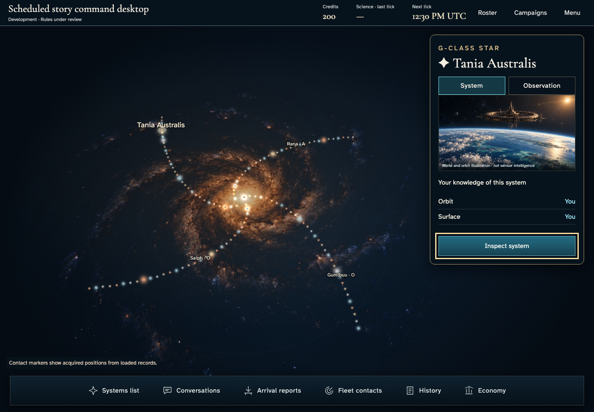
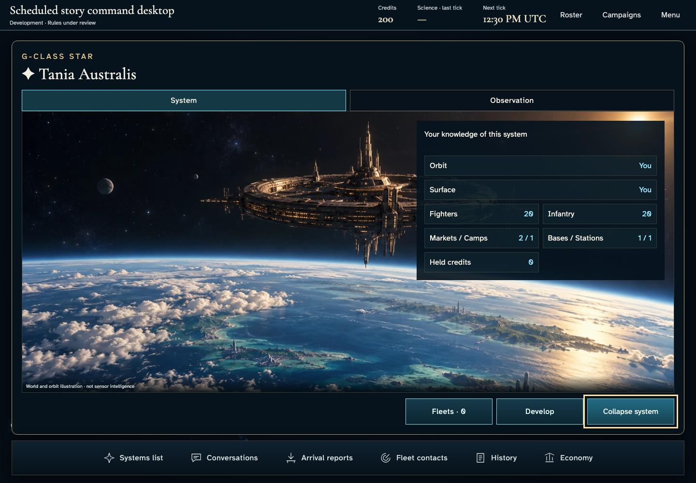
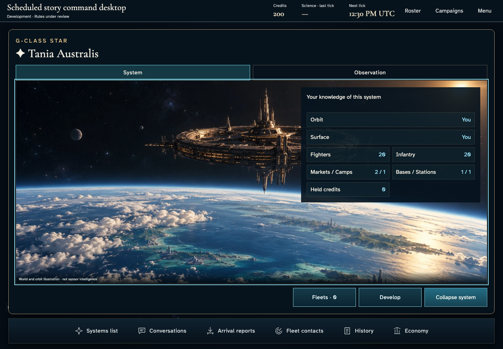
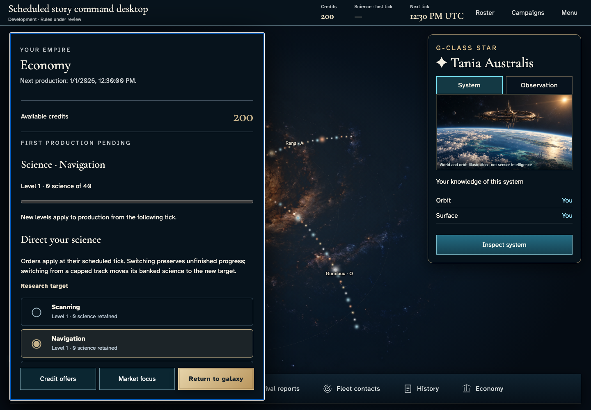
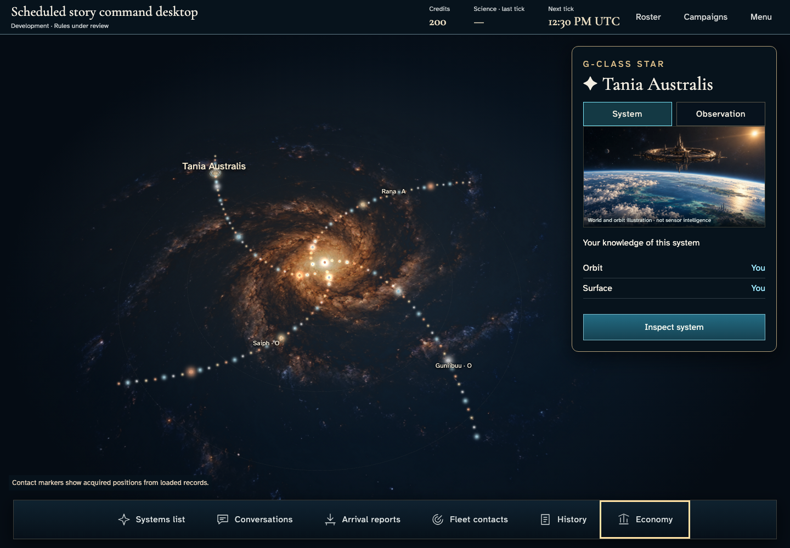
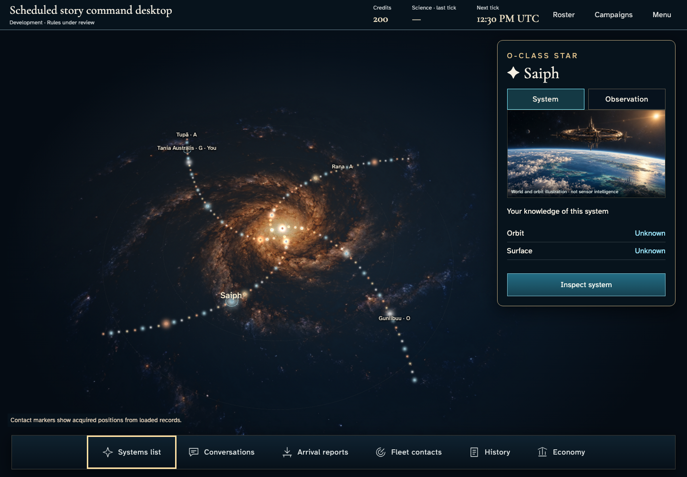
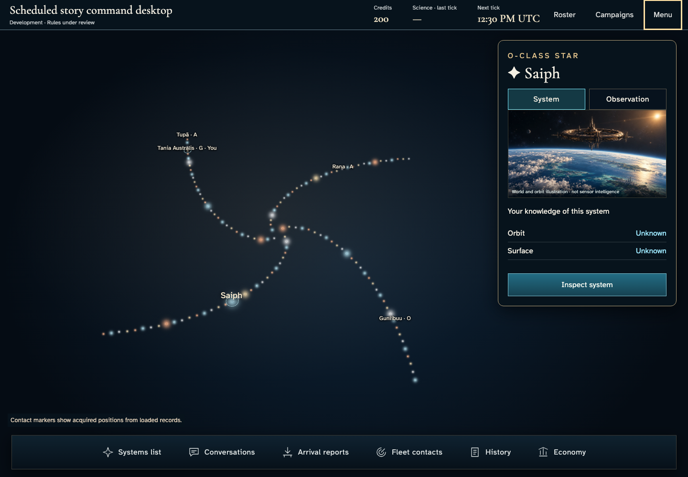

# Inspect a system without losing the galaxy

**BASELINE CANDIDATES — generation, not verification.** desktop · darwin-arm64. Inventory: UX-02, UX-03, UX-04, UX-15, UX-16.

Four ordinary authenticated players create, join and start one real campaign. The owner reads authorized resources, expands the independent ownership layers and uses the global dock without issuing an order. Developer entitlement, fixed catalogue/domain clock and real scheduler HTTP delivery are explicit harness controls, not injected seats or hosted scheduling evidence.

## 1. Ordinary Google emulator sign-in and acknowledged identity save; development entitlement is a labelled fixture.

Actor: **Test harness**. **Harness control; not a player action.**

Acknowledged outcome: Explicit test control; not a player action or hosted-service certification.

## 2. Ordinary Google emulator sign-in and acknowledged identity save; development entitlement is a labelled fixture.

Actor: **Test harness**. **Harness control; not a player action.**

Acknowledged outcome: Explicit test control; not a player action or hosted-service certification.

## 3. Ordinary Google emulator sign-in and acknowledged identity save; development entitlement is a labelled fixture.

Actor: **Test harness**. **Harness control; not a player action.**

Acknowledged outcome: Explicit test control; not a player action or hosted-service certification.

## 4. Ordinary Google emulator sign-in and acknowledged identity save; development entitlement is a labelled fixture.

Actor: **Test harness**. **Harness control; not a player action.**

Acknowledged outcome: Explicit test control; not a player action or hosted-service certification.

## 5. Actual create/join controls and accepted seat; catalogue and admission time are fixed by the demo-only loader, never injected state.

Actor: **Test harness**. **Harness control; not a player action.**

Acknowledged outcome: Explicit test control; not a player action or hosted-service certification.

## 6. Actual create/join controls and accepted seat; catalogue and admission time are fixed by the demo-only loader, never injected state.

Actor: **Test harness**. **Harness control; not a player action.**

Acknowledged outcome: Explicit test control; not a player action or hosted-service certification.

## 7. Actual create/join controls and accepted seat; catalogue and admission time are fixed by the demo-only loader, never injected state.

Actor: **Test harness**. **Harness control; not a player action.**

Acknowledged outcome: Explicit test control; not a player action or hosted-service certification.

## 8. Actual create/join controls and accepted seat; catalogue and admission time are fixed by the demo-only loader, never injected state.

Actor: **Test harness**. **Harness control; not a player action.**

Acknowledged outcome: Explicit test control; not a player action or hosted-service certification.

## 9. Deliver the real Scheduler HTTP request at the designated browser/domain boundary; no campaign or membership writes. This is not hosted cadence certification.

Actor: **Test harness**. **Harness control; not a player action.**

Acknowledged outcome: Explicit test control; not a player action or hosted-service certification.

## 10. Read the real started campaign, independent ownership layers and compact instrument rail before opening any order.

Actor: **Chart envoy**.

Acknowledged outcome: The authorized home view follows the acknowledged four-player start.

- [x] Credits, last confirmed science and actual next scheduled tick remain readable on phone as well as desktop; the chart and inspector stay within the viewport.

### Viewpoint: Chart envoy

## 11. Expand the selected system through its real keyboard control and read separate orbital and surface holdings. Artwork is explicitly illustrative.

Actor: **Chart envoy**.

Acknowledged outcome: The same selected system expands without changing ownership.

- [x] Authorized fields remain separate, and decorative art is not represented as sensor intelligence.

### Viewpoint: Chart envoy

## 12. Focus the bounded system reading region and use End to read the lower authorized developments and held credits while retaining the contextual controls.

Actor: **Chart envoy**.

Acknowledged outcome: The held credits label is fully inside the bounded reading viewport.

- [x] Keyboard reading does not move the page or replace the selected system.

### Viewpoint: Chart envoy

## 13. Collapse the system, open the global command dock and read Economy through the actual authorized projection.

Actor: **Chart envoy**.

Acknowledged outcome: The actual Empire economy panel opens with keyboard focus.

- [x] The authorized economy provides an enabled return to the galaxy; this check does not certify command absence or peer privacy.

### Viewpoint: Chart envoy

## 14. Close Economy with Escape and retain the selected system and accessible command opener.

Actor: **Chart envoy**.

Acknowledged outcome: The dock Economy opener regains focus.

- [x] The same system remains selected after global navigation.

### Viewpoint: Chart envoy

## 15. Use the factual systems list to select Saiph with the keyboard, then return to the compact inspector.

Actor: **Chart envoy**.

Acknowledged outcome: The actual selected system is Saiph and the same campaign remains open.

- [x] Credits, last confirmed science and actual next scheduled tick remain readable on phone as well as desktop; the chart and inspector stay within the viewport.

### Viewpoint: Chart envoy

## 16. Use the actual local setting with normal motion permitted by the device, verify its outcome, then restore the declared reduced-motion capture environment. Selection and authorized resource text remain unchanged.

Actor: **Chart envoy**.

Acknowledged outcome: The menu closes and restores its opener after acknowledging the local setting.

- [x] Authorized inspector and resource text match exactly; reduced decoration does not alter selected-system facts. This does not certify every canvas marker or hosted timing.

### Viewpoint: Chart envoy

