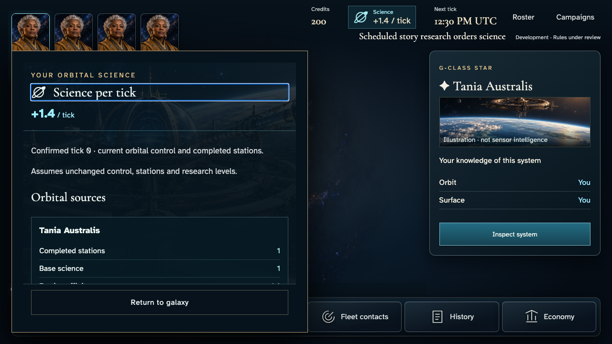
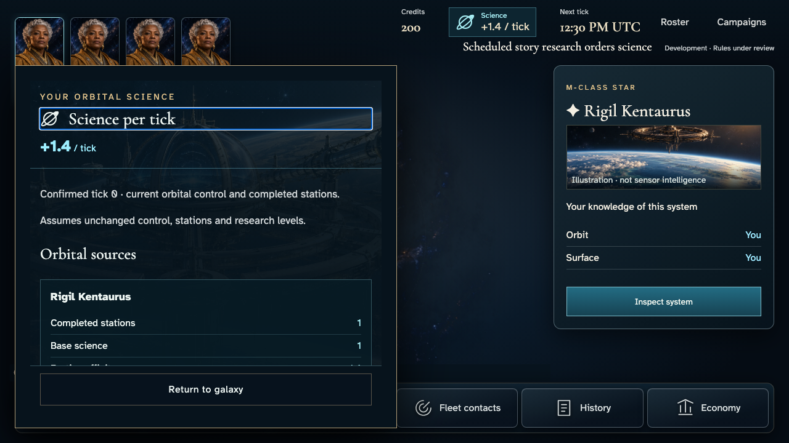
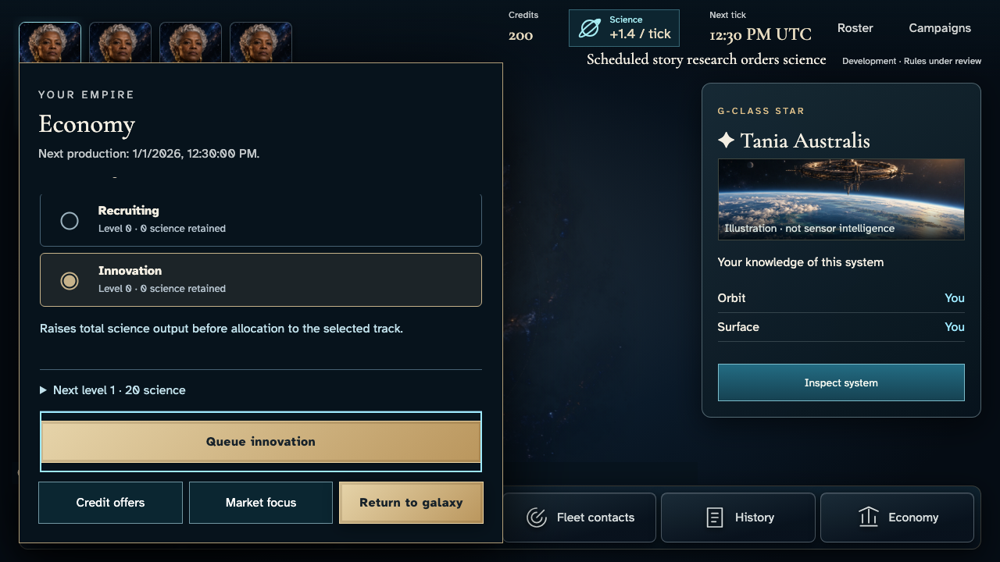
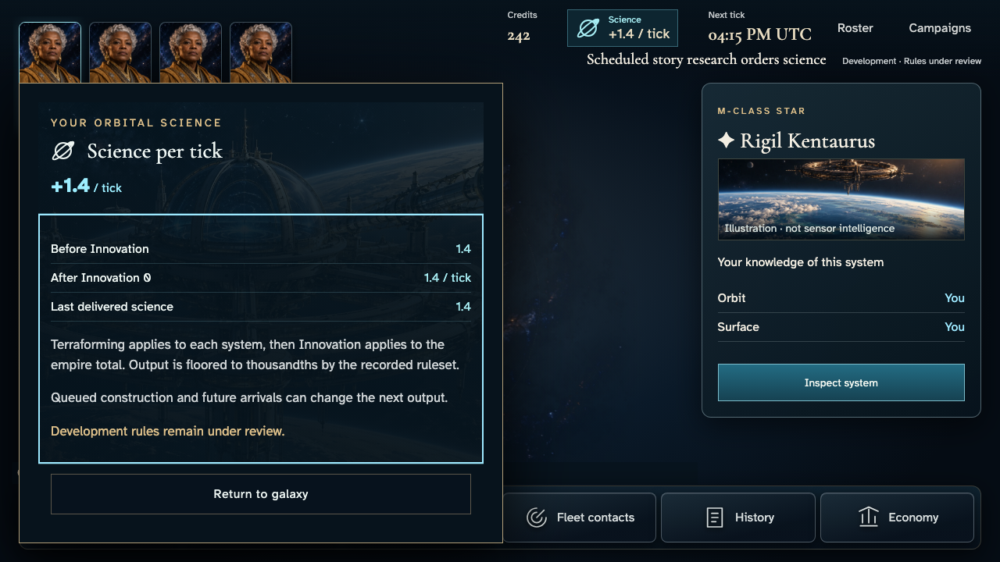

# Read science capacity separately from delivered output

**BASELINE CANDIDATES — generation, not verification.** short · darwin-arm64. Inventory: UX-03, UX-08, UX-16.

Four ordinary players start a real campaign. The owner opens the private science source ledger, queues Innovation and recovers the earned new capacity separately from delivered science. Demo catalogue/admission/research clock and leased tick delivery are explicitly labelled harness controls; no stored state is injected.

## 1. Ordinary Google emulator sign-in and acknowledged identity save; development entitlement is a labelled fixture.

Actor: **Test harness**. **Harness control; not a player action.**

Acknowledged outcome: Explicit test control; not a player action or hosted-service certification.

## 2. Ordinary Google emulator sign-in and acknowledged identity save; development entitlement is a labelled fixture.

Actor: **Test harness**. **Harness control; not a player action.**

Acknowledged outcome: Explicit test control; not a player action or hosted-service certification.

## 3. Ordinary Google emulator sign-in and acknowledged identity save; development entitlement is a labelled fixture.

Actor: **Test harness**. **Harness control; not a player action.**

Acknowledged outcome: Explicit test control; not a player action or hosted-service certification.

## 4. Ordinary Google emulator sign-in and acknowledged identity save; development entitlement is a labelled fixture.

Actor: **Test harness**. **Harness control; not a player action.**

Acknowledged outcome: Explicit test control; not a player action or hosted-service certification.

## 5. Actual create/join controls and accepted seat; catalogue and admission time are fixed by the demo-only loader, never injected state.

Actor: **Test harness**. **Harness control; not a player action.**

Acknowledged outcome: Explicit test control; not a player action or hosted-service certification.

## 6. Actual create/join controls and accepted seat; catalogue and admission time are fixed by the demo-only loader, never injected state.

Actor: **Test harness**. **Harness control; not a player action.**

Acknowledged outcome: Explicit test control; not a player action or hosted-service certification.

## 7. Actual create/join controls and accepted seat; catalogue and admission time are fixed by the demo-only loader, never injected state.

Actor: **Test harness**. **Harness control; not a player action.**

Acknowledged outcome: Explicit test control; not a player action or hosted-service certification.

## 8. Actual create/join controls and accepted seat; catalogue and admission time are fixed by the demo-only loader, never injected state.

Actor: **Test harness**. **Harness control; not a player action.**

Acknowledged outcome: Explicit test control; not a player action or hosted-service certification.

## 9. Deliver the real Scheduler HTTP request at the designated browser/domain boundary; no campaign or membership writes. This is not hosted cadence certification.

Actor: **Test harness**. **Harness control; not a player action.**

Acknowledged outcome: Explicit test control; not a player action or hosted-service certification.

## 10. Open the real per-tick rail control on both independent accounts. Current capacity exists before the first delivered output.

Actor: **Chart envoy**.

Acknowledged outcome: Both authorized ledgers acknowledge tick0, current1.4 capacity and their own completed station.

- [x] The two ordinary views name different owned orbital sources, and no historical output is substituted for capacity.

### Viewpoint: Chart envoy

### Viewpoint: Tidal envoy

## 11. Return to the same galaxy and queue Innovation through ordinary research controls. Capacity remains1.4 until the level is earned.

Actor: **Chart envoy**.

Acknowledged outcome: The actual research receipt accepts Innovation for tick1.

- [x] The peer remains at its own initial rate and source while the owner order is accepted.

### Viewpoint: Chart envoy

## 12. Existing guarded demo clock and fifteen real leased ticks, concurrent/repeated delivery. No levels, resources or private projections injected; not hosted Scheduler certification.

Actor: **Test harness**. **Harness control; not a player action.**

Acknowledged outcome: Explicit test control; not a player action or hosted-service certification.

## 13. Reload both accounts and inspect the earned new rate separately from tick15 output. The peer retains its independent sources and rate.

Actor: **Chart envoy**.

Acknowledged outcome: Authoritative tick15 supplies owner1.404 capacity while last delivered science is1.4; peer remains1.4.

- [x] Source identity and peer ownership remain isolated through reload; lower totals stay inside the reading viewport.

### Viewpoint: Chart envoy

### Viewpoint: Tidal envoy

## 14. One real leased following tick applies the already-earned Innovation level; repeated delivery remains empty.

Actor: **Test harness**. **Harness control; not a player action.**

Acknowledged outcome: Explicit test control; not a player action or hosted-service certification.

## 15. Recover tick16 after reload, read the actual1.404 delivery, then retain the same authoritative source and current rate.

Actor: **Chart envoy**.

Acknowledged outcome: The new rate is now also the actual delivered output at confirmed tick16.

- [x] Reload preserves source ownership and does not alter the accepted command identity.

### Viewpoint: Chart envoy

