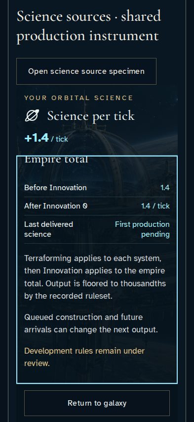
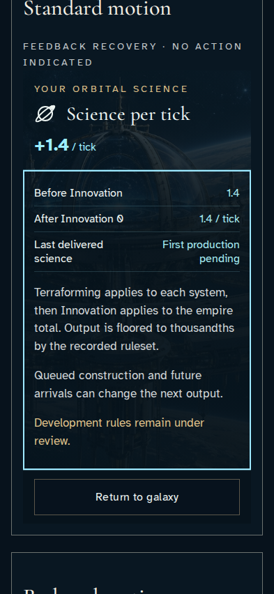
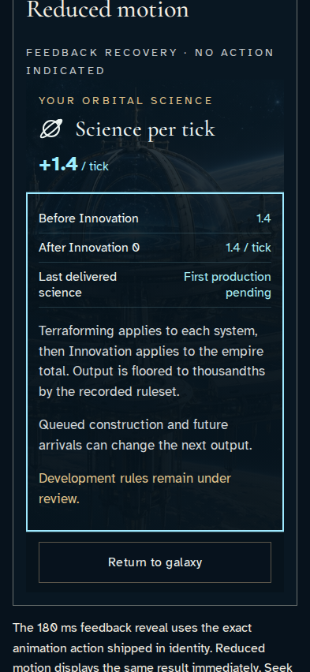
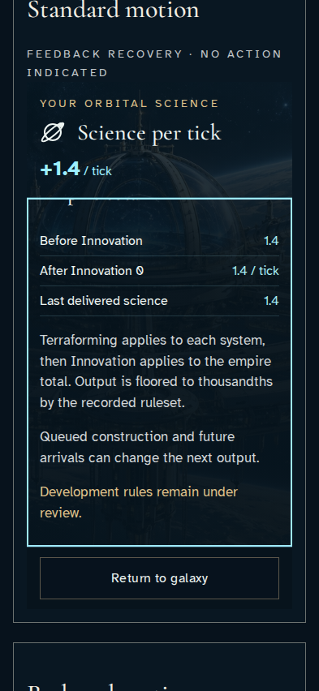
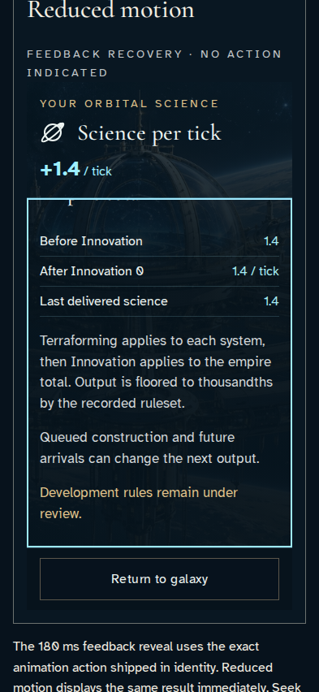

# Inspect the shared science source instrument

**BASELINE CANDIDATES — generation, not verification.** phone · linux-arm64. Inventory: UX-03, UX-08, UX-16.

Actual ScienceLedger in reducer-derived gallery/lab specimens. This is component evidence, not live authorization. The ledger itself has no invented animation or pending science values.

## 1. Open the actual shared ledger with Enter and read its lower totals through End.

Actor: **Component reviewer**.

Acknowledged outcome: The reducer-derived component distinguishes initial capacity from pending first delivery.

- [x] The actual delivered-total reading and Return remain usable inside the component.

### Viewpoint: Component reviewer

## 2. Open the actual shared ledger with Enter and read its lower totals through End.

Actor: **Component reviewer**.

Acknowledged outcome: The reducer-derived component distinguishes initial capacity from pending first delivery.

- [x] The actual delivered-total reading and Return remain usable inside the component.

### Viewpoint: Component reviewer

- [x] Normal-motion device preference; finite effects settled without fast-forward and exact pixels unchanged.

## 3. Inspect capacity at the actual lab frame using the production ledger in both comparison panels. Seek changes reducer-derived presentation, not game state.

Actor: **Component reviewer**.

Acknowledged outcome: Both comparison panels show the same capacity and the matching completed or pending delivery.

- [x] Normal and reduced comparison facts agree; no animation changes a science amount.

### Viewpoint: Standard motion comparison

- [x] The named comparison is the keyboard reading viewpoint; its delivered total and Return remain contained before capture.

### Viewpoint: Reduced motion comparison

- [x] The named comparison is the keyboard reading viewpoint; its delivered total and Return remain contained before capture.

## 4. Inspect delivered at the actual lab frame using the production ledger in both comparison panels. Seek changes reducer-derived presentation, not game state.

Actor: **Component reviewer**.

Acknowledged outcome: Both comparison panels show the same capacity and the matching completed or pending delivery.

- [x] Normal and reduced comparison facts agree; no animation changes a science amount.

### Viewpoint: Standard motion comparison

- [x] The named comparison is the keyboard reading viewpoint; its delivered total and Return remain contained before capture.

### Viewpoint: Reduced motion comparison

- [x] The named comparison is the keyboard reading viewpoint; its delivered total and Return remain contained before capture.

