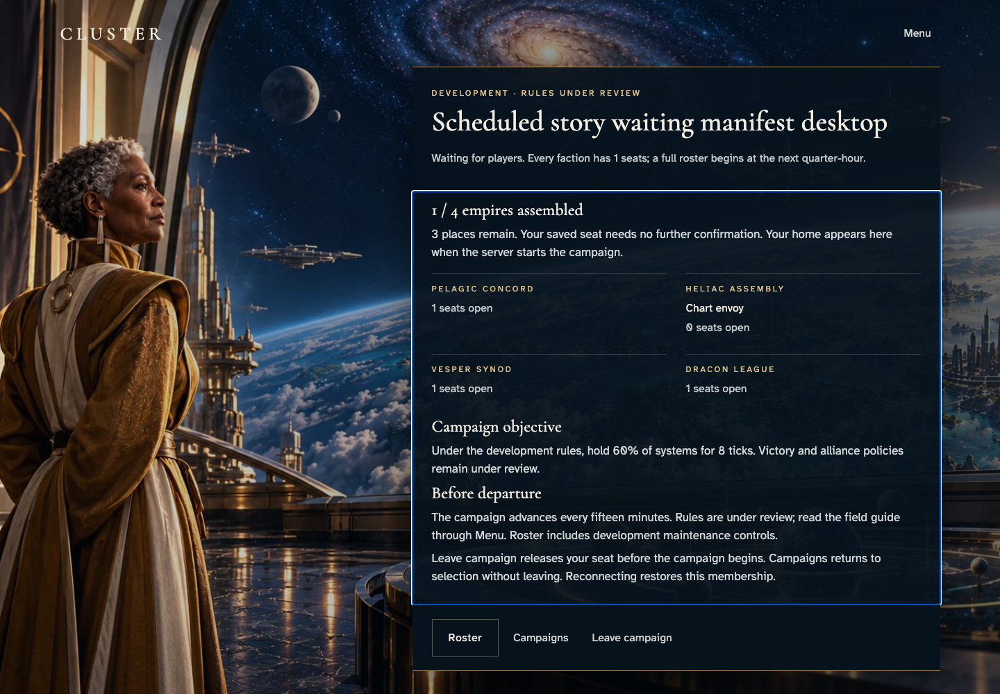
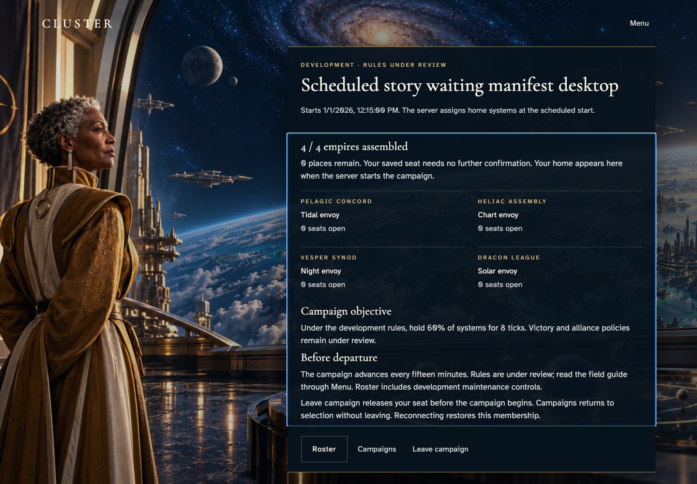
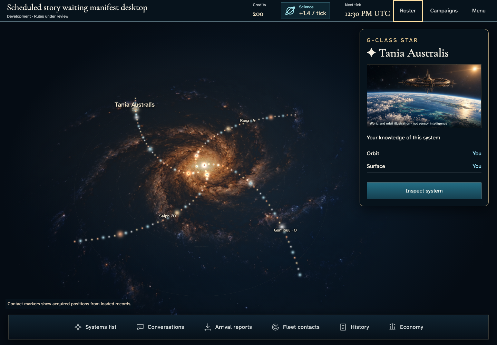
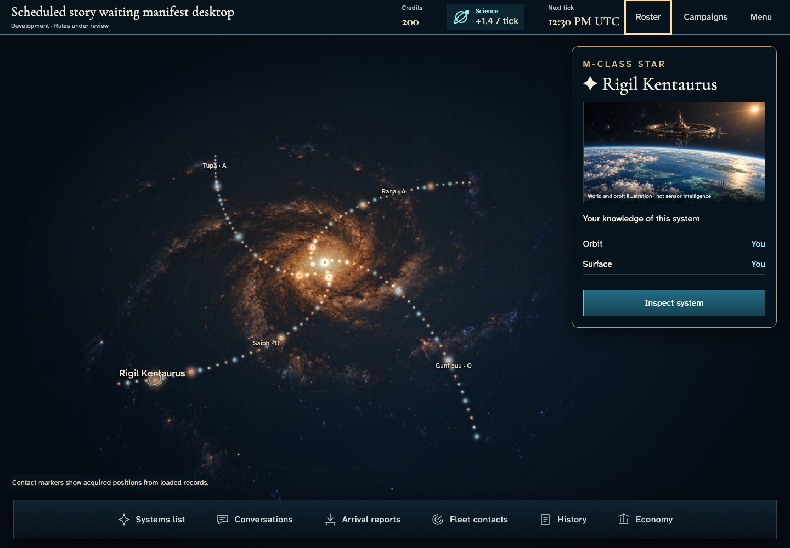

# Gather commanders and recover the same seat

**BASELINE CANDIDATES — generation, not verification.** desktop · darwin-arm64. Inventory: UX-02, UX-16.

Four ordinary authenticated players gather, recover a waiting membership and enter assigned homes after the real scheduler delivery. The demo catalogue/admission clock is a labelled harness; no state is injected.

## 1. Ordinary Google emulator sign-in and acknowledged identity save; development entitlement is a labelled fixture.

Actor: **Test harness**. **Harness control; not a player action.**

Acknowledged outcome: Explicit test control; not a player action or hosted-service certification.

## 2. Ordinary Google emulator sign-in and acknowledged identity save; development entitlement is a labelled fixture.

Actor: **Test harness**. **Harness control; not a player action.**

Acknowledged outcome: Explicit test control; not a player action or hosted-service certification.

## 3. Ordinary Google emulator sign-in and acknowledged identity save; development entitlement is a labelled fixture.

Actor: **Test harness**. **Harness control; not a player action.**

Acknowledged outcome: Explicit test control; not a player action or hosted-service certification.

## 4. Ordinary Google emulator sign-in and acknowledged identity save; development entitlement is a labelled fixture.

Actor: **Test harness**. **Harness control; not a player action.**

Acknowledged outcome: Explicit test control; not a player action or hosted-service certification.

## 5. Actual create/join controls and accepted seat; catalogue and admission time are fixed by the demo-only loader, never injected state.

Actor: **Test harness**. **Harness control; not a player action.**

Acknowledged outcome: Explicit test control; not a player action or hosted-service certification.

## 6. Reload the acknowledged membership without joining again; read named seats and remaining places.

Actor: **Chart envoy**.

Acknowledged outcome: Authorized manifest restores the saved roster and actual start condition.

- [x] Pre-start screen exposes no arbitrary world, home ownership or extra claim control.

### Viewpoint: Chart envoy

## 7. Actual create/join controls and accepted seat; catalogue and admission time are fixed by the demo-only loader, never injected state.

Actor: **Test harness**. **Harness control; not a player action.**

Acknowledged outcome: Explicit test control; not a player action or hosted-service certification.

## 8. Actual create/join controls and accepted seat; catalogue and admission time are fixed by the demo-only loader, never injected state.

Actor: **Test harness**. **Harness control; not a player action.**

Acknowledged outcome: Explicit test control; not a player action or hosted-service certification.

## 9. Actual create/join controls and accepted seat; catalogue and admission time are fixed by the demo-only loader, never injected state.

Actor: **Test harness**. **Harness control; not a player action.**

Acknowledged outcome: Explicit test control; not a player action or hosted-service certification.

## 10. The full actual roster schedules departure; no player starts the campaign manually.

Actor: **Chart envoy**.

Acknowledged outcome: Authorized manifest restores the saved roster and actual start condition.

- [x] Pre-start screen exposes no arbitrary world, home ownership or extra claim control.

### Viewpoint: Chart envoy

## 11. Deliver the real Scheduler HTTP request at the designated browser/domain boundary; no campaign or membership writes. This is not hosted cadence certification.

Actor: **Test harness**. **Harness control; not a player action.**

Acknowledged outcome: Explicit test control; not a player action or hosted-service certification.

## 12. The same campaign reveals a real home. Reload preserves that assignment and independent peer ownership.

Actor: **Chart envoy**.

Acknowledged outcome: Authorized active view has a home and no waiting manifest.

- [x] No new seat claim is offered after recovery.

### Viewpoint: Chart envoy

### Viewpoint: Tidal envoy

