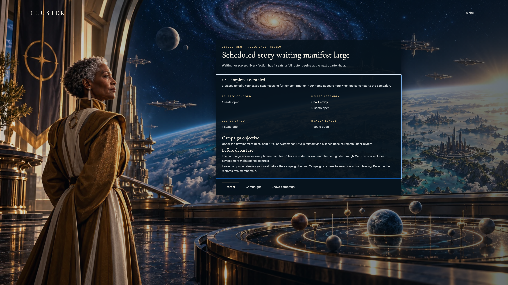
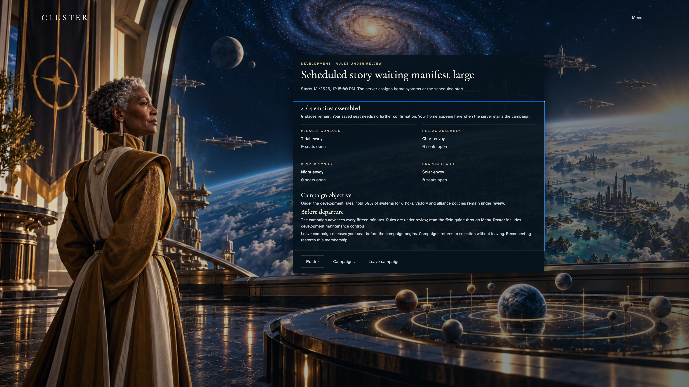
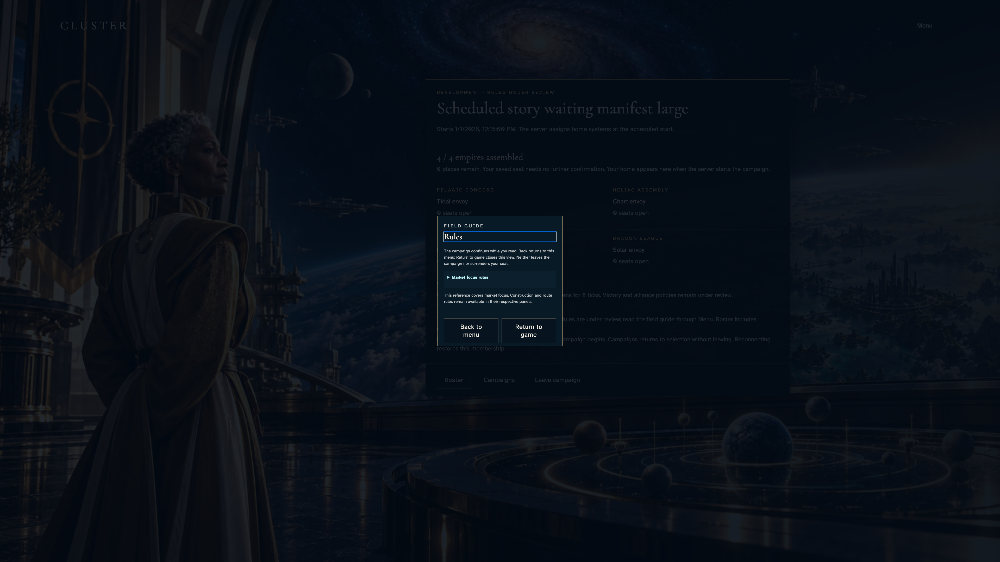
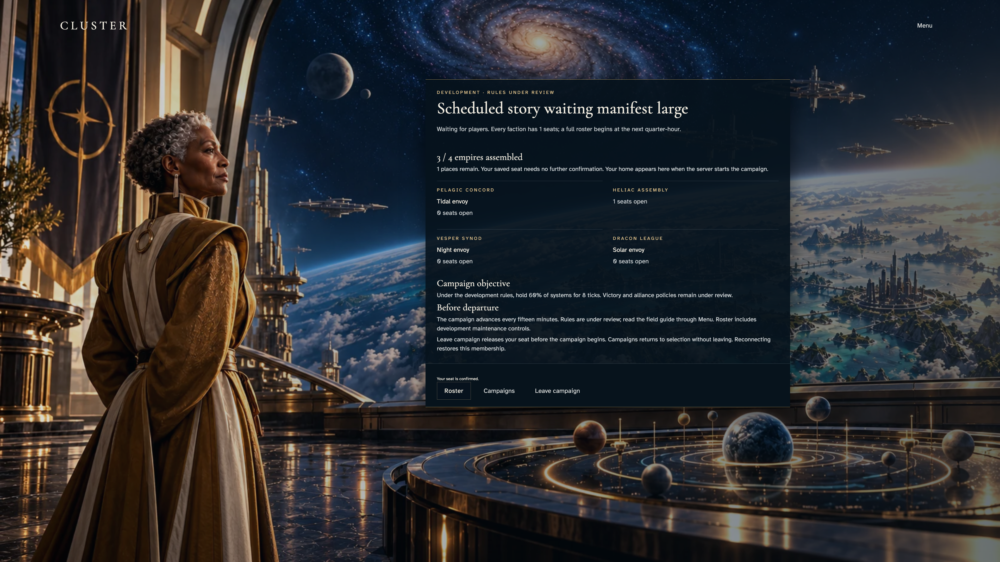
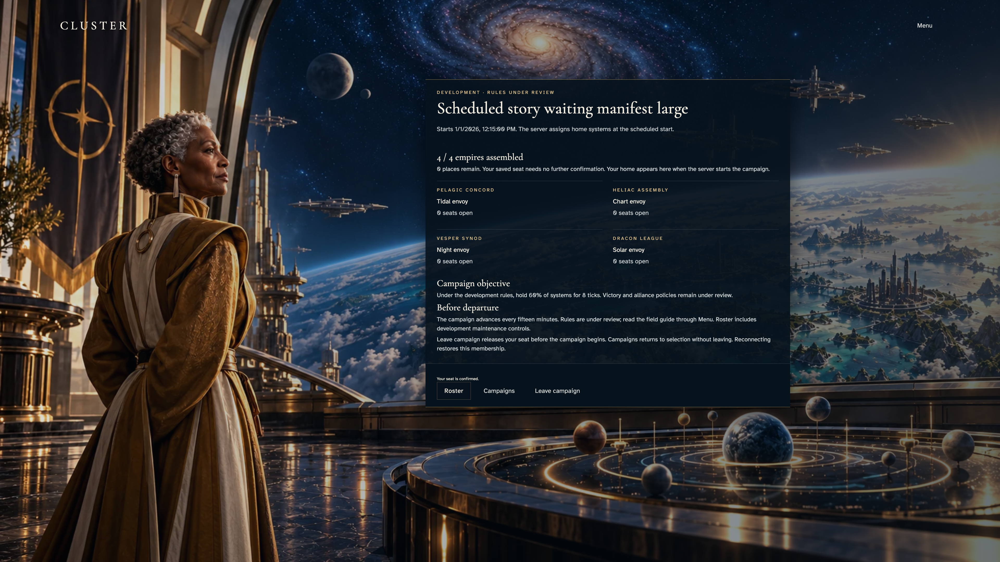
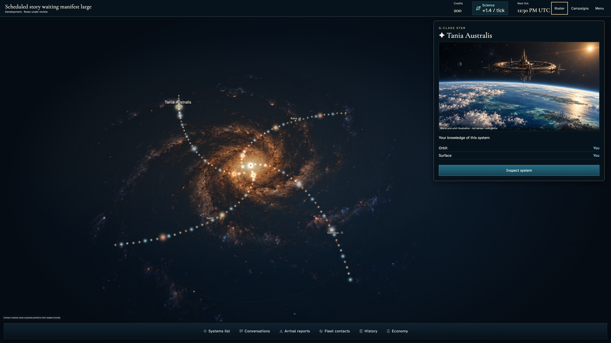
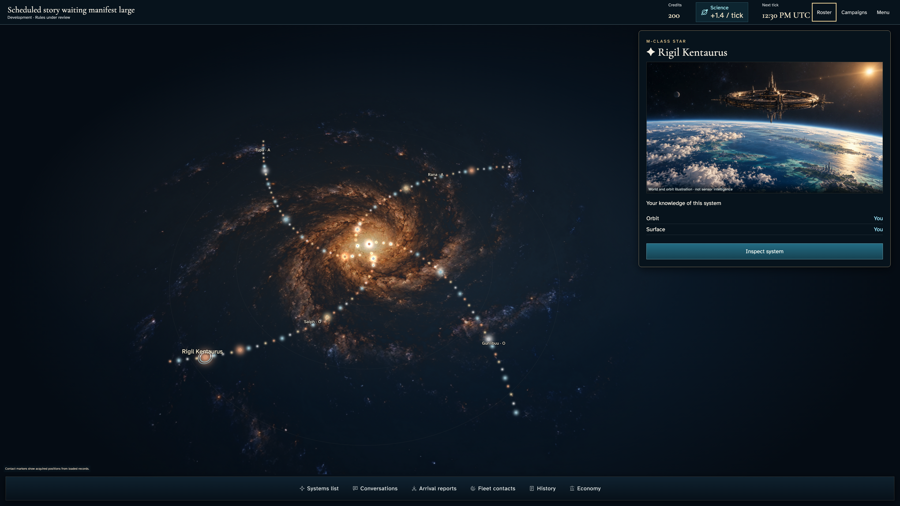

# Gather commanders and recover the same seat

**BASELINE CANDIDATES — generation, not verification.** large · darwin-arm64. Inventory: UX-02, UX-16.

Four ordinary authenticated players gather, recover a waiting membership and enter assigned homes after the real scheduler delivery. The demo catalogue/admission clock is a labelled harness; no state is injected.

## 1. Ordinary Google emulator sign-in and acknowledged identity save; development entitlement is a labelled fixture.

Actor: **Test harness**. **Harness control; not a player action.**

Acknowledged outcome: Explicit test control; not a player action or hosted-service certification.

## 2. Ordinary Google emulator sign-in and acknowledged identity save; development entitlement is a labelled fixture.

Actor: **Test harness**. **Harness control; not a player action.**

Acknowledged outcome: Explicit test control; not a player action or hosted-service certification.

## 3. Ordinary Google emulator sign-in and acknowledged identity save; development entitlement is a labelled fixture.

Actor: **Test harness**. **Harness control; not a player action.**

Acknowledged outcome: Explicit test control; not a player action or hosted-service certification.

## 4. Ordinary Google emulator sign-in and acknowledged identity save; development entitlement is a labelled fixture.

Actor: **Test harness**. **Harness control; not a player action.**

Acknowledged outcome: Explicit test control; not a player action or hosted-service certification.

## 5. Read-only corroboration: resolve actual emulator accounts by unique login email, mint their authenticated client sessions and use Firestore rules/campaignKey grants. No state writes or identity inference.

Actor: **Test harness**. **Harness control; not a player action.**

Acknowledged outcome: Explicit test control; not a player action or hosted-service certification.

## 6. Actual create/join controls and accepted seat; catalogue and admission time are fixed by the demo-only loader, never injected state.

Actor: **Test harness**. **Harness control; not a player action.**

Acknowledged outcome: Explicit test control; not a player action or hosted-service certification.

## 7. Reload the acknowledged membership without joining again; read named seats and remaining places.

Actor: **Chart envoy**.

Acknowledged outcome: Authorized manifest restores the saved roster and actual start condition.

- [x] Pre-start screen exposes no arbitrary world, home ownership or extra claim control.

### Viewpoint: Chart envoy

## 8. Actual create/join controls and accepted seat; catalogue and admission time are fixed by the demo-only loader, never injected state.

Actor: **Test harness**. **Harness control; not a player action.**

Acknowledged outcome: Explicit test control; not a player action or hosted-service certification.

## 9. Actual create/join controls and accepted seat; catalogue and admission time are fixed by the demo-only loader, never injected state.

Actor: **Test harness**. **Harness control; not a player action.**

Acknowledged outcome: Explicit test control; not a player action or hosted-service certification.

## 10. Actual create/join controls and accepted seat; catalogue and admission time are fixed by the demo-only loader, never injected state.

Actor: **Test harness**. **Harness control; not a player action.**

Acknowledged outcome: Explicit test control; not a player action or hosted-service certification.

## 11. The full actual roster schedules departure; no player starts the campaign manually.

Actor: **Chart envoy**.

Acknowledged outcome: Authorized manifest restores the saved roster and actual start condition.

- [x] Pre-start screen exposes no arbitrary world, home ownership or extra claim control.

### Viewpoint: Chart envoy

## 12. Keyboard-scroll the bounded manifest to the objective and Leave policy while actions remain contained.

Actor: **Chart envoy**.

Acknowledged outcome: Complete departure policy is readable without moving the document.

- [x] Keyboard focus remains in the reading region.

### Viewpoint: Chart envoy

## 13. Open shared Rules through Menu, then Escape back through the menu and restore the original opener.

Actor: **Chart envoy**.

Acknowledged outcome: Rules disclose proposed policy and preserve the campaign.

- [x] Rules takes heading focus and both return controls remain completely contained before capture.

### Viewpoint: Chart envoy

## 14. Ordinary Escape restores Rules, then Menu, without a server command.

Actor: **Test harness**. **Harness control; not a player action.**

Acknowledged outcome: Explicit test control; not a player action or hosted-service certification.

## 15. Leave before departure; the server releases this seat and cancels the full-roster schedule for the remaining player.

Actor: **Chart envoy**.

Acknowledged outcome: The Leave receipt is accepted and peer capacity updates.

- [x] The remaining authorized projection has one free place and no scheduled start; departed private read is denied.

### Viewpoint: Tidal envoy

## 16. Choose the released faction and submit a new ordinary admission; the actual full roster schedules departure again.

Actor: **Chart envoy**.

Acknowledged outcome: Server confirms rejoin and four occupied places.

- [x] One seat per authenticated commander and no home before start.

### Viewpoint: Chart envoy

## 17. Explicit normal-motion interaction check: enable no-preference before real scheduled transition; reduced capture metadata is restored only afterward.

Actor: **Test harness**. **Harness control; not a player action.**

Acknowledged outcome: Explicit test control; not a player action or hosted-service certification.

## 18. Deliver the real Scheduler HTTP request at the designated browser/domain boundary; no campaign or membership writes. This is not hosted cadence certification.

Actor: **Test harness**. **Harness control; not a player action.**

Acknowledged outcome: Explicit test control; not a player action or hosted-service certification.

## 19. The same campaign reveals a real home. Reload preserves that assignment and independent peer ownership.

Actor: **Chart envoy**.

Acknowledged outcome: Authorized active view has a home and no waiting manifest.

- [x] No new seat claim is offered after recovery.

### Viewpoint: Chart envoy

### Viewpoint: Tidal envoy

