# Review, join, recover and leave a waiting campaign

**BASELINE CANDIDATES — generation, not verification.** desktop · darwin-arm64. Inventory: UX-01, UX-02, UX-03, UX-14, UX-16.

A developer creates a real waiting campaign, reviews portrait/faction/briefing with a persistent commitment rail, joins and recovers that exact campaign through Play. Waiting membership never offers Continue. Seat release is acknowledged and survives reload. The catalogue seed is fixed by the emulator-only harness; no campaign state or tick is fabricated.

## 1. Prepare a saved commander identity through ordinary UI and grant explicit emulator developer access. The test loader fixes catalogue entropy only.

Actor: **Test harness**. **Harness control; not a player action.**

Acknowledged outcome: Explicit test control; not a player action or hosted-service certification.

## 2. Open campaign creation and name the four-empire development galaxy.

Actor: **Star envoy**.

Acknowledged outcome: The named proposal is ready to commit.

- [x] Create galaxy stays in the viewport before automatic scrolling.

### Viewpoint: Star envoy

[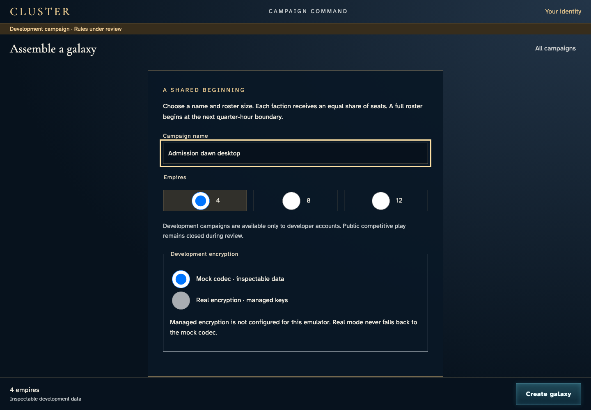](002-propose-campaign-1-star-envoy.png)

## 3. Create the galaxy and review its faction choice before claiming a seat.

Actor: **Star envoy**.

Acknowledged outcome: Campaign creation is acknowledged and faction selection opens.

- [x] The initial view contains all four choices, affinity matrix and Claim without automatic scrolling; longer reading remains bounded.

### Viewpoint: Star envoy

## 4. Review portraits and choose The emissary without leaving the visible seat commitment.

Actor: **Star envoy**.

Acknowledged outcome: The named portrait is selected.

- [x] Claim stays visible before scrolling.

### Viewpoint: Star envoy

[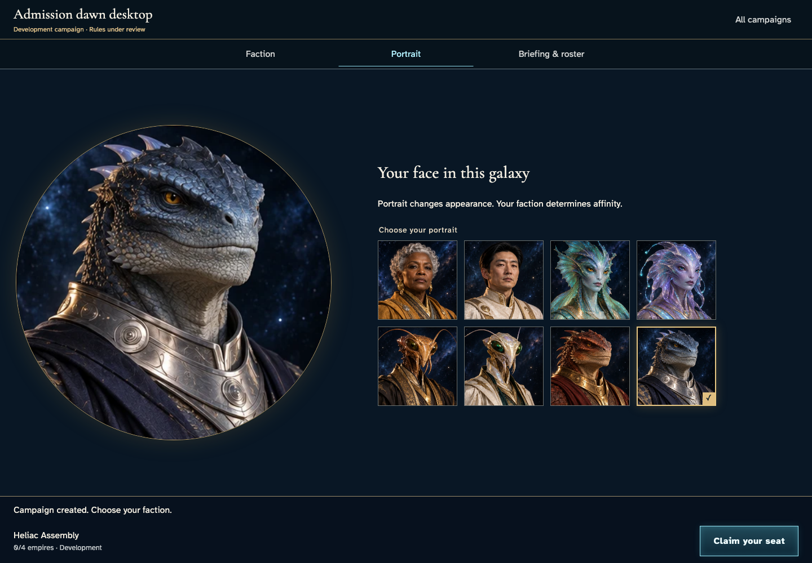](004-choose-portrait-1-star-envoy.png)

## 5. Return to the faction briefing while keeping the chosen portrait and commitment.

Actor: **Star envoy**.

Acknowledged outcome: Faction details are visible again.

- [x] Keyboard-selected Vesper and the complete four-class affinity matrix remain readable; no document scroll or seat claim occurs.

### Viewpoint: Star envoy

[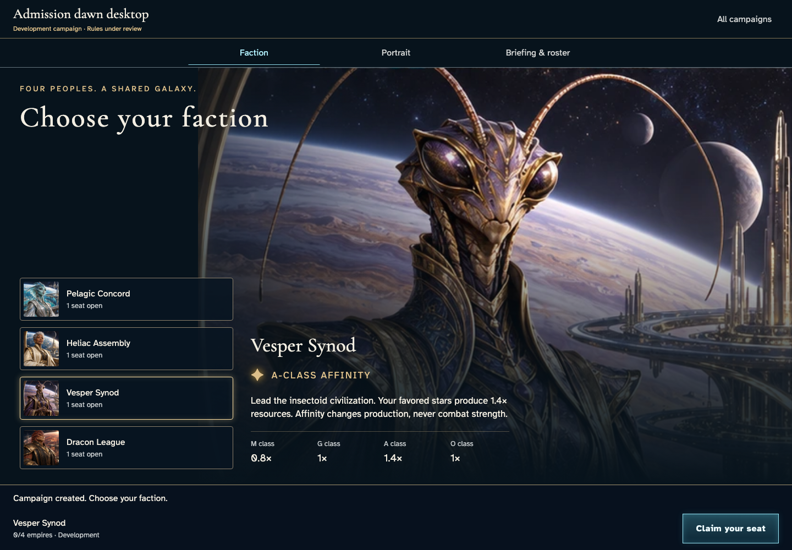](005-review-faction-1-star-envoy.png)

## 6. Read the campaign briefing and distinguish the shared-victory design from enabled development behavior.

Actor: **Star envoy**.

Acknowledged outcome: The briefing explicitly says victory evaluation is not enabled.

- [x] Claim remains visible while reviewing the briefing.

### Viewpoint: Star envoy

[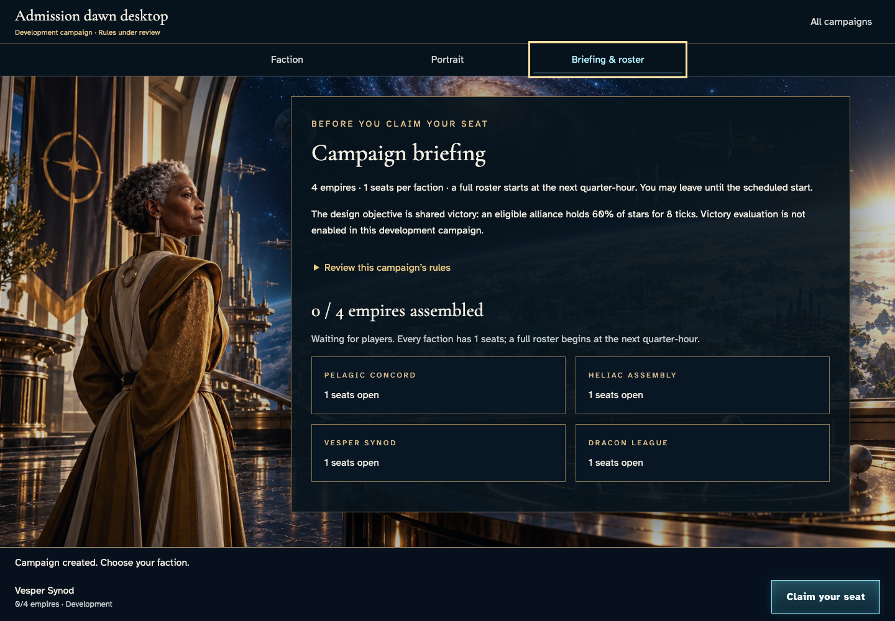](006-review-rules-1-star-envoy.png)

## 7. Open the actual rules with the keyboard, then read the last faction capacity inside the bounded campaign details. The selected faction and uncommitted seat remain unchanged.

Actor: **Star envoy**.

Acknowledged outcome: The real rules disclosure remains open; no seat has been claimed.

- [x] The final faction and capacity are fully readable, with the commitment and document position preserved.

### Viewpoint: Star envoy

[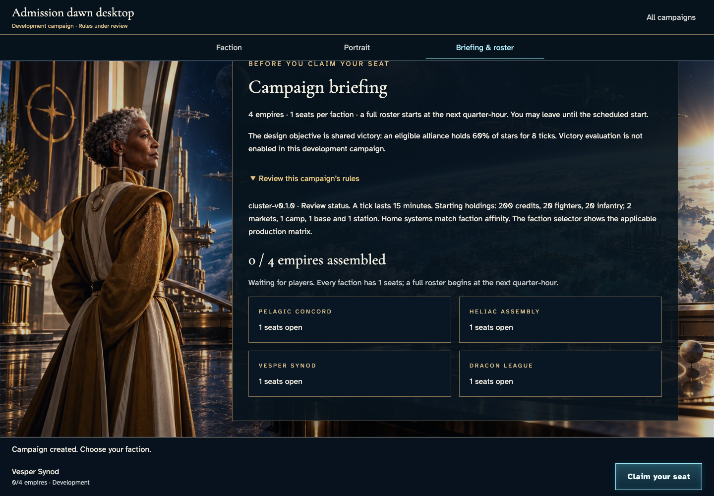](007-read-full-briefing-1-star-envoy.png)

## 8. Commit the seat and enter the authoritative waiting galaxy.

Actor: **Star envoy**.

Acknowledged outcome: The seat is confirmed and the one-member manifest preserves the waiting phase.

- [x] The campaign URL records its authoritative UUID.

### Viewpoint: Star envoy

[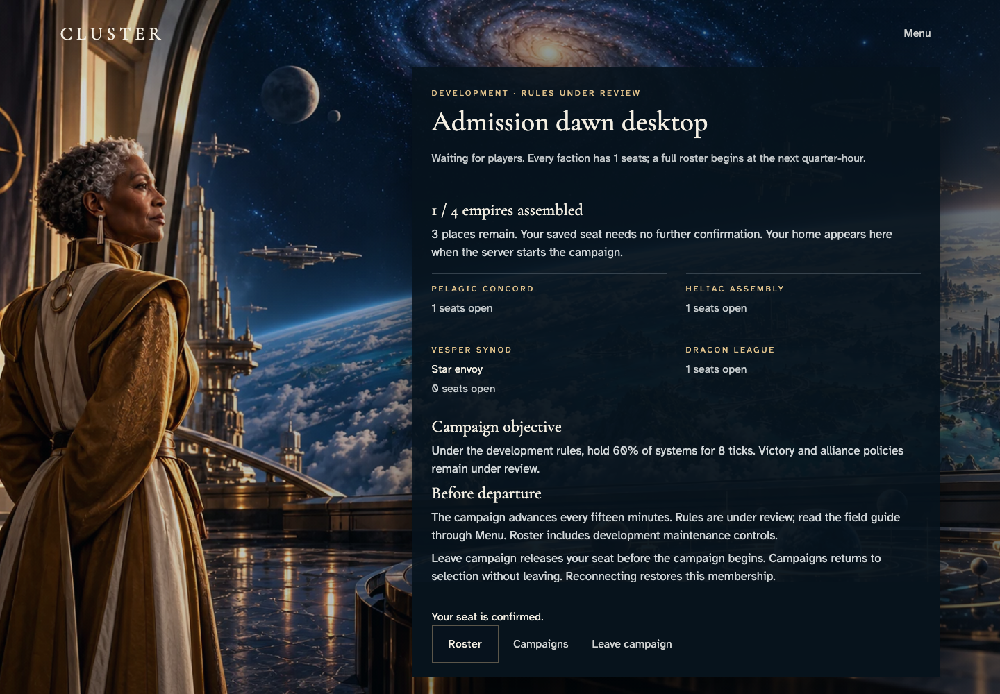](008-seat-confirmed-1-star-envoy.png)

## 9. Return to entry. A waiting membership remains accessible through Play and does not offer Continue.

Actor: **Star envoy**.

Acknowledged outcome: Play is available without an active-campaign Continue.

- [x] The campaign directory link is retained.

### Viewpoint: Star envoy

[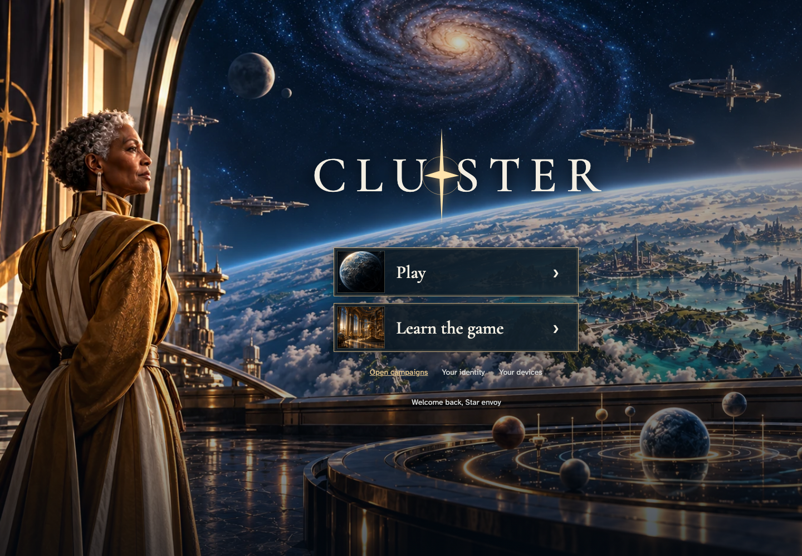](009-waiting-entry-1-star-envoy.png)

## 10. Open and close identity, returning keyboard focus to its entry control.

Actor: **Star envoy**.

Acknowledged outcome: Your identity regains focus.

- [x] The acknowledged navigation causes no uncaught application errors.

### Viewpoint: Star envoy

## 11. Use Play to review the joined waiting campaign by name.

Actor: **Star envoy**.

Acknowledged outcome: The joined campaign appears in the directory.

- [x] The directory reports exactly one joined membership.

### Viewpoint: Star envoy

[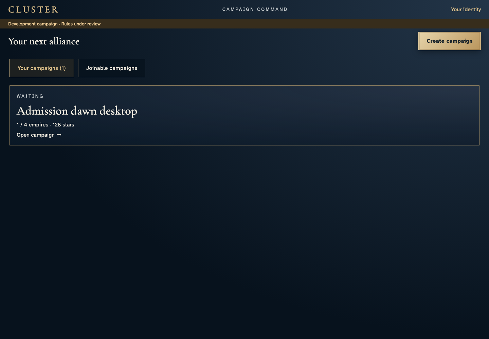](011-campaign-directory-1-star-envoy.png)

## 12. Select the named membership and recover its exact authoritative galaxy.

Actor: **Star envoy**.

Acknowledged outcome: The same campaign URL, named saved seat and waiting manifest recover.

- [x] The acknowledged navigation causes no uncaught application errors.

### Viewpoint: Star envoy

[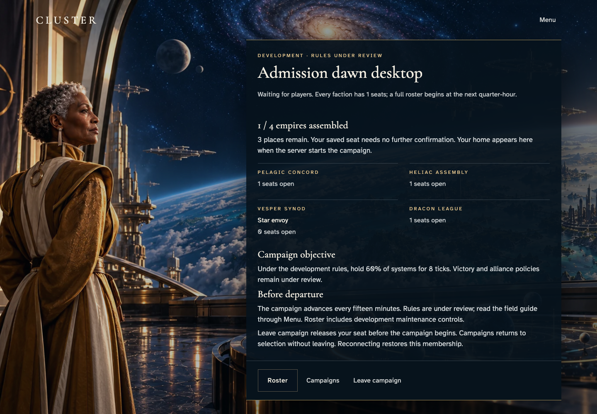](012-recover-exact-campaign-1-star-envoy.png)

## 13. Reload the waiting galaxy, recover its exact directory card through Campaigns and reopen its roster.

Actor: **Star envoy**.

Acknowledged outcome: The recovered roster permits leaving the waiting campaign.

- [x] Reload retains the exact campaign ID.

### Viewpoint: Star envoy

[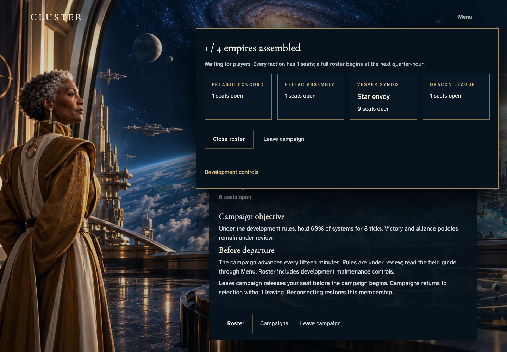](013-reload-membership-1-star-envoy.png)

## 14. Close the roster with Escape and retain its keyboard opening control.

Actor: **Star envoy**.

Acknowledged outcome: Roster regains keyboard focus.

- [x] The acknowledged navigation causes no uncaught application errors.

### Viewpoint: Star envoy

[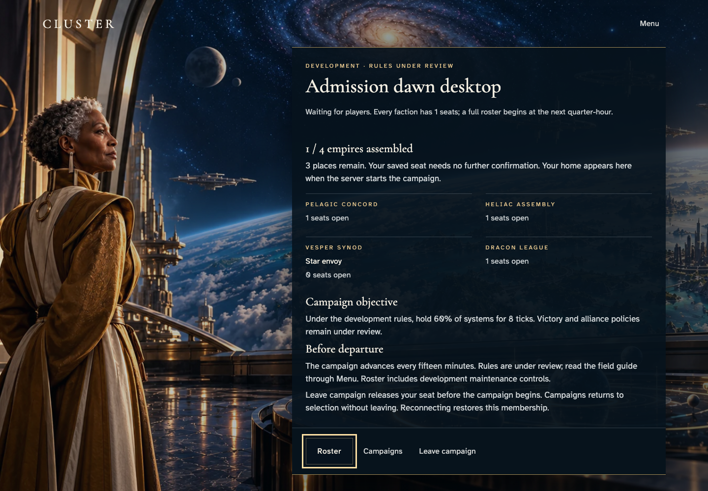](014-roster-focus-return-1-star-envoy.png)

## 15. Reopen the roster with Enter and release the waiting seat.

Actor: **Star envoy**.

Acknowledged outcome: Seat release is acknowledged and the member galaxy view closes.

- [x] One logical Leave has its matching accepted receipt; membership is absent and the retained protected view denies player access, with no involuntary-access error or retry remedy.
- [x] The ordinary journey has no uncaught page errors.

### Viewpoint: Star envoy

[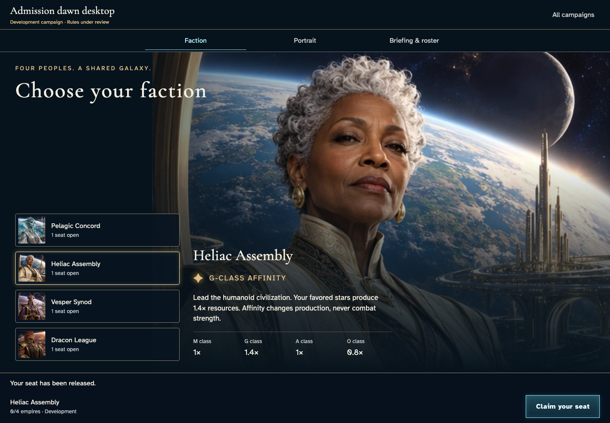](015-release-seat-1-star-envoy.png)

## 16. Reload entry and open Play again to confirm the released membership is absent.

Actor: **Star envoy**.

Acknowledged outcome: Your campaigns reports zero joined seats.

- [x] No uncaught page errors occurred.

### Viewpoint: Star envoy

[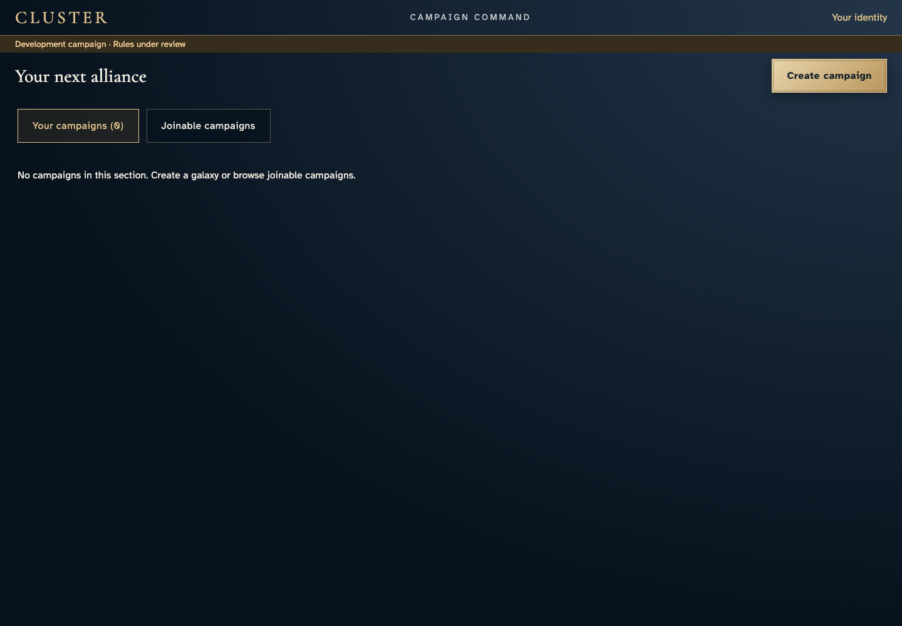](016-released-membership-reload-1-star-envoy.png)
