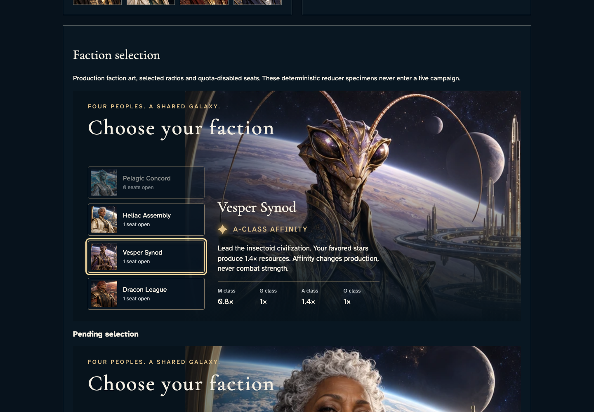

# Inspect the shared faction instrument

**BASELINE CANDIDATES — generation, not verification.** desktop · darwin-arm64. Inventory: UX-02, UX-03, UX-16.

The existing reducer-derived gallery roster exercises the real FactionPicker, art, radio controls and affinity matrix. It is a component demonstration, not a live seat or service acknowledgement. Live admission remains a separate genuine player journey.

## 1. Use the actual shared radios with reduce preference; full faction slots stay unavailable and the selected matrix comes from versioned rules.

Actor: **Component reviewer**.

Acknowledged outcome: The component acknowledges the keyboard selection without issuing a campaign command.

- [x] The full Pelagic quota is disabled, all four affinities remain present and the pending component retains disabled controls.

### Viewpoint: Component reviewer

## 2. Use the actual shared radios with no-preference preference; full faction slots stay unavailable and the selected matrix comes from versioned rules.

Actor: **Component reviewer**.

Acknowledged outcome: The component acknowledges the keyboard selection without issuing a campaign command.

- [x] The full Pelagic quota is disabled, all four affinities remain present and the pending component retains disabled controls.

### Viewpoint: Component reviewer

- [x] Normal-motion device preference; finite effects settled without fast-forward and exact pixels unchanged.

