# Plot, recover and follow an authoritative fleet arrival

Generated from complete four-size exact verification; regression evidence, not full design or release acceptance.

Four independent commanders enter through actual authenticated controls. Formation establishes a fleet; a route preview becomes an acknowledged departure and authoritative arrival. Owner and other-player views show private orders and outcomes. Fixed catalogue/domain clocks and semantic fleet-scan entropy identities are explicit harness controls; no scan outcome is injected. Development transport capacity and tick rules remain under review; this does not certify interrupted route-draft recovery, managed encryption or hosted scheduling.

phone: source 01adba341d607298a3b1c3f0c932c8024eddd466; dirty:true; spec tests/e2e/008-fleet-travel/fleet-travel.spec.ts; spec SHA256 439a5638421387793a54eac3c0867c708490e3554a0ab0358cde09db8ff389f9; platform linux-arm64.

desktop: source 01adba341d607298a3b1c3f0c932c8024eddd466; dirty:true; spec tests/e2e/008-fleet-travel/fleet-travel.spec.ts; spec SHA256 439a5638421387793a54eac3c0867c708490e3554a0ab0358cde09db8ff389f9; platform linux-arm64.

large: source 01adba341d607298a3b1c3f0c932c8024eddd466; dirty:true; spec tests/e2e/008-fleet-travel/fleet-travel.spec.ts; spec SHA256 439a5638421387793a54eac3c0867c708490e3554a0ab0358cde09db8ff389f9; platform linux-arm64.

short: source 01adba341d607298a3b1c3f0c932c8024eddd466; dirty:true; spec tests/e2e/008-fleet-travel/fleet-travel.spec.ts; spec SHA256 439a5638421387793a54eac3c0867c708490e3554a0ab0358cde09db8ff389f9; platform linux-arm64.

## 1. Ordinary emulator sign-in and identity save, with explicit developer entitlement and fixed browser Date; timers continue normally.

Actor: **Test harness**. Harness control; not a player action.

Acknowledged outcome: Explicit test control; not a player action or hosted-service certification.

## 2. Ordinary emulator sign-in and identity save, with explicit developer entitlement and fixed browser Date; timers continue normally.

Actor: **Test harness**. Harness control; not a player action.

Acknowledged outcome: Explicit test control; not a player action or hosted-service certification.

## 3. Ordinary emulator sign-in and identity save, with explicit developer entitlement and fixed browser Date; timers continue normally.

Actor: **Test harness**. Harness control; not a player action.

Acknowledged outcome: Explicit test control; not a player action or hosted-service certification.

## 4. Ordinary emulator sign-in and identity save, with explicit developer entitlement and fixed browser Date; timers continue normally.

Actor: **Test harness**. Harness control; not a player action.

Acknowledged outcome: Explicit test control; not a player action or hosted-service certification.

## 5. Create/join through ordinary campaign controls. Fixed catalogue and admission clock are test controls; no seat, message or command outcome is injected.

Actor: **Test harness**. Harness control; not a player action.

Acknowledged outcome: Explicit test control; not a player action or hosted-service certification.

## 6. Create/join through ordinary campaign controls. Fixed catalogue and admission clock are test controls; no seat, message or command outcome is injected.

Actor: **Test harness**. Harness control; not a player action.

Acknowledged outcome: Explicit test control; not a player action or hosted-service certification.

## 7. Create/join through ordinary campaign controls. Fixed catalogue and admission clock are test controls; no seat, message or command outcome is injected.

Actor: **Test harness**. Harness control; not a player action.

Acknowledged outcome: Explicit test control; not a player action or hosted-service certification.

## 8. Create/join through ordinary campaign controls. Fixed catalogue and admission clock are test controls; no seat, message or command outcome is injected.

Actor: **Test harness**. Harness control; not a player action.

Acknowledged outcome: Explicit test control; not a player action or hosted-service certification.

## 9. Advance the designated browser/domain clock to 12:15 UTC and deliver the actual emulator Scheduler HTTP request. This does not certify hosted scheduling.

Actor: **Test harness**. Harness control; not a player action.

Acknowledged outcome: Explicit test control; not a player action or hosted-service certification.

## 10. Open each commander's own fleet preparation. Enter two fighters and an over-capacity infantry complement before committing anything.

Actor: **Fleet marshal**.

Acknowledged outcome: The actual capacity constraint disables formation without a command.

- [x] Both fixed action rails are visible before scrolling and no application error occurred.

- [x] Other commanders have no owner fleet, private order or ledger in their actual member projections.

- [x] Invalid input does not change canonical state or reserve forces.

### phone — Fleet marshal

[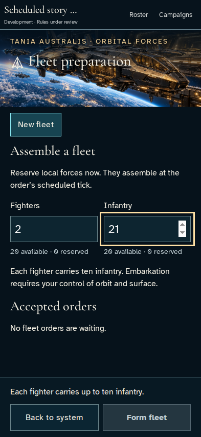](../../screenshots/live-fleet-travel/phone/linux-arm64/010-inspect-formation-1-fleet-marshal.png)

### phone — Independent marshal

### desktop — Fleet marshal

[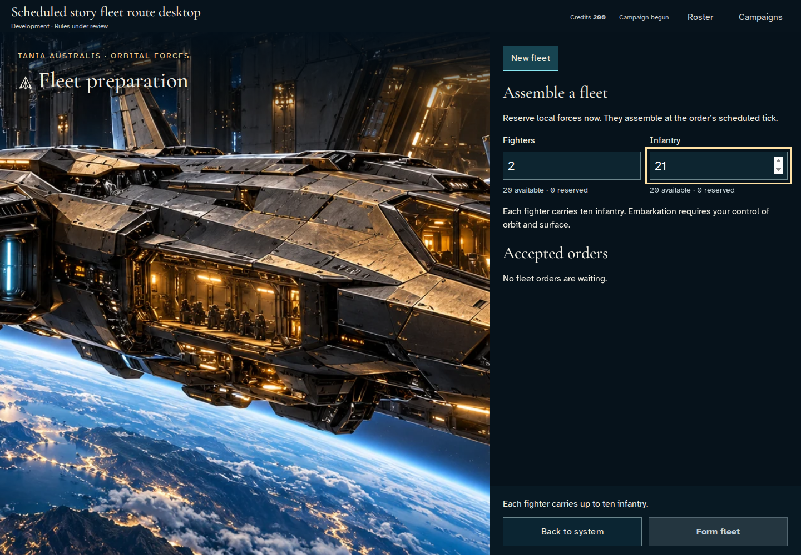](../../screenshots/live-fleet-travel/desktop/linux-arm64/010-inspect-formation-1-fleet-marshal.png)

### desktop — Independent marshal

### large — Fleet marshal

[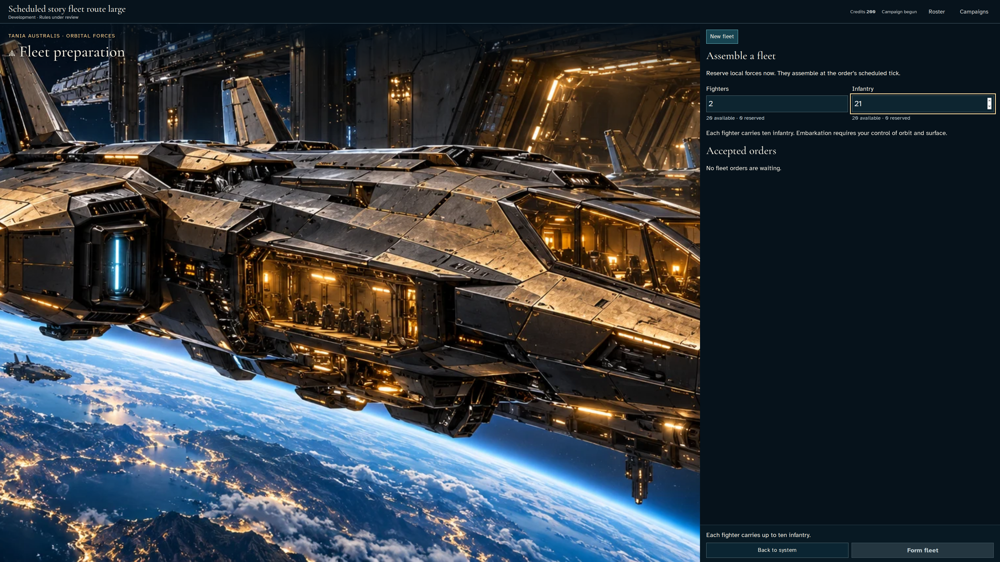](../../screenshots/live-fleet-travel/large/linux-arm64/010-inspect-formation-1-fleet-marshal.png)

### large — Independent marshal

### short — Fleet marshal

[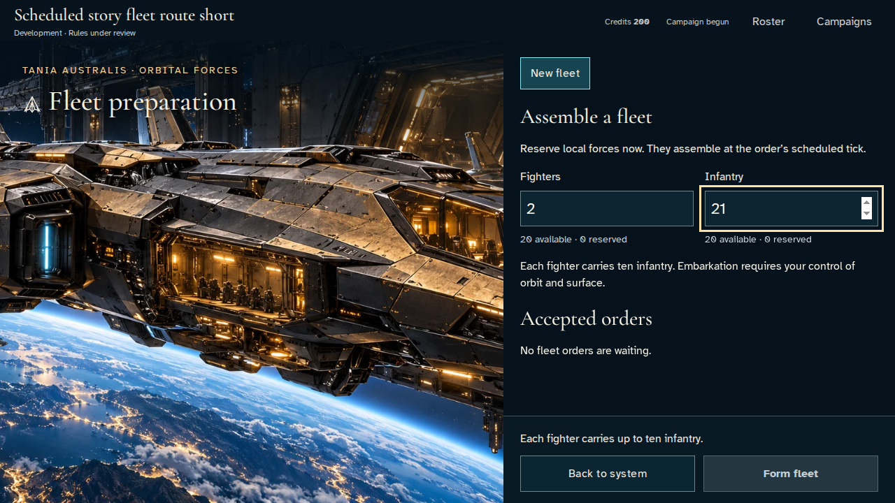](../../screenshots/live-fleet-travel/short/linux-arm64/010-inspect-formation-1-fleet-marshal.png)

### short — Independent marshal

## 11. Reduce infantry to the supported twenty and inspect the ready formation.

Actor: **Fleet marshal**.

Acknowledged outcome: Formation is enabled and focused for keyboard confirmation.

- [x] Both fixed action rails are visible before scrolling and no application error occurred.

- [x] Other commanders have no owner fleet, private order or ledger in their actual member projections.

### phone — Fleet marshal

[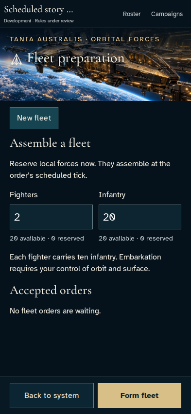](../../screenshots/live-fleet-travel/phone/linux-arm64/011-choose-complement-1-fleet-marshal.png)

### phone — Independent marshal

[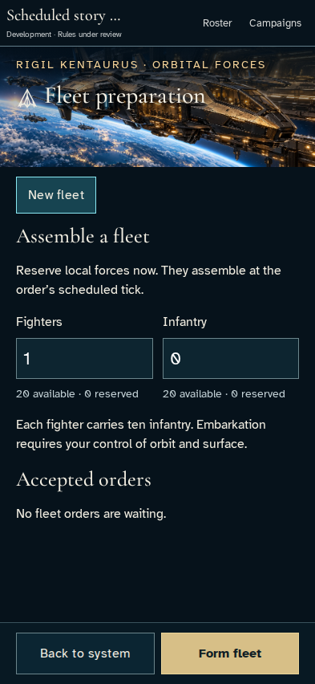](../../screenshots/live-fleet-travel/phone/linux-arm64/011-choose-complement-2-independent-marshal.png)

### desktop — Fleet marshal

[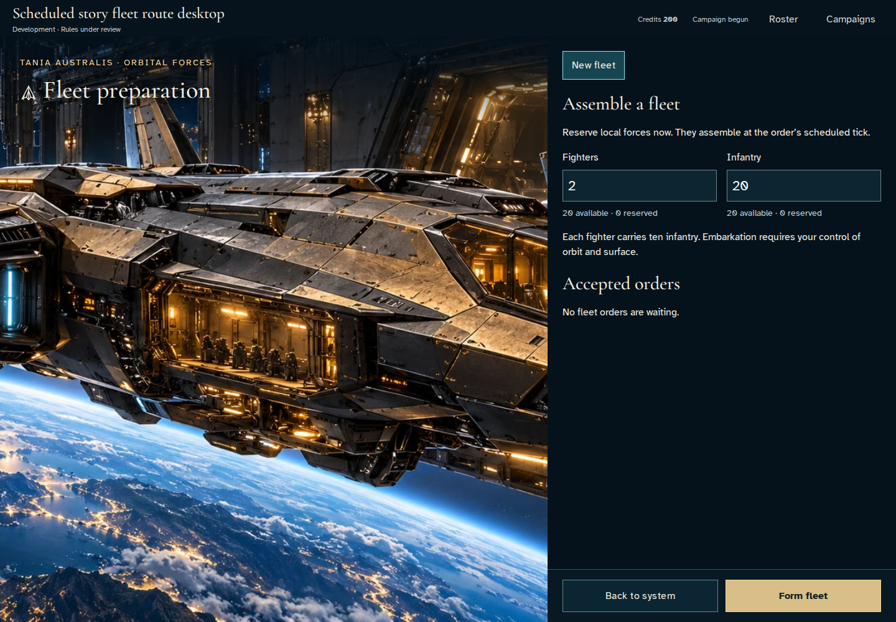](../../screenshots/live-fleet-travel/desktop/linux-arm64/011-choose-complement-1-fleet-marshal.png)

### desktop — Independent marshal

### large — Fleet marshal

### large — Independent marshal

### short — Fleet marshal

### short — Independent marshal

## 12. Confirm formation with Enter. The authoritative receipt reserves two fighters and twenty infantry for tick one, without moving them yet.

Actor: **Fleet marshal**.

Acknowledged outcome: The service acknowledges the formation and publishes its exact waiting complement.

- [x] Both fixed action rails are visible before scrolling and no application error occurred.

- [x] Other commanders have no owner fleet, private order or ledger in their actual member projections.

- [x] One accepted receipt and revision reserve the original forces without creating a fleet or moving the garrison.

### phone — Fleet marshal

[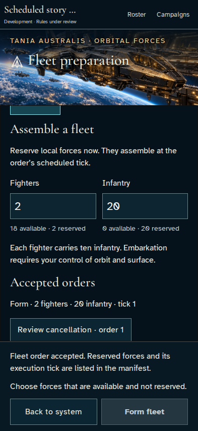](../../screenshots/live-fleet-travel/phone/linux-arm64/012-reserve-formation-1-fleet-marshal.png)

### phone — Independent marshal

### desktop — Fleet marshal

[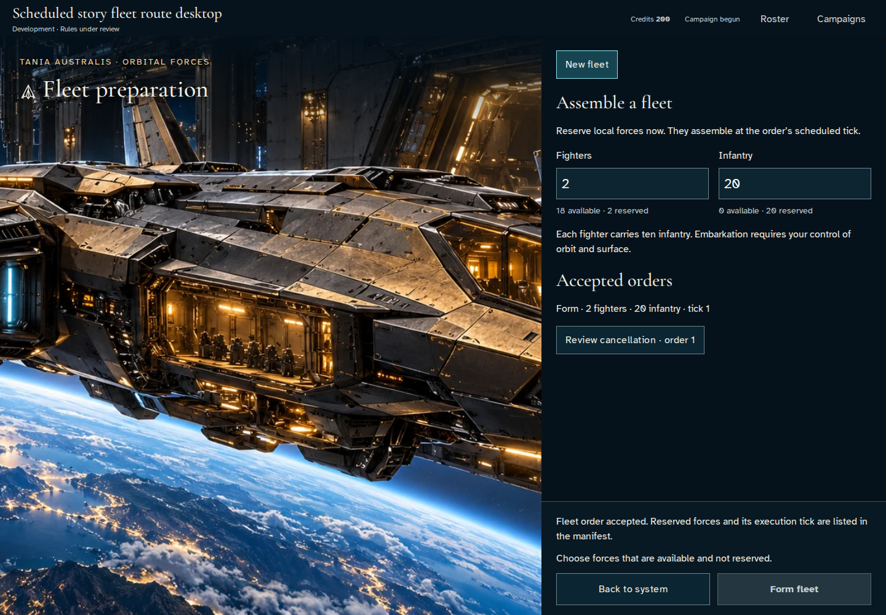](../../screenshots/live-fleet-travel/desktop/linux-arm64/012-reserve-formation-1-fleet-marshal.png)

### desktop — Independent marshal

### large — Fleet marshal

[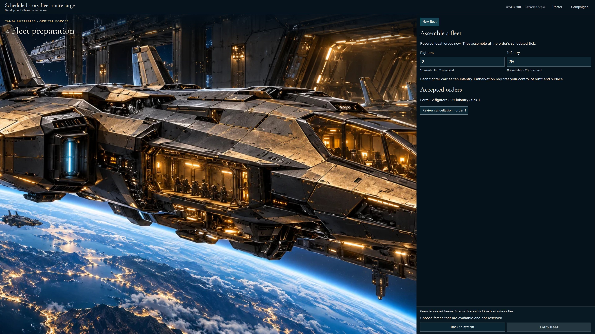](../../screenshots/live-fleet-travel/large/linux-arm64/012-reserve-formation-1-fleet-marshal.png)

### large — Independent marshal

### short — Fleet marshal

[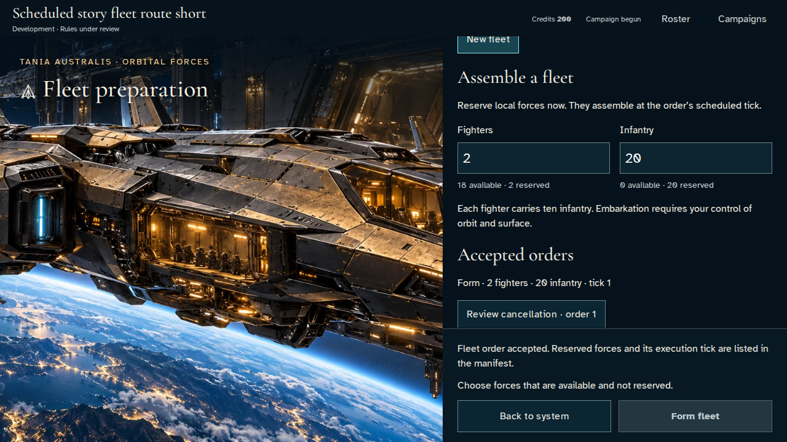](../../screenshots/live-fleet-travel/short/linux-arm64/012-reserve-formation-1-fleet-marshal.png)

### short — Independent marshal

## 13. Reload the owner account and reopen its exact campaign's home-system fleet panel.

Actor: **Fleet marshal**.

Acknowledged outcome: The same accepted order and reserved complement return from persistence.

- [x] Both fixed action rails are visible before scrolling and no application error occurred.

- [x] Other commanders have no owner fleet, private order or ledger in their actual member projections.

- [x] Reload adds no revision, order or effect.

### phone — Fleet marshal

[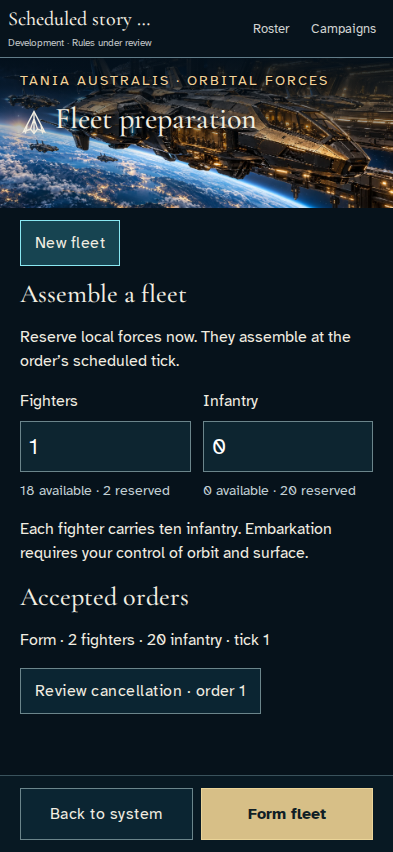](../../screenshots/live-fleet-travel/phone/linux-arm64/013-reload-formation-1-fleet-marshal.png)

### phone — Independent marshal

### desktop — Fleet marshal

[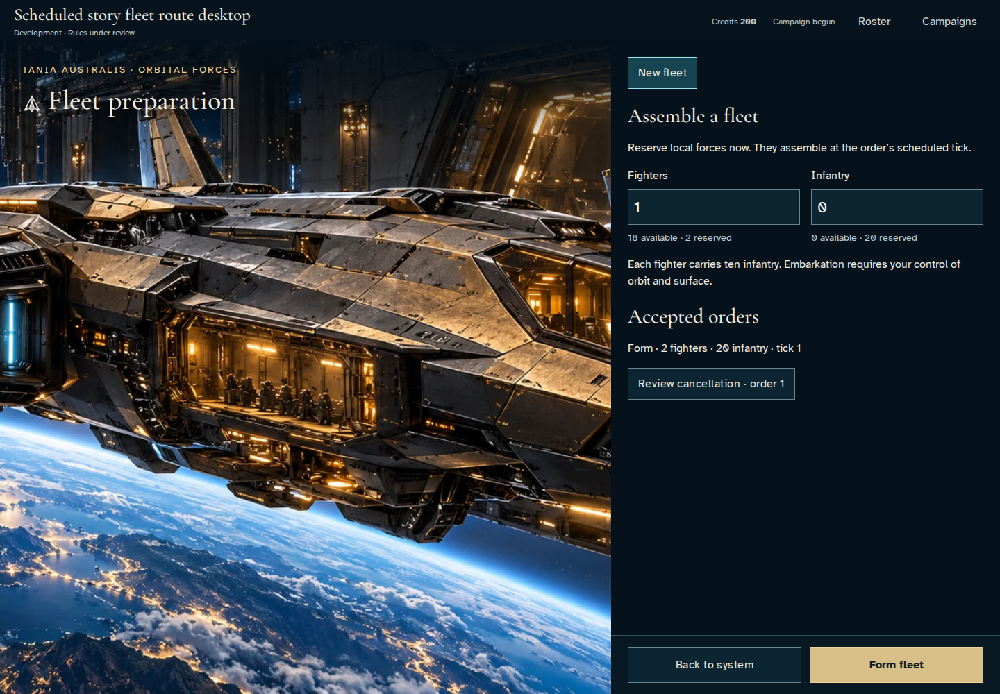](../../screenshots/live-fleet-travel/desktop/linux-arm64/013-reload-formation-1-fleet-marshal.png)

### desktop — Independent marshal

### large — Fleet marshal

### large — Independent marshal

### short — Fleet marshal

[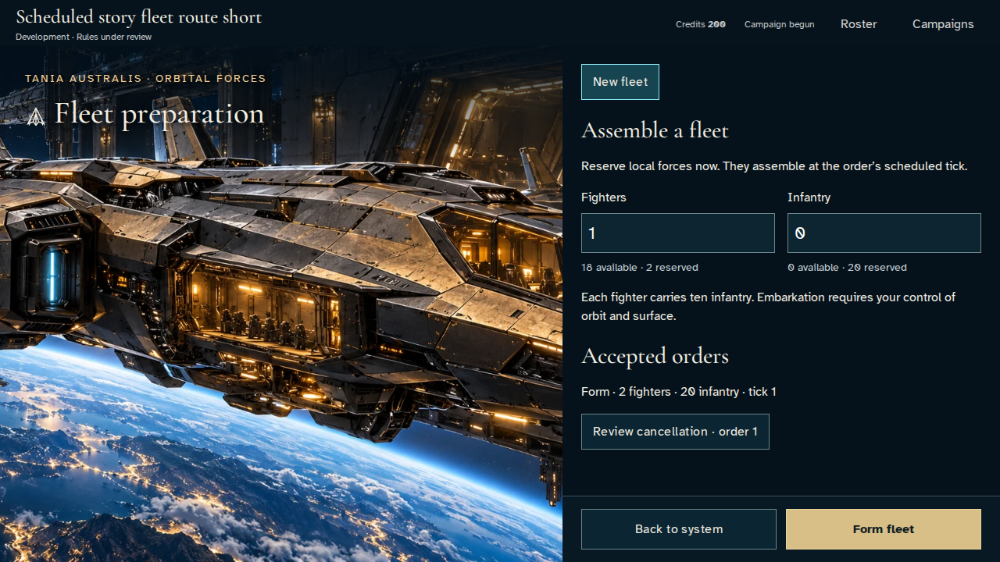](../../screenshots/live-fleet-travel/short/linux-arm64/013-reload-formation-1-fleet-marshal.png)

### short — Independent marshal

## 14. Advance the explicit domain clock once and invoke the real leased tick service. Repeat delivery must do no work; no fleet or outcome is injected.

Actor: **Test harness**. Harness control; not a player action.

Acknowledged outcome: Explicit test control; not a player action or hosted-service certification.

## 15. Read the authoritative formation result and select the new fleet with the keyboard. The other commander still sees only their own forces.

Actor: **Fleet marshal**.

Acknowledged outcome: The confirmed fleet contains two fighters and twenty infantry and can be disbanded.

- [x] Both fixed action rails are visible before scrolling and no application error occurred.

- [x] Other commanders have no owner fleet, private order or ledger in their actual member projections.

- [x] Units move from garrison to exactly one fleet; only this tick's recorded production changes empire totals.

### phone — Fleet marshal

[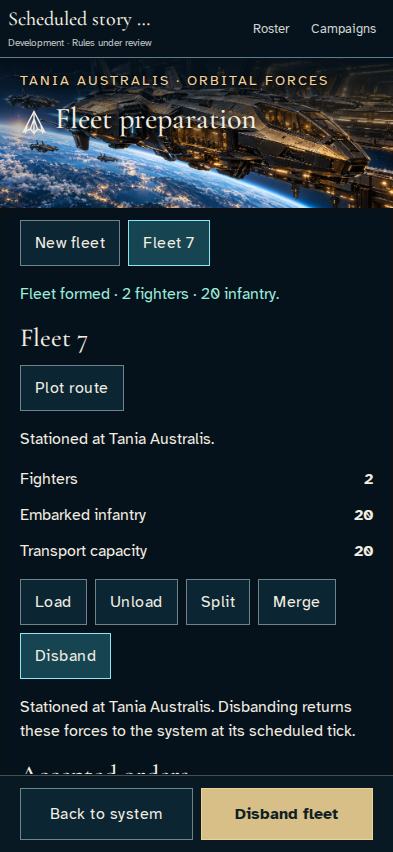](../../screenshots/live-fleet-travel/phone/linux-arm64/015-formed-fleet-1-fleet-marshal.png)

### phone — Independent marshal

### desktop — Fleet marshal

### desktop — Independent marshal

### large — Fleet marshal

### large — Independent marshal

### short — Fleet marshal

[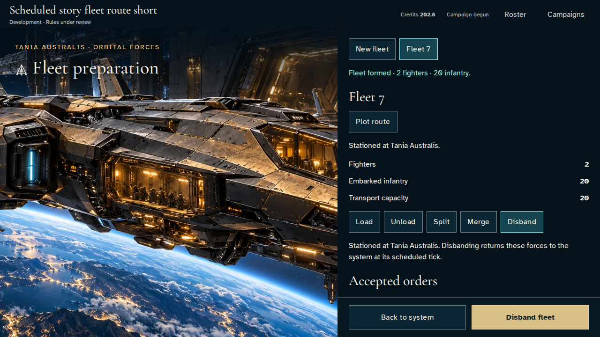](../../screenshots/live-fleet-travel/short/linux-arm64/015-formed-fleet-1-fleet-marshal.png)

### short — Independent marshal

## 16. Open the fleet route planner with the keyboard. Range limits each leg; speed determines its travel duration.

Actor: **Fleet marshal**.

Acknowledged outcome: The real route details gain focus and show distinct range and speed.

- [x] The route commitment rail is visible before scrolling, and other commanders receive no private route, fleet complement or arrival report.

### phone — Fleet marshal

[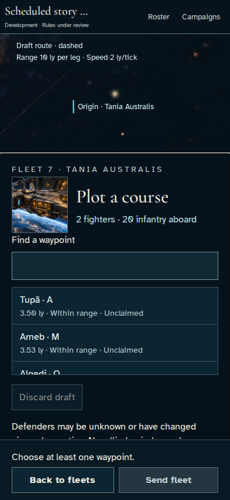](../../screenshots/live-fleet-travel/phone/linux-arm64/016-open-route-1-fleet-marshal.png)

### phone — Independent marshal

### desktop — Fleet marshal

[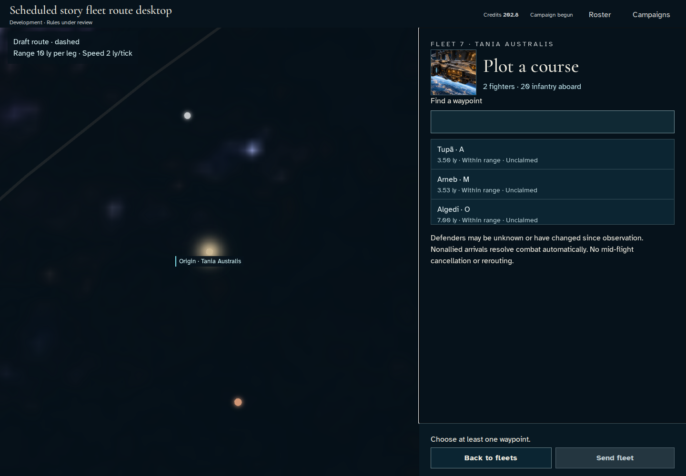](../../screenshots/live-fleet-travel/desktop/linux-arm64/016-open-route-1-fleet-marshal.png)

### desktop — Independent marshal

### large — Fleet marshal

[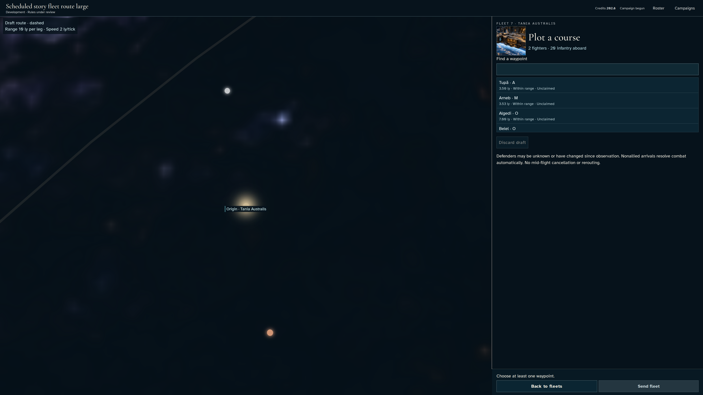](../../screenshots/live-fleet-travel/large/linux-arm64/016-open-route-1-fleet-marshal.png)

### large — Independent marshal

### short — Fleet marshal

[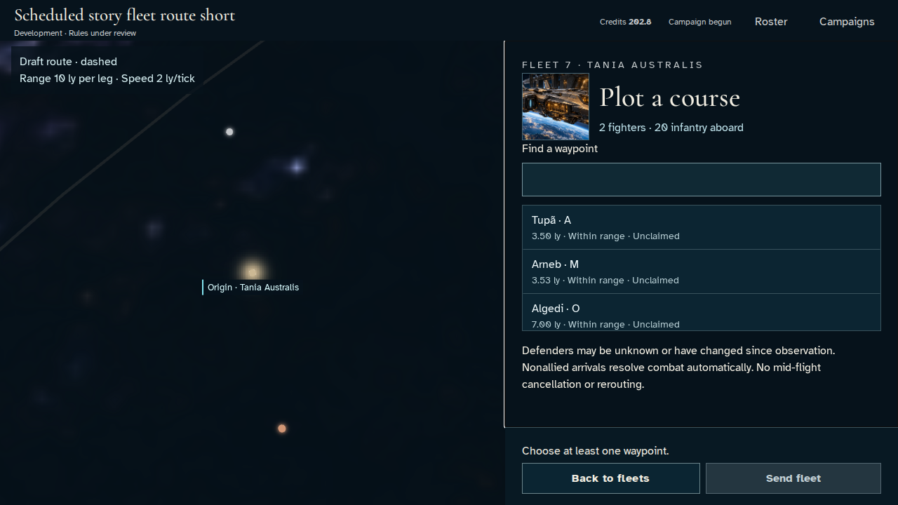](../../screenshots/live-fleet-travel/short/linux-arm64/016-open-route-1-fleet-marshal.png)

### short — Independent marshal

## 17. Select the nearest displayed within-range destination through its ordinary catalogue control and read the route preview.

Actor: **Fleet marshal**.

Acknowledged outcome: A draft leg shows catalogue distance and speed-derived duration, and enables commitment.

- [x] The route commitment rail is visible before scrolling, and other commanders receive no private route, fleet complement or arrival report.

- [x] Preview adds no command or movement; exact public coordinates satisfy range independently of the speed-derived tick count.

### phone — Fleet marshal

### phone — Independent marshal

### desktop — Fleet marshal

[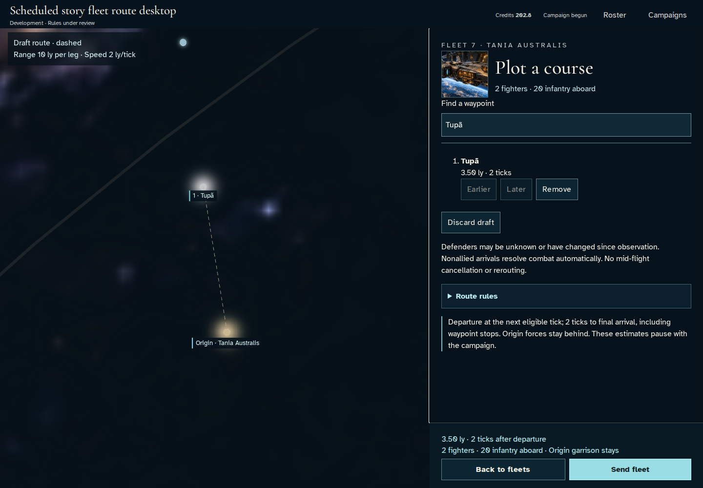](../../screenshots/live-fleet-travel/desktop/linux-arm64/017-choose-waypoint-1-fleet-marshal.png)

### desktop — Independent marshal

### large — Fleet marshal

[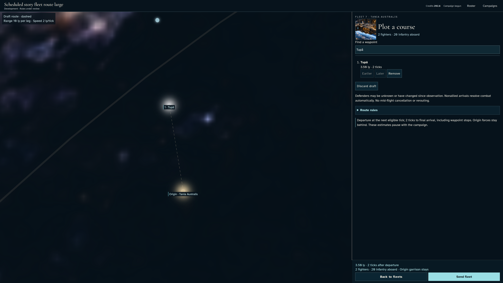](../../screenshots/live-fleet-travel/large/linux-arm64/017-choose-waypoint-1-fleet-marshal.png)

### large — Independent marshal

### short — Fleet marshal

[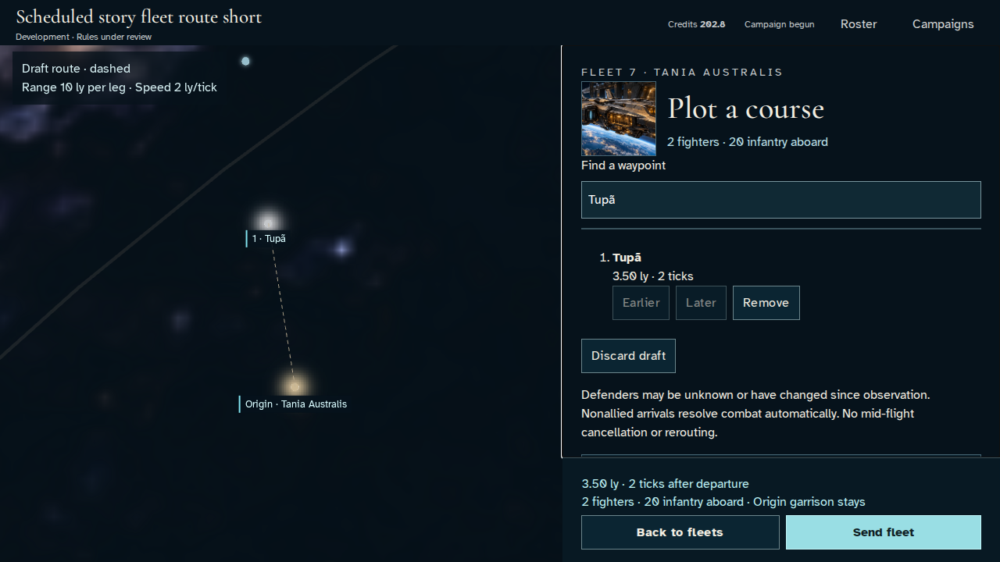](../../screenshots/live-fleet-travel/short/linux-arm64/017-choose-waypoint-1-fleet-marshal.png)

### short — Independent marshal

## 18. Add a displayed beyond-range waypoint. Inspect the range remedy before issuing any route.

Actor: **Fleet marshal**.

Acknowledged outcome: The out-of-range leg disables Send fleet with a specific range remedy.

- [x] The route commitment rail is visible before scrolling, and other commanders receive no private route, fleet complement or arrival report.

- [x] Invalid routing preserves the exact canonical forces and orders.

### phone — Fleet marshal

[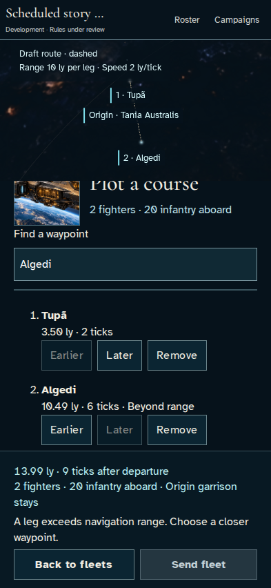](../../screenshots/live-fleet-travel/phone/linux-arm64/018-reject-distant-leg-1-fleet-marshal.png)

### phone — Independent marshal

### desktop — Fleet marshal

[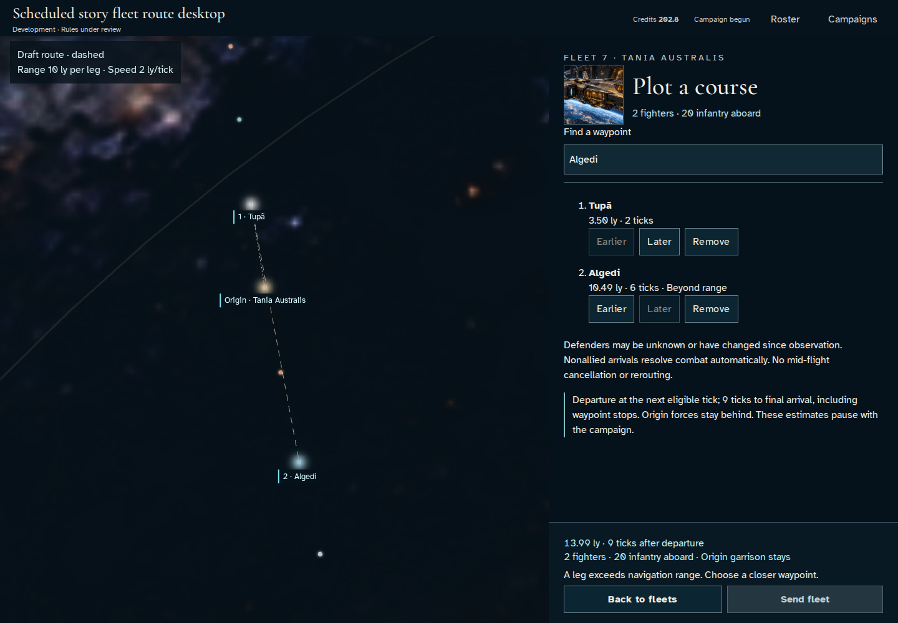](../../screenshots/live-fleet-travel/desktop/linux-arm64/018-reject-distant-leg-1-fleet-marshal.png)

### desktop — Independent marshal

### large — Fleet marshal

[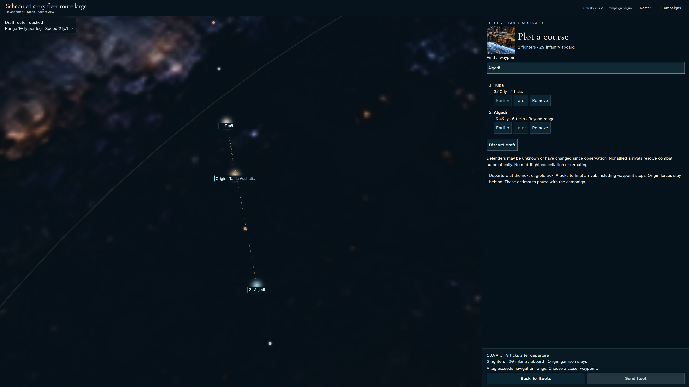](../../screenshots/live-fleet-travel/large/linux-arm64/018-reject-distant-leg-1-fleet-marshal.png)

### large — Independent marshal

### short — Fleet marshal

[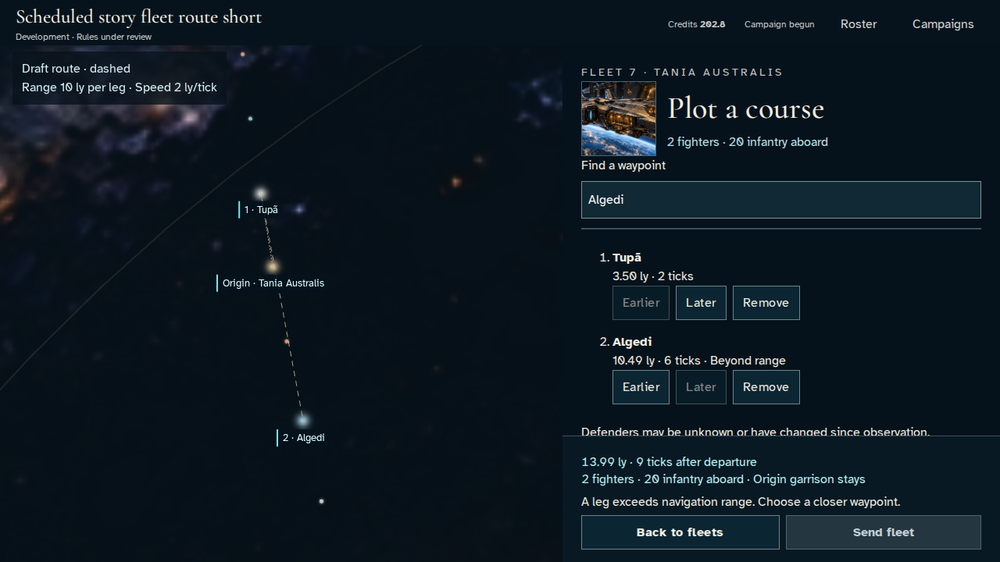](../../screenshots/live-fleet-travel/short/linux-arm64/018-reject-distant-leg-1-fleet-marshal.png)

### short — Independent marshal

## 19. Reorder the distant leg with keyboard controls, restore its position, then remove it. Return to fleets and reopen the planner to retain the valid draft.

Actor: **Fleet marshal**.

Acknowledged outcome: The retained single-leg draft is ready for keyboard commitment.

- [x] The route commitment rail is visible before scrolling, and other commanders receive no private route, fleet complement or arrival report.

### phone — Fleet marshal

[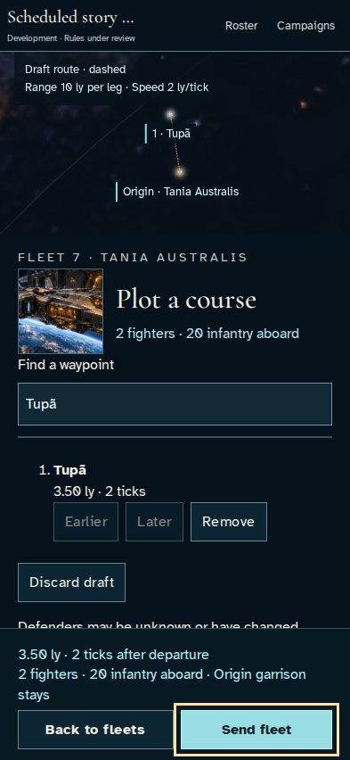](../../screenshots/live-fleet-travel/phone/linux-arm64/019-repair-route-1-fleet-marshal.png)

### phone — Independent marshal

### desktop — Fleet marshal

### desktop — Independent marshal

### large — Fleet marshal

[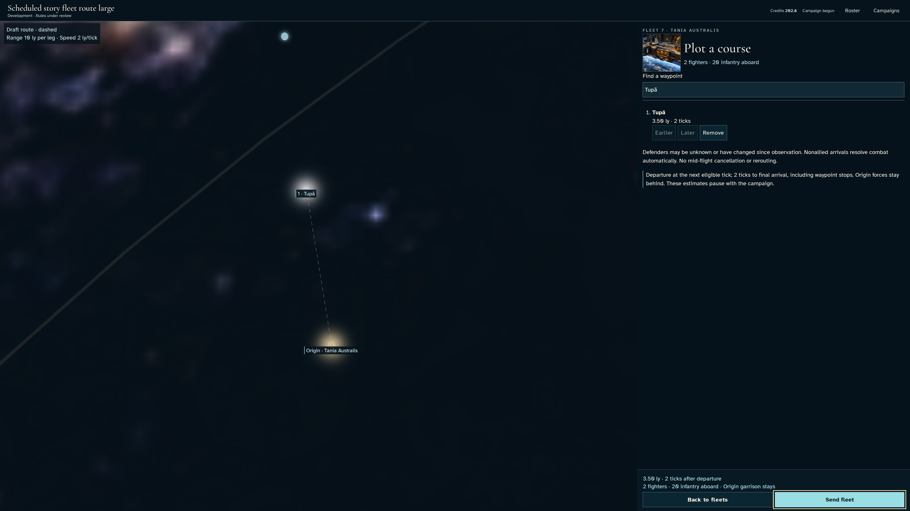](../../screenshots/live-fleet-travel/large/linux-arm64/019-repair-route-1-fleet-marshal.png)

### large — Independent marshal

### short — Fleet marshal

[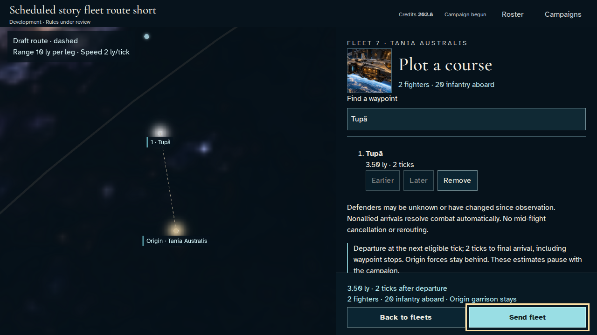](../../screenshots/live-fleet-travel/short/linux-arm64/019-repair-route-1-fleet-marshal.png)

### short — Independent marshal

## 20. Read the route rules beside the unsent plan. Range and speed are distinct; opening help does not pause the campaign or send the fleet.

Actor: **Fleet marshal**.

Acknowledged outcome: The contextual guide expands through keyboard input and explains actual shared range, speed and proposed development rules.

- [x] The route commitment rail is visible before scrolling, and other commanders receive no private route, fleet complement or arrival report.

- [x] The reading panel remains bounded, and help changes neither the exact unsent route nor the complete authoritative state.

### phone — Fleet marshal

[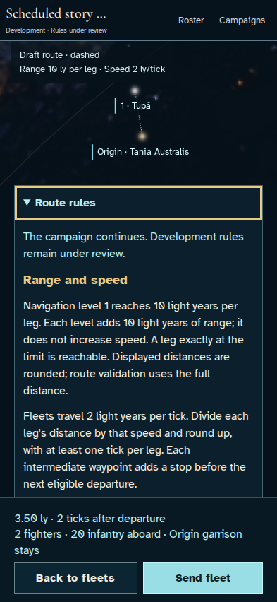](../../screenshots/live-fleet-travel/phone/linux-arm64/020-read-contextual-route-rules-1-fleet-marshal.png)

### phone — Independent marshal

### desktop — Fleet marshal

[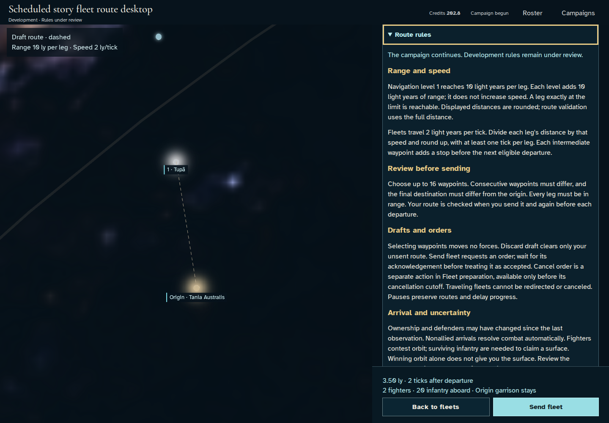](../../screenshots/live-fleet-travel/desktop/linux-arm64/020-read-contextual-route-rules-1-fleet-marshal.png)

### desktop — Independent marshal

### large — Fleet marshal

[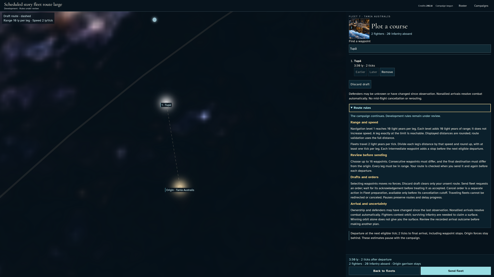](../../screenshots/live-fleet-travel/large/linux-arm64/020-read-contextual-route-rules-1-fleet-marshal.png)

### large — Independent marshal

[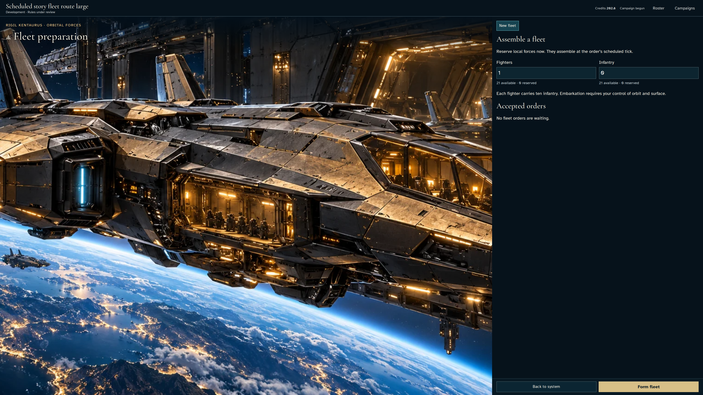](../../screenshots/live-fleet-travel/large/linux-arm64/020-read-contextual-route-rules-2-independent-marshal.png)

### short — Fleet marshal

[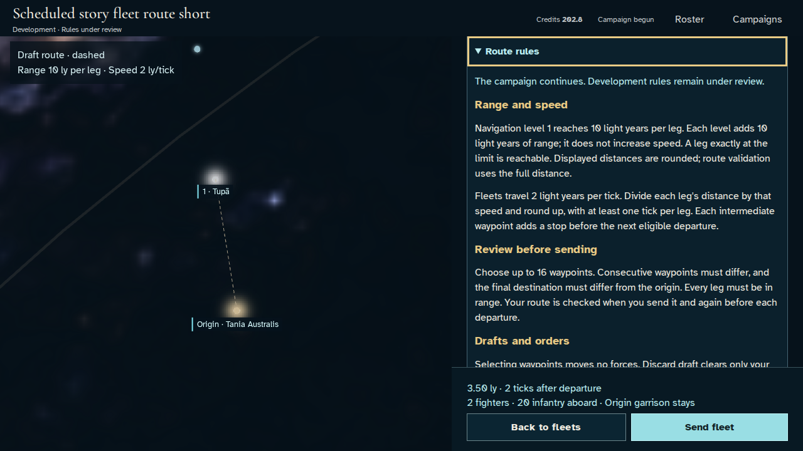](../../screenshots/live-fleet-travel/short/linux-arm64/020-read-contextual-route-rules-1-fleet-marshal.png)

### short — Independent marshal

## 21. Scroll within the rule chapter to read the distinction between orbit and surface control, and the warning about stale intelligence.

Actor: **Fleet marshal**.

Acknowledged outcome: The final rule paragraph is fully visible within the bounded route details while the commitment rail remains on screen.

- [x] The route commitment rail is visible before scrolling, and other commanders receive no private route, fleet complement or arrival report.

- [x] Reading the complete chapter preserves the unsent route and canonical state under normal and reduced motion.

### phone — Fleet marshal

[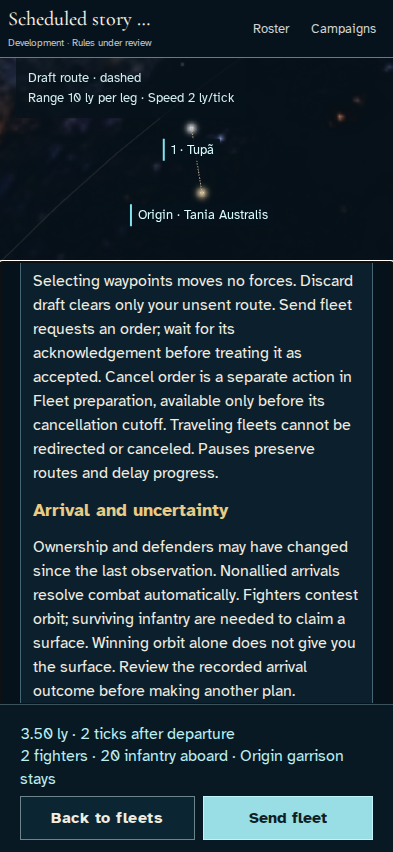](../../screenshots/live-fleet-travel/phone/linux-arm64/021-read-arrival-rule-boundaries-1-fleet-marshal.png)

### phone — Independent marshal

### desktop — Fleet marshal

[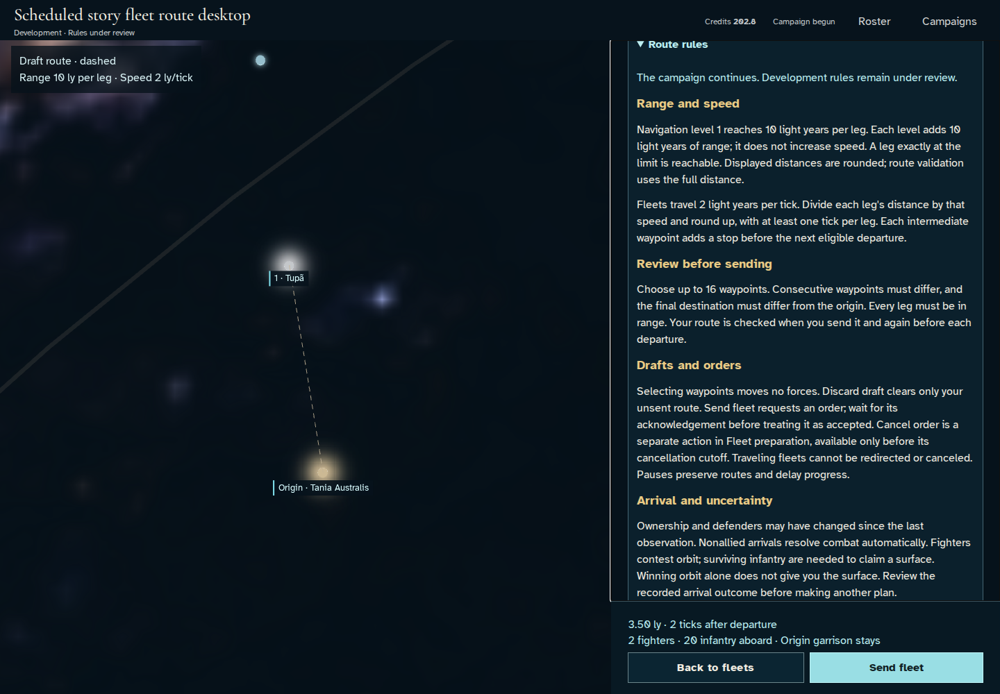](../../screenshots/live-fleet-travel/desktop/linux-arm64/021-read-arrival-rule-boundaries-1-fleet-marshal.png)

### desktop — Independent marshal

### large — Fleet marshal

[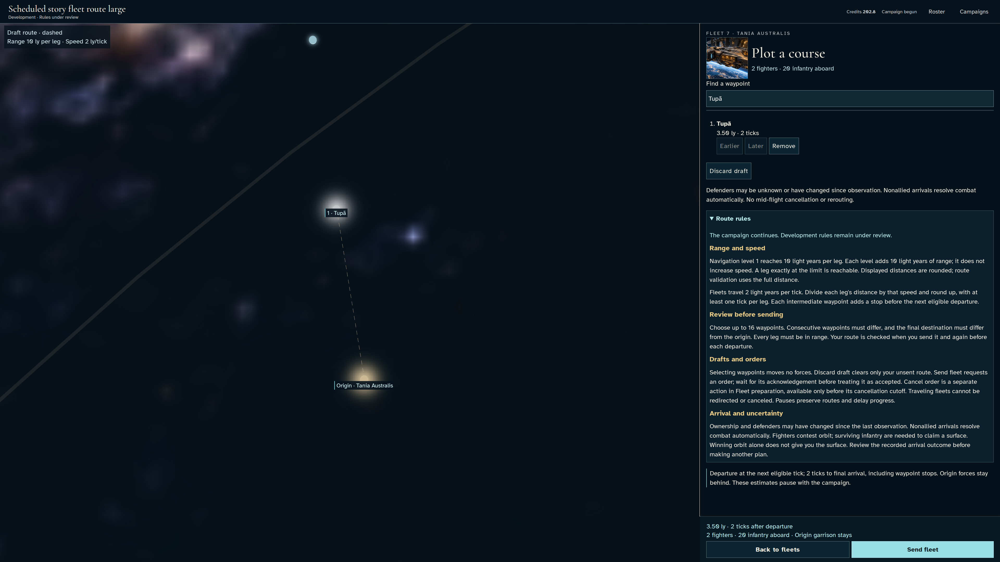](../../screenshots/live-fleet-travel/large/linux-arm64/021-read-arrival-rule-boundaries-1-fleet-marshal.png)

### large — Independent marshal

### short — Fleet marshal

[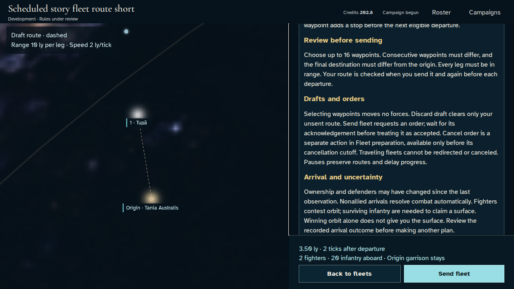](../../screenshots/live-fleet-travel/short/linux-arm64/021-read-arrival-rule-boundaries-1-fleet-marshal.png)

### short — Independent marshal

## 22. Read the final arrival warning within the bounded panel, then close help with the keyboard and return to the unchanged draft.

Actor: **Fleet marshal**.

Acknowledged outcome: Help closes without discarding the route; the same draft is ready for deliberate commitment.

- [x] The route commitment rail is visible before scrolling, and other commanders receive no private route, fleet complement or arrival report.

- [x] Reading and closing contextual help sends no gameplay command and reveals no private facts to another commander.

### phone — Fleet marshal

[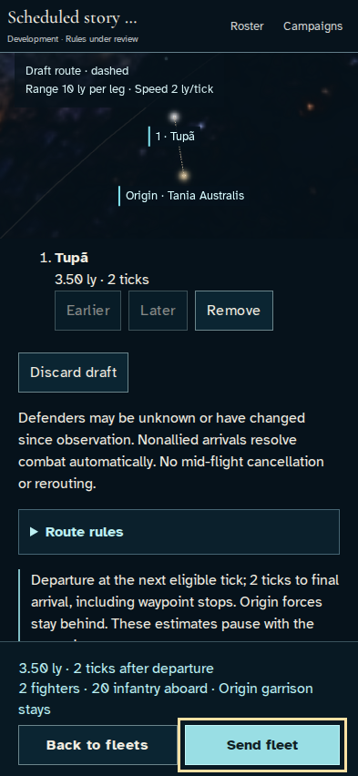](../../screenshots/live-fleet-travel/phone/linux-arm64/022-return-from-route-rules-1-fleet-marshal.png)

### phone — Independent marshal

### desktop — Fleet marshal

### desktop — Independent marshal

### large — Fleet marshal

[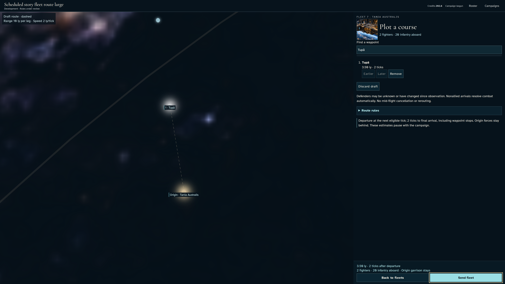](../../screenshots/live-fleet-travel/large/linux-arm64/022-return-from-route-rules-1-fleet-marshal.png)

### large — Independent marshal

### short — Fleet marshal

[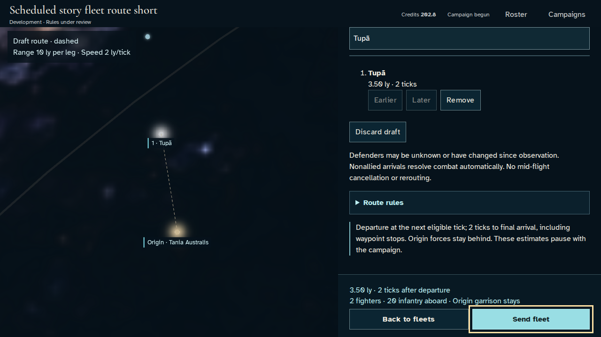](../../screenshots/live-fleet-travel/short/linux-arm64/022-return-from-route-rules-1-fleet-marshal.png)

### short — Independent marshal

## 23. Discard the selected fleet's unsent route with the keyboard. This is a local draft decision, not cancellation of an accepted order.

Actor: **Fleet marshal**.

Acknowledged outcome: The editor confirms local discard, clears the route and returns keyboard focus to waypoint search.

- [x] The route commitment rail is visible before scrolling, and other commanders receive no private route, fleet complement or arrival report.

- [x] Discard neither issues a command nor changes any authoritative force, order, balance or revision.

### phone — Fleet marshal

[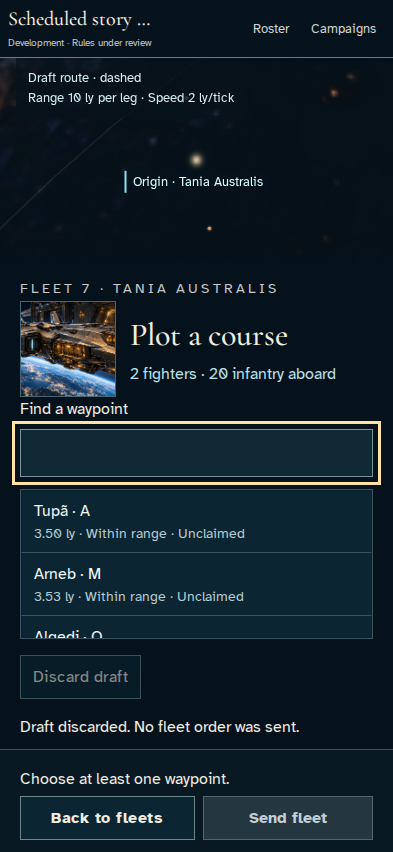](../../screenshots/live-fleet-travel/phone/linux-arm64/023-discard-uncommitted-route-1-fleet-marshal.png)

### phone — Independent marshal

### desktop — Fleet marshal

[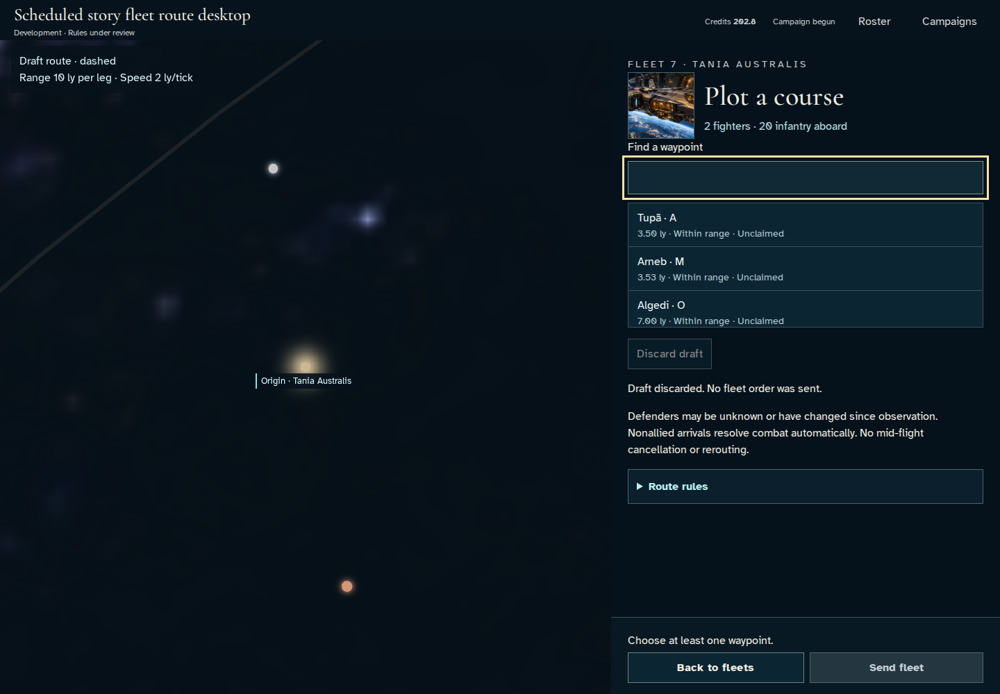](../../screenshots/live-fleet-travel/desktop/linux-arm64/023-discard-uncommitted-route-1-fleet-marshal.png)

### desktop — Independent marshal

### large — Fleet marshal

[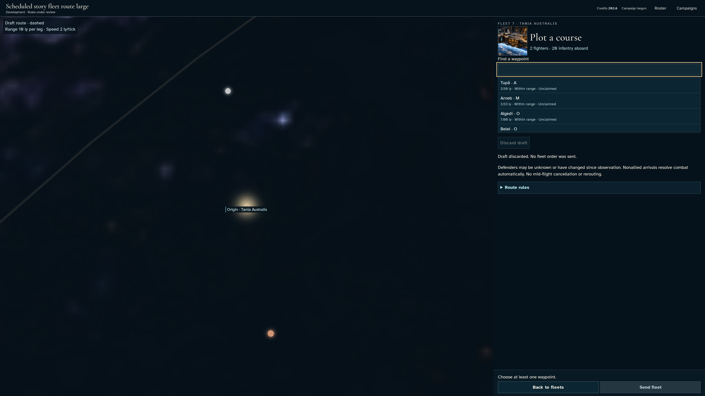](../../screenshots/live-fleet-travel/large/linux-arm64/023-discard-uncommitted-route-1-fleet-marshal.png)

### large — Independent marshal

### short — Fleet marshal

[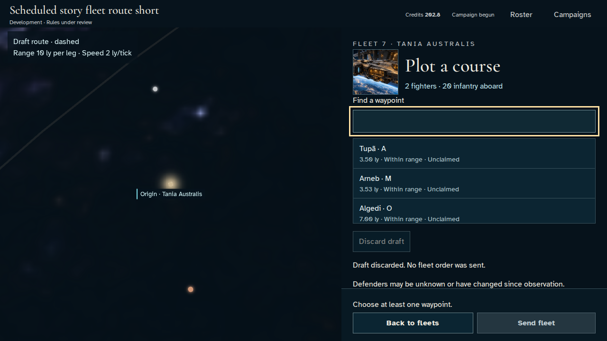](../../screenshots/live-fleet-travel/short/linux-arm64/023-discard-uncommitted-route-1-fleet-marshal.png)

### short — Independent marshal

## 24. Return to fleets and reopen the planner. The discarded route stays empty; select the original destination again as a new draft.

Actor: **Fleet marshal**.

Acknowledged outcome: Only the newly selected destination is ready to send; no stale discard notice accompanies it.

- [x] The route commitment rail is visible before scrolling, and other commanders receive no private route, fleet complement or arrival report.

- [x] Replanning preserves canonical state and has the same result with normal motion.

### phone — Fleet marshal

[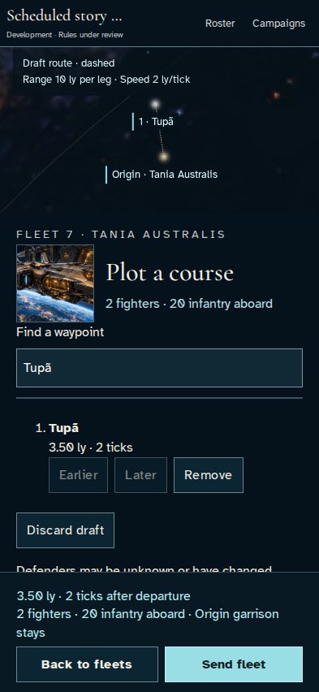](../../screenshots/live-fleet-travel/phone/linux-arm64/024-reopen-cleared-route-1-fleet-marshal.png)

### phone — Independent marshal

### desktop — Fleet marshal

[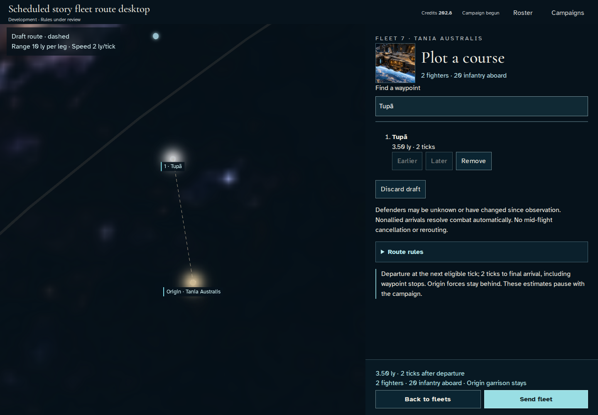](../../screenshots/live-fleet-travel/desktop/linux-arm64/024-reopen-cleared-route-1-fleet-marshal.png)

### desktop — Independent marshal

### large — Fleet marshal

[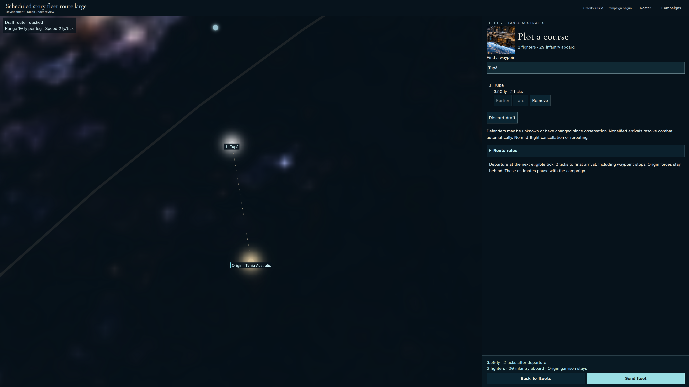](../../screenshots/live-fleet-travel/large/linux-arm64/024-reopen-cleared-route-1-fleet-marshal.png)

### large — Independent marshal

### short — Fleet marshal

### short — Independent marshal

## 25. Commit the route with Enter. The authoritative acknowledgement schedules departure without moving the fleet.

Actor: **Fleet marshal**.

Acknowledged outcome: The route receipt publishes departure tick two and the selected destination.

- [x] The route commitment rail is visible before scrolling, and other commanders receive no private route, fleet complement or arrival report.

- [x] One accepted receipt and revision retain the full fleet until departure.

### phone — Fleet marshal

[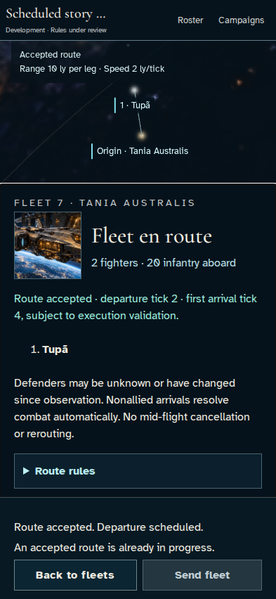](../../screenshots/live-fleet-travel/phone/linux-arm64/025-accept-route-1-fleet-marshal.png)

### phone — Independent marshal

### desktop — Fleet marshal

### desktop — Independent marshal

### large — Fleet marshal

### large — Independent marshal

### short — Fleet marshal

### short — Independent marshal

## 26. Reload the exact campaign and reopen the original fleet's accepted route, without issuing a replacement command.

Actor: **Fleet marshal**.

Acknowledged outcome: The same accepted destination and departure tick return from persistence.

- [x] The route commitment rail is visible before scrolling, and other commanders receive no private route, fleet complement or arrival report.

- [x] Reload neither duplicates the route nor changes forces; accepted routes cannot be discarded as drafts.

### phone — Fleet marshal

### phone — Independent marshal

### desktop — Fleet marshal

### desktop — Independent marshal

### large — Fleet marshal

### large — Independent marshal

### short — Fleet marshal

### short — Independent marshal

## 27. Advance the labelled domain clock and invoke actual leased settlement. Repeat delivery must leave the full canonical state unchanged; no travel state is injected.

Actor: **Test harness**. Harness control; not a player action.

Acknowledged outcome: Explicit test control; not a player action or hosted-service certification.

## 28. Read the authoritative departure and scheduled arrival. A traveling fleet cannot receive another route.

Actor: **Fleet marshal**.

Acknowledged outcome: The fleet is traveling with a speed-derived arrival tick and disabled commitment.

- [x] The route commitment rail is visible before scrolling, and other commanders receive no private route, fleet complement or arrival report.

- [x] Departure conserves the complete fleet and its original route identity.

### phone — Fleet marshal

### phone — Independent marshal

### desktop — Fleet marshal

### desktop — Independent marshal

### large — Fleet marshal

### large — Independent marshal

### short — Fleet marshal

### short — Independent marshal

## 29. Deliver each due boundary through the real leased service, checking repeat delivery and recording actual production. This accelerated domain-clock journey does not certify hosted cadence or batch catch-up.

Actor: **Test harness**. Harness control; not a player action.

Acknowledged outcome: Explicit test control; not a player action or hosted-service certification.

## 30. Read the resolved arrival and resulting orbit/surface control. Landed infantry remains part of the commander's conserved forces.

Actor: **Fleet marshal**.

Acknowledged outcome: The authoritative arrival names the destination, forces and resulting control.

- [x] The route commitment rail is visible before scrolling, and other commanders receive no private route, fleet complement or arrival report.

- [x] A single arrival retains all forces across fleet and newly controlled surface, with only actual production added.

### phone — Fleet marshal

### phone — Independent marshal

### desktop — Fleet marshal

### desktop — Independent marshal

### large — Fleet marshal

### large — Independent marshal

### short — Fleet marshal

### short — Independent marshal

## 31. Return to fleet preparation, recover the destination after reload and inspect the same stationed fleet with the keyboard.

Actor: **Fleet marshal**.

Acknowledged outcome: The recovered fleet is stationed at the destination with its surviving complement.

- [x] Both fixed action rails are visible before scrolling and no application error occurred.

- [x] Other commanders have no owner fleet, private order or ledger in their actual member projections.

- [x] Final reload preserves the exact settled state and receipt identity.

### phone — Fleet marshal

### phone — Independent marshal

### desktop — Fleet marshal

### desktop — Independent marshal

### large — Fleet marshal

### large — Independent marshal

### short — Fleet marshal

### short — Independent marshal

## 32. Both commanders open their own arrival archive. The owner recovers the secured system; the uninvolved commander receives no private arrival report.

Actor: **Fleet marshal**.

Acknowledged outcome: Authorized history selects the owner's recorded arrival and acknowledges an empty archive to the other commander.

- [x] Reading arrival history preserves the single canonical outcome and private recipient projections; both return rails stay visible before scrolling.

### phone — Fleet marshal

### phone — Independent marshal

### desktop — Fleet marshal

### desktop — Independent marshal

### large — Fleet marshal

### large — Independent marshal

### short — Fleet marshal

### short — Independent marshal

## 33. Read the recorded zero losses and surviving complement through the bounded, keyboard-focusable report body.

Actor: **Fleet marshal**.

Acknowledged outcome: The named report facts are fully visible inside the bounded panel and match the single authoritative outcome.

- [x] Reading arrival history preserves the single canonical outcome and private recipient projections; both return rails stay visible before scrolling.

### phone — Fleet marshal

### phone — Independent marshal

### desktop — Fleet marshal

### desktop — Independent marshal

### large — Fleet marshal

### large — Independent marshal

### short — Fleet marshal

### short — Independent marshal

## 34. Read separately recorded orbit and surface control; both layers belong to the arriving commander at this tick.

Actor: **Fleet marshal**.

Acknowledged outcome: The named report facts are fully visible inside the bounded panel and match the single authoritative outcome.

- [x] Reading arrival history preserves the single canonical outcome and private recipient projections; both return rails stay visible before scrolling.

### phone — Fleet marshal

### phone — Independent marshal

### desktop — Fleet marshal

### desktop — Independent marshal

### large — Fleet marshal

### large — Independent marshal

### short — Fleet marshal

### short — Independent marshal

## 35. Open Participants and resolution with the keyboard to read the recorded order, private opposing-force boundary and development-rule disclosure.

Actor: **Fleet marshal**.

Acknowledged outcome: The expanded resolution explanation is visible and identifies proposed development rules without revealing opposing forces.

- [x] Reading arrival history preserves the single canonical outcome and private recipient projections; both return rails stay visible before scrolling.

### phone — Fleet marshal

### phone — Independent marshal

### desktop — Fleet marshal

### desktop — Independent marshal

### large — Fleet marshal

### large — Independent marshal

### short — Fleet marshal

### short — Independent marshal

## 36. Reload both independent sessions and reopen their own archives with the keyboard. Stored outcomes survive; unrelated players still receive no report.

Actor: **Fleet marshal**.

Acknowledged outcome: The same recorded destination/tick returns only to its recipient after loss of local panel state.

- [x] Reading arrival history preserves the single canonical outcome and private recipient projections; both return rails stay visible before scrolling.

- [x] Normal and reduced motion retain the same authoritative history and recipient outcomes.

### phone — Fleet marshal

### phone — Independent marshal

### desktop — Fleet marshal

### desktop — Independent marshal

### large — Fleet marshal

### large — Independent marshal

### short — Fleet marshal

### short — Independent marshal

## 37. Both commanders close the archive with Escape and return to the opening Arrival reports control.

Actor: **Fleet marshal**.

Acknowledged outcome: Both archive panels close and focus returns to each player's Arrival reports control.

- [x] Keyboard dismissal changes no canonical outcome or receipt.

### phone — Fleet marshal

- [x] Escape opener retains document focus, keyboard-visible outline and complete focus paint at capture.

### phone — Independent marshal

- [x] Escape opener retains document focus, keyboard-visible outline and complete focus paint at capture.

### desktop — Fleet marshal

- [x] Escape opener retains document focus, keyboard-visible outline and complete focus paint at capture.

### desktop — Independent marshal

- [x] Escape opener retains document focus, keyboard-visible outline and complete focus paint at capture.

### large — Fleet marshal

- [x] Escape opener retains document focus, keyboard-visible outline and complete focus paint at capture.

### large — Independent marshal

- [x] Escape opener retains document focus, keyboard-visible outline and complete focus paint at capture.

### short — Fleet marshal

- [x] Escape opener retains document focus, keyboard-visible outline and complete focus paint at capture.

### short — Independent marshal

- [x] Escape opener retains document focus, keyboard-visible outline and complete focus paint at capture.

