# Recover research after losing orbital science

**BASELINE CANDIDATES — generation, not verification.** large · darwin-arm64. Inventory: UX-04, UX-06, UX-07, UX-08, UX-09, UX-14, UX-15, UX-16.

Four independently authenticated commanders use real fleet controls after100 earned ticks. An escape and rival route produce actual orbital loss, zero science and retained surface control. Owner and peer recover private research through reload. Fixed catalogue/domain clocks are explicit harness controls; budgets are220 ticks,240 seconds and26 captures per viewport. Rules remain under review; this does not certify managed encryption or hosted scheduling.

## 1. Ordinary emulator sign-in and identity save, with explicit developer entitlement and fixed browser Date; timers continue normally.

Actor: **Test harness**. **Harness control; not a player action.**

Acknowledged outcome: Explicit test control; not a player action or hosted-service certification.

## 2. Ordinary emulator sign-in and identity save, with explicit developer entitlement and fixed browser Date; timers continue normally.

Actor: **Test harness**. **Harness control; not a player action.**

Acknowledged outcome: Explicit test control; not a player action or hosted-service certification.

## 3. Ordinary emulator sign-in and identity save, with explicit developer entitlement and fixed browser Date; timers continue normally.

Actor: **Test harness**. **Harness control; not a player action.**

Acknowledged outcome: Explicit test control; not a player action or hosted-service certification.

## 4. Ordinary emulator sign-in and identity save, with explicit developer entitlement and fixed browser Date; timers continue normally.

Actor: **Test harness**. **Harness control; not a player action.**

Acknowledged outcome: Explicit test control; not a player action or hosted-service certification.

## 5. Create/join through ordinary campaign controls. Fixed catalogue and admission clock are test controls; no seat, message or command outcome is injected.

Actor: **Test harness**. **Harness control; not a player action.**

Acknowledged outcome: Explicit test control; not a player action or hosted-service certification.

## 6. Create/join through ordinary campaign controls. Fixed catalogue and admission clock are test controls; no seat, message or command outcome is injected.

Actor: **Test harness**. **Harness control; not a player action.**

Acknowledged outcome: Explicit test control; not a player action or hosted-service certification.

## 7. Create/join through ordinary campaign controls. Fixed catalogue and admission clock are test controls; no seat, message or command outcome is injected.

Actor: **Test harness**. **Harness control; not a player action.**

Acknowledged outcome: Explicit test control; not a player action or hosted-service certification.

## 8. Create/join through ordinary campaign controls. Fixed catalogue and admission clock are test controls; no seat, message or command outcome is injected.

Actor: **Test harness**. **Harness control; not a player action.**

Acknowledged outcome: Explicit test control; not a player action or hosted-service certification.

## 9. Advance the designated browser/domain clock to 12:15 UTC and deliver the actual emulator Scheduler HTTP request. This does not certify hosted scheduling.

Actor: **Test harness**. **Harness control; not a player action.**

Acknowledged outcome: Explicit test control; not a player action or hosted-service certification.

## 10. Both captured players return through ordinary Campaigns controls while time passes; setup-only witnesses close after admission. No service delivery or authorization is bypassed.

Actor: **Test harness**. **Harness control; not a player action.**

Acknowledged outcome: Explicit test control; not a player action or hosted-service certification.

## 11. Deliver100 real leased ticks in bounded batches. No levels, balances, forces or ownership are injected; this is not hosted scheduling.

Actor: **Test harness**. **Harness control; not a player action.**

Acknowledged outcome: Explicit test control; not a player action or hosted-service certification.

## 12. Both real saved identities reopen the exact campaign after elapsed-time settlement.

Actor: **Test harness**. **Harness control; not a player action.**

Acknowledged outcome: Explicit test control; not a player action or hosted-service certification.

## 13. Use the actual home-system fleet controls to reserve all160 earned fighters. The other commander's order remains private.

Actor: **Fleet marshal**.

Acknowledged outcome: A real receipt accepts160 fighters for tick101.

- [x] Actual owner SDK reads and campaignKey grants succeed; foreign private reads are denied and returned projections omit foreign order IDs.

### Viewpoint: Fleet marshal

[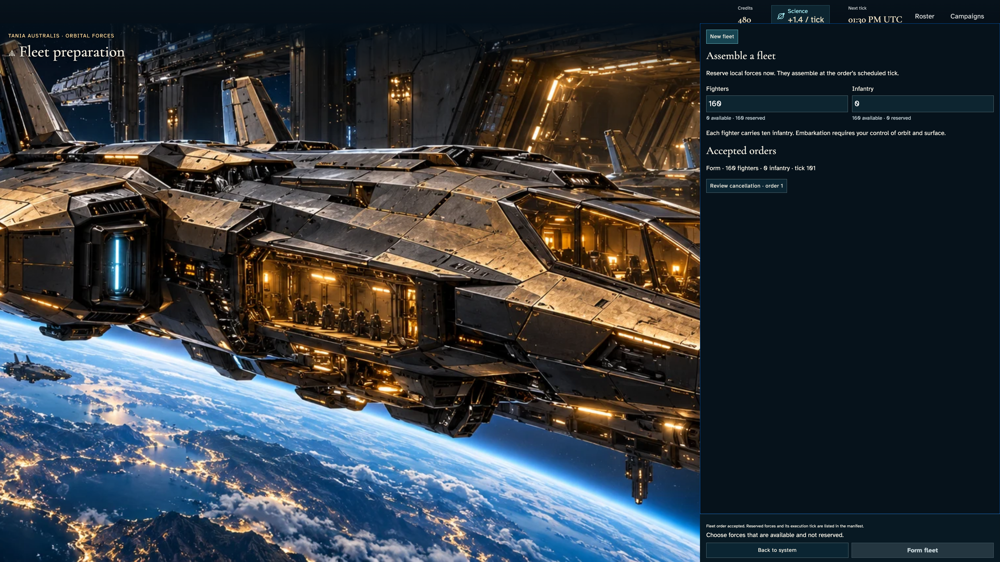](013-form-0-1-fleet-marshal.png)

## 14. Use the actual home-system fleet controls to reserve all160 earned fighters. The other commander's order remains private.

Actor: **Independent marshal**.

Acknowledged outcome: A real receipt accepts160 fighters for tick101.

- [x] Actual owner SDK reads and campaignKey grants succeed; foreign private reads are denied and returned projections omit foreign order IDs.

### Viewpoint: Independent marshal

## 15. Real leased settlement forms both fleets once; repeat delivery does no work.

Actor: **Test harness**. **Harness control; not a player action.**

Acknowledged outcome: Explicit test control; not a player action or hosted-service certification.

## 16. Select each acknowledged fleet with the keyboard and read its actual160-fighter complement.

Actor: **Fleet marshal**.

Acknowledged outcome: Both players see the settled formation outcome.

- [x] Actual owner SDK reads and campaignKey grants succeed; foreign private reads are denied and returned projections omit foreign order IDs.

### Viewpoint: Fleet marshal

### Viewpoint: Independent marshal

[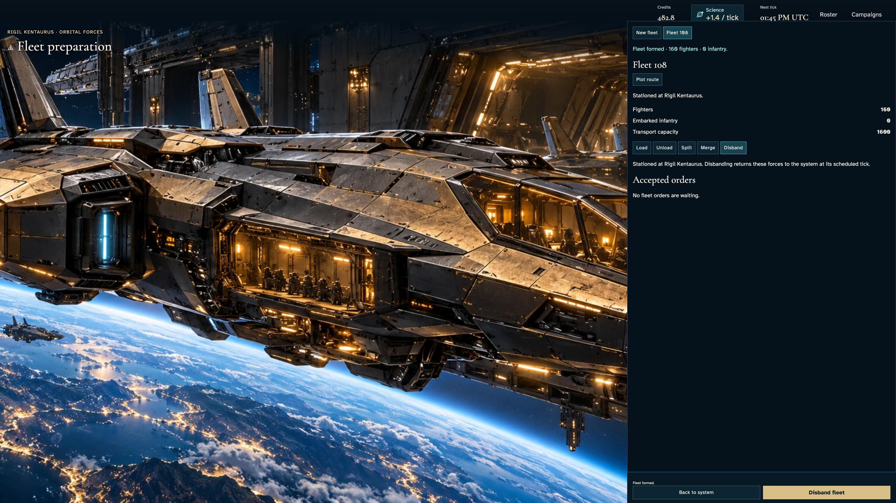](016-formed-fleets-2-independent-marshal.png)

## 17. Plot an escape to a neutral star without a science station.

Actor: **Fleet marshal**.

Acknowledged outcome: Reachable legs enable commitment; range30 and speed2 remain distinct.

- [x] Actual owner SDK reads and campaignKey grants succeed; foreign private reads are denied and returned projections omit foreign order IDs.

### Viewpoint: Fleet marshal

[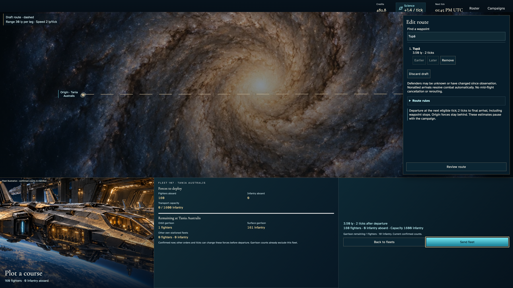](017-preview-route-0-1-fleet-marshal.png)

## 18. Confirm the original route with Enter and read the authoritative scheduled departure acknowledgement.

Actor: **Fleet marshal**.

Acknowledged outcome: The server accepts the route and retains its exact waypoints for tick102.

- [x] Actual owner SDK reads and campaignKey grants succeed; foreign private reads are denied and returned projections omit foreign order IDs.

### Viewpoint: Fleet marshal

[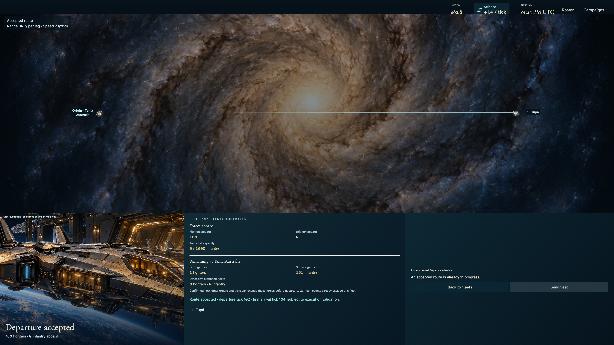](018-commit-route-0-1-fleet-marshal.png)

## 19. Plot a seven-leg route through the actual catalogue toward the other commander's home.

Actor: **Independent marshal**.

Acknowledged outcome: Reachable legs enable commitment; range30 and speed2 remain distinct.

- [x] Actual owner SDK reads and campaignKey grants succeed; foreign private reads are denied and returned projections omit foreign order IDs.

### Viewpoint: Independent marshal

[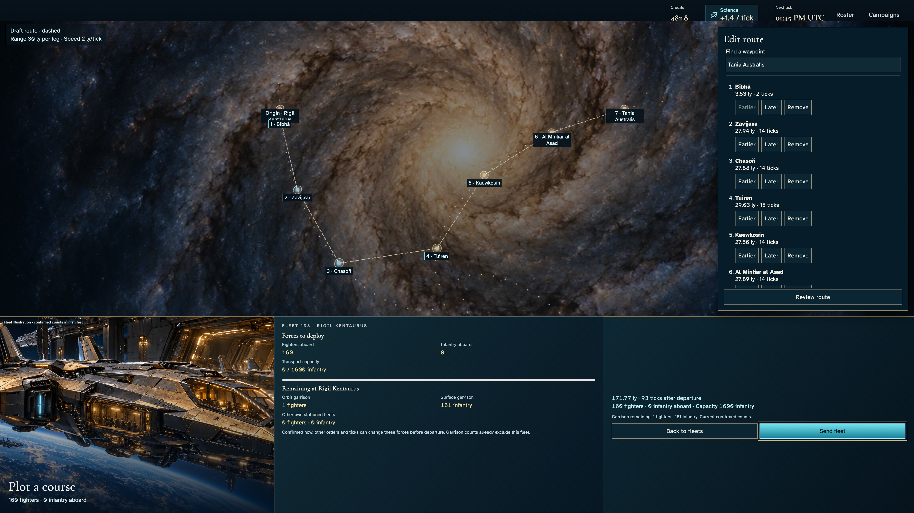](019-preview-route-1-1-independent-marshal.png)

## 20. Confirm the original route with Enter and read the authoritative scheduled departure acknowledgement.

Actor: **Independent marshal**.

Acknowledged outcome: The server accepts the route and retains its exact waypoints for tick102.

- [x] Actual owner SDK reads and campaignKey grants succeed; foreign private reads are denied and returned projections omit foreign order IDs.

### Viewpoint: Independent marshal

[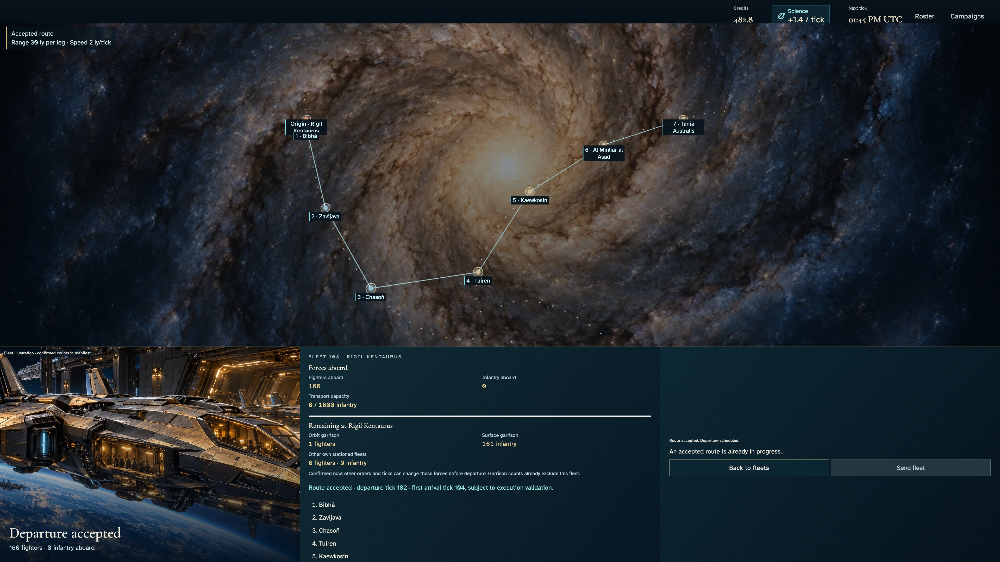](020-commit-route-1-1-independent-marshal.png)

## 21. Deliver bounded real leased travel/combat/production ticks. The peer captures orbit; no battle outcome is injected.

Actor: **Test harness**. **Harness control; not a player action.**

Acknowledged outcome: Explicit test control; not a player action or hosted-service certification.

## 22. Reload both accounts, then use keyboard navigation to read persisted science production and research progress after orbital loss.

Actor: **Fleet marshal**.

Acknowledged outcome: Both players recover the settled tick and their own distinct science ledger.

- [x] Actual owner SDK reads and campaignKey grants succeed; foreign private reads are denied and returned projections omit foreign order IDs.
- [x] The owner retains surface control but no opposing orbital values; zero output freezes research while the rival gains science.

### Viewpoint: Fleet marshal

[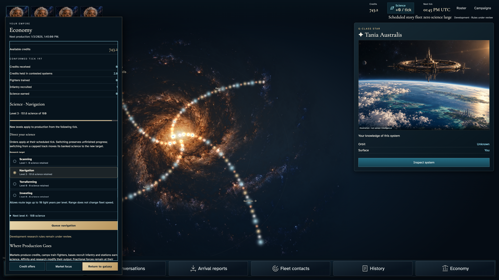](022-lost-orbit-1-fleet-marshal.png)

### Viewpoint: Independent marshal

[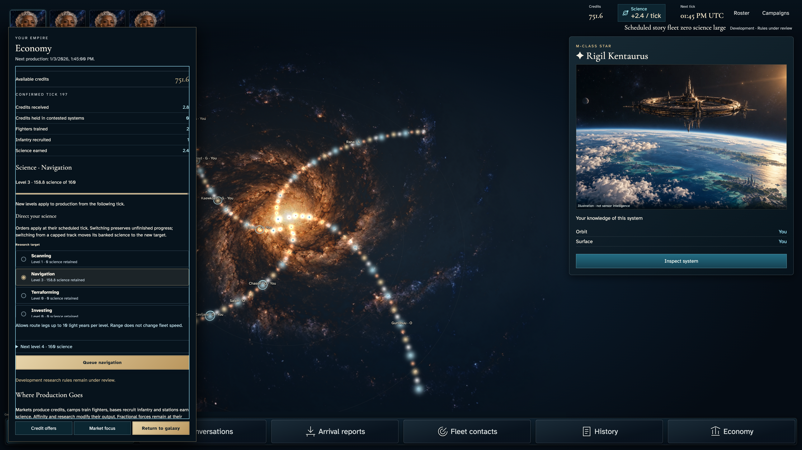](022-lost-orbit-2-independent-marshal.png)

## 23. Deliver one further real tick and repeat it; zero science must retain the same research state.

Actor: **Test harness**. **Harness control; not a player action.**

Acknowledged outcome: Explicit test control; not a player action or hosted-service certification.

## 24. Reload both accounts, then use keyboard navigation to read persisted science production and research progress after orbital loss.

Actor: **Fleet marshal**.

Acknowledged outcome: Both players recover the settled tick and their own distinct science ledger.

- [x] Actual owner SDK reads and campaignKey grants succeed; foreign private reads are denied and returned projections omit foreign order IDs.
- [x] The owner retains surface control but no opposing orbital values; zero output freezes research while the rival gains science.

### Viewpoint: Fleet marshal

### Viewpoint: Independent marshal

[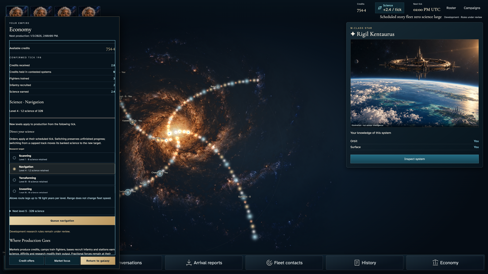](024-still-unfunded-2-independent-marshal.png)

## 25. Open the real forecast with the keyboard. Read why no completion date is available at zero science.

Actor: **Fleet marshal**.

Acknowledged outcome: The forecast states zero-rate explicitly and invents no ETA.

- [x] Actual owner SDK reads and campaignKey grants succeed; foreign private reads are denied and returned projections omit foreign order IDs.
- [x] The owner retains surface control but no opposing orbital values; zero output freezes research while the rival gains science.

### Viewpoint: Fleet marshal

[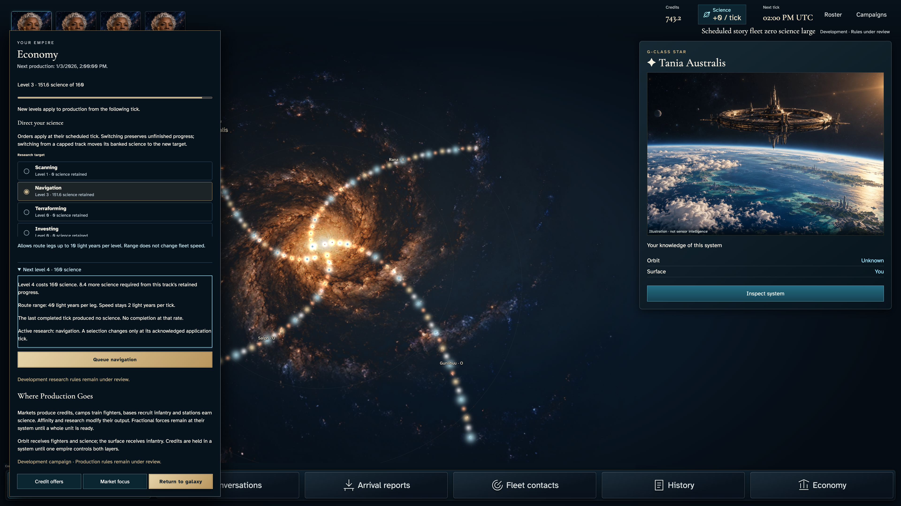](025-no-completion-estimate-1-fleet-marshal.png)

## 26. Close Economy with Escape and return keyboard focus to its opening control.

Actor: **Fleet marshal**.

Acknowledged outcome: The panel closes and Economy is focused and fully usable.

- [x] Actual owner SDK reads and campaignKey grants succeed; foreign private reads are denied and returned projections omit foreign order IDs.
- [x] The owner retains surface control but no opposing orbital values; zero output freezes research while the rival gains science.

### Viewpoint: Fleet marshal

[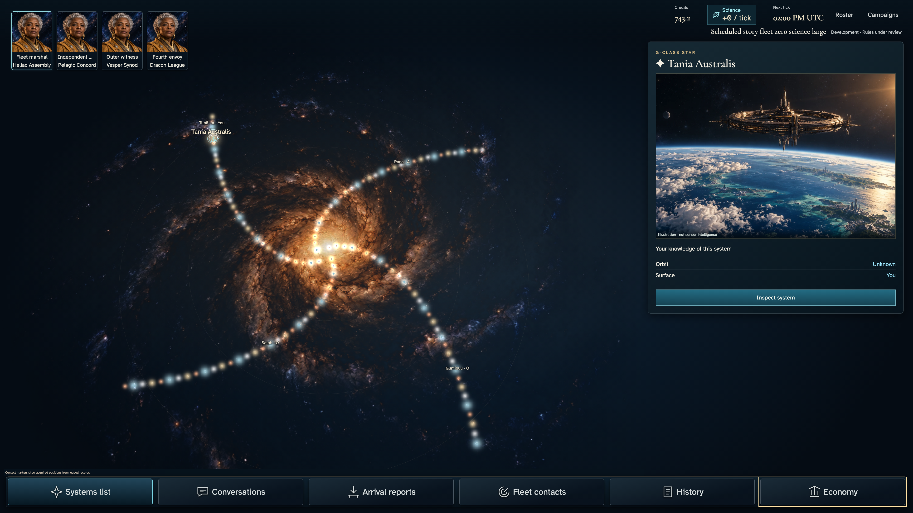](026-close-economy-1-fleet-marshal.png)

## 27. Reload the existing acknowledged campaign with normal motion, open its actual science rail using Enter, then Tab into the bounded ledger. No campaign command is sent.

Actor: **Fleet marshal**.

Acknowledged outcome: The mounted private ledger recovers the confirmed tick, current capacity and delivered output under the selected motion preference.

- [x] Authorized rates, delivered output, source ownership and accepted command state remain unchanged by local reading or motion preference.
- [x] Top basis and primary Return remain fully inside their clipping ancestors; keyboard reading does not move the game document.

### Viewpoint: Fleet marshal

- [x] Normal-motion device preference; finite effects settled without fast-forward and exact pixels unchanged.

### Viewpoint: Independent marshal

- [x] Normal-motion device preference; finite effects settled without fast-forward and exact pixels unchanged.

[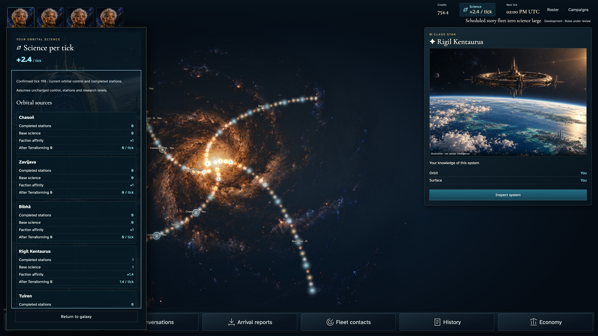](027-zero-rate-normal-ledger-2-independent-marshal.png)

## 28. Press End in the focused ledger to read delivered science and assumptions, while the return action remains available.

Actor: **Fleet marshal**.

Acknowledged outcome: Keyboard reading reaches the actual delivered total without changing the acknowledged rate or server facts.

- [x] Authorized rates, delivered output, source ownership and accepted command state remain unchanged by local reading or motion preference.
- [x] Delivered total and Return are contained before capture; only the bounded reading region scrolls.

### Viewpoint: Fleet marshal

- [x] Normal-motion device preference; finite effects settled without fast-forward and exact pixels unchanged.

### Viewpoint: Independent marshal

- [x] Normal-motion device preference; finite effects settled without fast-forward and exact pixels unchanged.

## 29. Home returns the same reading region to its basis, then Escape closes the ledger and restores its real rail opener.

Actor: **Fleet marshal**.

Acknowledged outcome: The ledger closes and focus returns to the science resource control, without sending a command.

- [x] Authorized rates, delivered output, source ownership and accepted command state remain unchanged by local reading or motion preference.

### Viewpoint: Fleet marshal

- [x] Normal-motion device preference; finite effects settled without fast-forward and exact pixels unchanged.

[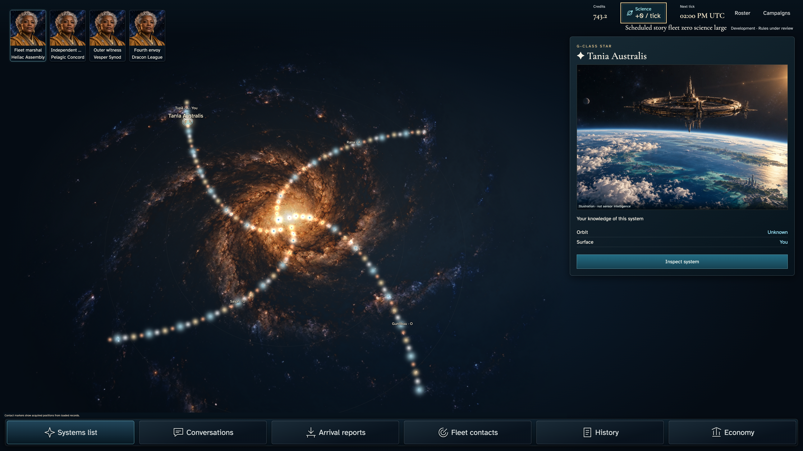](029-zero-rate-normal-return-1-fleet-marshal.png)

### Viewpoint: Independent marshal

- [x] Normal-motion device preference; finite effects settled without fast-forward and exact pixels unchanged.

[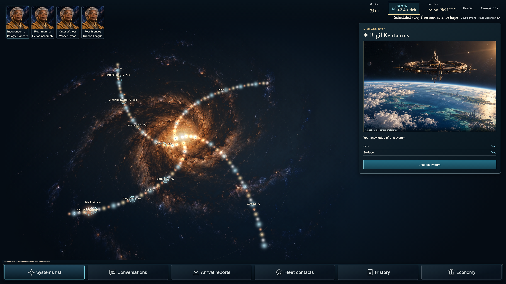](029-zero-rate-normal-return-2-independent-marshal.png)

## 30. Reload the existing acknowledged campaign with reduced motion, open its actual science rail using Enter, then Tab into the bounded ledger. No campaign command is sent.

Actor: **Fleet marshal**.

Acknowledged outcome: The mounted private ledger recovers the confirmed tick, current capacity and delivered output under the selected motion preference.

- [x] Authorized rates, delivered output, source ownership and accepted command state remain unchanged by local reading or motion preference.
- [x] Top basis and primary Return remain fully inside their clipping ancestors; keyboard reading does not move the game document.

### Viewpoint: Fleet marshal

[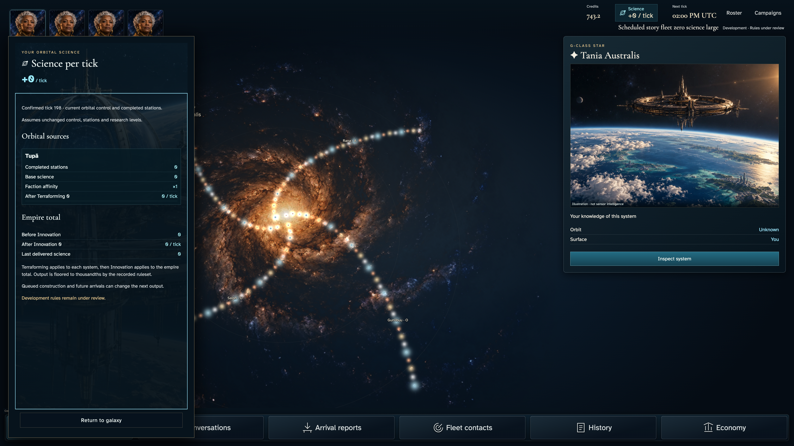](030-zero-rate-reduced-ledger-1-fleet-marshal.png)

### Viewpoint: Independent marshal

## 31. Press End in the focused ledger to read delivered science and assumptions, while the return action remains available.

Actor: **Fleet marshal**.

Acknowledged outcome: Keyboard reading reaches the actual delivered total without changing the acknowledged rate or server facts.

- [x] Authorized rates, delivered output, source ownership and accepted command state remain unchanged by local reading or motion preference.
- [x] Delivered total and Return are contained before capture; only the bounded reading region scrolls.

### Viewpoint: Fleet marshal

### Viewpoint: Independent marshal

[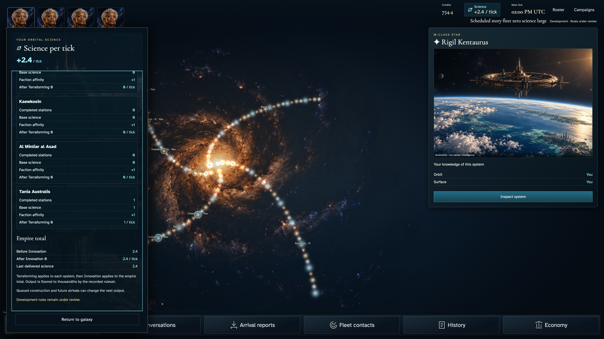](031-zero-rate-reduced-totals-2-independent-marshal.png)

## 32. Home returns the same reading region to its basis, then Return to galaxy closes the ledger and restores its real rail opener.

Actor: **Fleet marshal**.

Acknowledged outcome: The ledger closes and focus returns to the science resource control, without sending a command.

- [x] Authorized rates, delivered output, source ownership and accepted command state remain unchanged by local reading or motion preference.

### Viewpoint: Fleet marshal

### Viewpoint: Independent marshal

